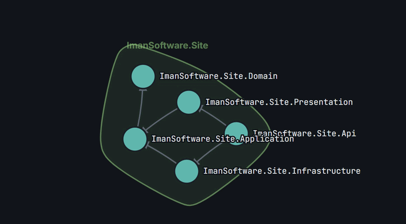
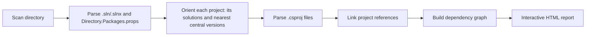

### dependency-graph 

```html 

        <!DOCTYPE html>
<html lang="en">
<head>
<meta charset="UTF-8">
<meta name="viewport" content="width=device-width, initial-scale=1, viewport-fit=cover">
<title>DepLens — Dependency Map</title>
<link rel="preconnect" href="https://fonts.googleapis.com">
<link rel="preconnect" href="https://fonts.gstatic.com" crossorigin>
<link href="https://fonts.googleapis.com/css2?family=JetBrains+Mono:wght@400;500;600&family=Inter:wght@400;500;600;700&display=swap" rel="stylesheet">
<script src="https://cdnjs.cloudflare.com/ajax/libs/d3/7.9.0/d3.min.js"></script>
<style>
  :root {
    --bg: #11151a; --surface: #1a1f26; --ink: #e7eaee; --ink-soft: #8b95a1; --line: #2a3038;
    --project: #5fb8ae; --project-glow: #8fd8cf; --package: #4a5560; --package-border: #6b7684;
    --accent: #e3a15c; --accent-soft: #3a2f1f; --link: #5b6673; --panel-w: 300px;
  }
  * { box-sizing: border-box; }
  html, body { height: 100%; margin: 0; background: var(--bg); color: var(--ink);
    font-family: 'Inter', 'Segoe UI', sans-serif; overflow: hidden; }
  #app { display: flex; flex-direction: column; height: 100%; }

  header { padding: 12px 18px; background: var(--surface); border-bottom: 1px solid var(--line);
    display: flex; align-items: center; gap: 14px; flex-wrap: wrap; z-index: 6; }
  h1 { font-size: 15px; font-weight: 700; margin: 0; white-space: nowrap; color: var(--ink); }
  h1 span { color: var(--ink-soft); font-weight: 500; font-size: 12px; display: block; margin-top: 2px; }

  .view-toggle { display: flex; border: 1px solid var(--line); border-radius: 8px; overflow: hidden; }
  .view-toggle button { border: none; background: var(--bg); color: var(--ink-soft); padding: 7px 12px;
    font-size: 12px; font-family: inherit; cursor: pointer; }
  .view-toggle button.active { background: var(--project); color: #0d1113; font-weight: 600; }

  #search { flex: 1; min-width: 140px; max-width: 260px; padding: 7px 12px; border-radius: 8px;
    border: 1px solid var(--line); background: var(--bg); color: var(--ink); font-family: inherit; font-size: 13px; }
  #search::placeholder { color: var(--ink-soft); }

  .tightness { display: flex; align-items: center; gap: 7px; font-size: 11.5px; color: var(--ink-soft); white-space: nowrap; }
  .tightness input[type="range"] { width: 90px; accent-color: var(--project); }

  .legend { display: flex; gap: 14px; font-size: 11.5px; color: var(--ink-soft); margin-inline-start: auto; }
  .legend-item { display: flex; align-items: center; gap: 5px; }
  .dot { width: 9px; height: 9px; border-radius: 50%; }
  .dot.proj { background: var(--project); }
  .dot.pkg { background: var(--package); border: 1px solid var(--package-border); }
  .dot.arrow { width: 14px; height: 2px; background: var(--link); }
  .dot.arrow.dashed { background: none; border-top: 2px dashed var(--link); height: 0; }

  .body-row { flex: 1; display: flex; min-height: 0; position: relative; }

  #sidebar { position: relative; width: var(--panel-w); flex-shrink: 0; background: var(--surface);
    border-inline-end: 1px solid var(--line); display: flex; flex-direction: column;
    transition: margin-inline-start .2s ease; overflow: hidden; }
  #app.sidebar-collapsed #sidebar { margin-inline-start: calc(-1 * var(--panel-w)); }
  #sidebar-resizer { position: absolute; top: 0; bottom: 0; inset-inline-end: -3px; width: 6px;
    cursor: col-resize; z-index: 8; }
  #sidebar-resizer:hover, #sidebar-resizer.active { background: var(--project-glow); opacity: .45; }
  #sidebar-toggle { position: absolute; top: 10px; inset-inline-start: 10px; z-index: 7; width: 30px; height: 30px;
    border-radius: 8px; border: 1px solid var(--line); background: var(--surface); color: var(--ink); cursor: pointer; font-size: 14px; }
  #app:not(.sidebar-collapsed) #sidebar-toggle { display: none; }

  .sidebar-head { padding: 10px 12px; border-bottom: 1px solid var(--line); display: flex; align-items: center;
    justify-content: space-between; }
  .sidebar-head b { font-size: 12.5px; color: var(--ink); }
  .sidebar-head button { border: none; background: none; color: var(--ink-soft); cursor: pointer; font-size: 13px; }

  #tree { flex: 1; overflow-y: auto; padding: 6px; font-size: 12.5px; }
  .tree-row { display: flex; align-items: center; gap: 6px; padding: 5px 8px; border-radius: 6px; cursor: pointer;
    white-space: nowrap; color: var(--ink); }
  .tree-row:not(.leaf) { overflow: hidden; text-overflow: ellipsis; }
  .tree-row:hover { background: var(--bg); }
  .tree-row.group { color: var(--ink-soft); font-size: 11px; text-transform: uppercase; letter-spacing: .03em; cursor: default; }
  .tree-row.group:hover { background: none; }
  .tree-row .chev { width: 12px; flex-shrink: 0; font-size: 9px; color: var(--ink-soft); transition: transform .15s; }
  .tree-row.leaf { padding-inline-start: 14px; color: var(--ink-soft); }
  .tree-row.leaf .name { flex: 1; min-width: 0; overflow: hidden; text-overflow: ellipsis; white-space: nowrap; }
  .tree-row.leaf .ver { flex-shrink: 0; color: var(--accent); font-family: 'JetBrains Mono', monospace; font-size: 10.5px; }
  .tree-row.selected { background: var(--accent-soft); }
  li.collapsed > .tree-children { display: none; }
  li.collapsed > .tree-row .chev { transform: rotate(-90deg); }
  ul.tree, ul.tree-children { list-style: none; margin: 0; padding-inline-start: 14px; }
  ul.tree { padding-inline-start: 0; }
  .tree-row.flash { animation: flash 1s ease 2; }
  @keyframes flash { 0%,100% { background: none; } 50% { background: var(--accent-soft); } }

  #details { border-top: 1px solid var(--line); padding: 12px; font-size: 12.5px; max-height: 42%; overflow-y: auto; }
  #details h3 { margin: 0 0 4px; font-size: 13px; font-family: 'JetBrains Mono', monospace; color: var(--ink); word-break: break-word; }
  #details .path { color: var(--ink-soft); font-size: 11px; word-break: break-all; margin-bottom: 8px; }
  #details .row { display: flex; justify-content: space-between; gap: 8px; padding: 3px 0; border-bottom: 1px dashed var(--line); }
  #details .row .n { font-family: 'JetBrains Mono', monospace; color: var(--ink); word-break: break-word; }
  #details .row .v { color: var(--accent); font-family: 'JetBrains Mono', monospace; font-size: 11px; flex-shrink: 0; }
  #details .empty { color: var(--ink-soft); font-style: italic; }

  main { position: relative; flex: 1; min-height: 0; background: var(--bg); }
  svg { width: 100%; height: 100%; display: block; cursor: grab; }
  .cluster-hull { fill-opacity: 1; stroke-width: 1.6; }
  .cluster-label { font-size: 11px; font-weight: 700; font-family: 'Inter', sans-serif; }

  .link { fill: none; stroke: var(--link); stroke-width: 1.6; opacity: 1;
    transition: opacity .2s, stroke .15s, stroke-width .15s; marker-end: url(#arrow); }
  .link.free { stroke-dasharray: 4 3; opacity: .55; }
  .link.dim { opacity: .08; }
  .link.hi { stroke: var(--accent); stroke-width: 2.4; opacity: 1; stroke-dasharray: none; }
  .node circle { stroke: var(--surface); stroke-width: 2px; transition: opacity .2s, filter .2s; cursor: pointer; }
  .node.external circle { stroke-dasharray: 3 2; }
  .node.dim { opacity: .15; }
  .node text { font-family: 'JetBrains Mono', monospace; font-size: 10px; fill: var(--ink); pointer-events: none;
    paint-order: stroke; stroke: var(--bg); stroke-width: 3px; }
  .node.dim text { opacity: .12; }
  .node.hi circle { filter: drop-shadow(0 0 7px var(--project-glow)); }

  #tooltip { position: fixed; pointer-events: none; background: var(--surface); border: 1px solid var(--line);
    border-radius: 10px; padding: 9px 13px; font-size: 12px; box-shadow: 0 6px 20px rgba(0,0,0,.4);
    max-width: 260px; opacity: 0; transition: opacity .12s; z-index: 20; word-break: break-word; }
  #tooltip.show { opacity: 1; }
  #tooltip .tt-name { font-weight: 700; font-family: 'JetBrains Mono', monospace; color: var(--ink); }
  #tooltip .tt-meta { color: var(--ink-soft); margin-top: 3px; display: flex; justify-content: space-between; gap: 10px; }
  #tooltip .tt-version { color: var(--accent); font-family: 'JetBrains Mono', monospace; flex-shrink: 0; }
  #tooltip .tt-solutions { color: var(--ink-soft); margin-top: 3px; font-size: 11px; }

  @media (max-width: 720px) {
    :root { --panel-w: 80vw; }
    .legend, .tightness { display: none; }
    #sidebar-resizer { display: none; }
  }
</style>
</head>
<body>
<div id="app">
  <header>
    <h1>Dependency Map<span id="subtitle"></span></h1>
    <div class="view-toggle">
      <button id="view-pkg" class="active">Dependency Graph</button>
      <button id="view-arch">Solution Architecture</button>
    </div>
    <input id="search" type="text" placeholder="Search project or package…" autocomplete="off">
    <div class="tightness">
      <label for="tightness">Cluster pull</label>
      <input type="range" id="tightness" min="1" max="20" value="5">
    </div>
    <div class="legend">
      <div class="legend-item"><span class="dot proj"></span> Project</div>
      <div class="legend-item"><span class="dot pkg"></span> NuGet package</div>
      <div class="legend-item"><span class="dot arrow"></span> depends on →</div>
      <div class="legend-item"><span class="dot arrow dashed"></span> shared / unassigned</div>
    </div>
  </header>
  <div class="body-row">
    <button id="sidebar-toggle" title="Show sidebar">☰</button>
    <aside id="sidebar">
      <div class="sidebar-head"><b>Analysis Tree</b><button id="sidebar-close" title="Collapse">⟨⟨</button></div>
      <div id="tree"></div>
      <div id="details"><div class="empty">Click a node or a tree item to see details.</div></div>
      <div id="sidebar-resizer" title="Drag to resize"></div>
    </aside>
    <main>
      <svg id="graph">
        <defs>
          <marker id="arrow" viewBox="0 0 10 10" refX="17" refY="5" markerWidth="6.5" markerHeight="6.5" orient="auto-start-reverse">
            <path d="M0,0 L10,5 L0,10 z" fill="context-stroke"></path>
          </marker>
        </defs>
      </svg>
    </main>
  </div>
</div>
<div id="tooltip"></div>

<script>
const reports = [{"projectFullPath":"g:\\projects\\git\\iman\\deplens\\src\\Core\\ImanSoftware.DepLens.Abstractions\\ImanSoftware.DepLens.Abstractions.csproj","solutionPaths":["g:\\projects\\git\\iman\\deplens\\DepLens.slnx"],"dependencies":[{"name":"ImanSoftware.OutCome","version":"1.0.3","type":"Package","scope":"Direct","versionSource":"CentralPackageManagement","isResolved":true,"targetFullPath":null},{"name":"ImanSoftware.FileStorage","version":"2.1.1","type":"Package","scope":"Direct","versionSource":"CentralPackageManagement","isResolved":true,"targetFullPath":null},{"name":"ImanSoftware.Extensions","version":"1.0.4","type":"Package","scope":"Direct","versionSource":"CentralPackageManagement","isResolved":true,"targetFullPath":null}]},{"projectFullPath":"g:\\projects\\git\\iman\\deplens\\src\\Core\\ImanSoftware.DepLens.Core\\ImanSoftware.DepLens.Core.csproj","solutionPaths":["g:\\projects\\git\\iman\\deplens\\DepLens.slnx"],"dependencies":[{"name":"ImanSoftware.DepLens.Abstractions","version":null,"type":"Project","scope":"Direct","versionSource":null,"isResolved":true,"targetFullPath":"g:\\projects\\git\\iman\\deplens\\src\\Core\\ImanSoftware.DepLens.Abstractions\\ImanSoftware.DepLens.Abstractions.csproj"},{"name":"ImanSoftware.OutCome","version":"1.0.3","type":"Package","scope":"Transitive","versionSource":"CentralPackageManagement","isResolved":true,"targetFullPath":null},{"name":"ImanSoftware.FileStorage","version":"2.1.1","type":"Package","scope":"Transitive","versionSource":"CentralPackageManagement","isResolved":true,"targetFullPath":null},{"name":"ImanSoftware.Extensions","version":"1.0.4","type":"Package","scope":"Transitive","versionSource":"CentralPackageManagement","isResolved":true,"targetFullPath":null}]},{"projectFullPath":"g:\\projects\\git\\iman\\deplens\\src\\Playground\\ImanSoftware.DepLens.Playground\\ImanSoftware.DepLens.Playground.csproj","solutionPaths":["g:\\projects\\git\\iman\\deplens\\DepLens.slnx"],"dependencies":[{"name":"ImanSoftware.DepLens.Core","version":null,"type":"Project","scope":"Direct","versionSource":null,"isResolved":true,"targetFullPath":"g:\\projects\\git\\iman\\deplens\\src\\Core\\ImanSoftware.DepLens.Core\\ImanSoftware.DepLens.Core.csproj"},{"name":"ImanSoftware.DepLens.Abstractions","version":null,"type":"Project","scope":"Transitive","versionSource":null,"isResolved":true,"targetFullPath":"g:\\projects\\git\\iman\\deplens\\src\\Core\\ImanSoftware.DepLens.Abstractions\\ImanSoftware.DepLens.Abstractions.csproj"},{"name":"ImanSoftware.OutCome","version":"1.0.3","type":"Package","scope":"Transitive","versionSource":"CentralPackageManagement","isResolved":true,"targetFullPath":null},{"name":"ImanSoftware.FileStorage","version":"2.1.1","type":"Package","scope":"Transitive","versionSource":"CentralPackageManagement","isResolved":true,"targetFullPath":null},{"name":"ImanSoftware.Extensions","version":"1.0.4","type":"Package","scope":"Transitive","versionSource":"CentralPackageManagement","isResolved":true,"targetFullPath":null}]},{"projectFullPath":"g:\\projects\\git\\iman\\deplens\\src\\tests\\ImanSoftware.DepLens.Tests\\ImanSoftware.DepLens.Tests.csproj","solutionPaths":["g:\\projects\\git\\iman\\deplens\\DepLens.slnx"],"dependencies":[{"name":"coverlet.collector","version":"6.0.4","type":"Package","scope":"Direct","versionSource":"CentralPackageManagement","isResolved":true,"targetFullPath":null},{"name":"FluentAssertions","version":"8.11.0","type":"Package","scope":"Direct","versionSource":"CentralPackageManagement","isResolved":true,"targetFullPath":null},{"name":"Microsoft.NET.Test.Sdk","version":"17.14.1","type":"Package","scope":"Direct","versionSource":"CentralPackageManagement","isResolved":true,"targetFullPath":null},{"name":"xunit","version":"2.9.3","type":"Package","scope":"Direct","versionSource":"CentralPackageManagement","isResolved":true,"targetFullPath":null},{"name":"xunit.runner.visualstudio","version":"3.1.4","type":"Package","scope":"Direct","versionSource":"CentralPackageManagement","isResolved":true,"targetFullPath":null},{"name":"ImanSoftware.DepLens.Core","version":null,"type":"Project","scope":"Direct","versionSource":null,"isResolved":true,"targetFullPath":"g:\\projects\\git\\iman\\deplens\\src\\Core\\ImanSoftware.DepLens.Core\\ImanSoftware.DepLens.Core.csproj"},{"name":"ImanSoftware.DepLens.Abstractions","version":null,"type":"Project","scope":"Transitive","versionSource":null,"isResolved":true,"targetFullPath":"g:\\projects\\git\\iman\\deplens\\src\\Core\\ImanSoftware.DepLens.Abstractions\\ImanSoftware.DepLens.Abstractions.csproj"},{"name":"ImanSoftware.OutCome","version":"1.0.3","type":"Package","scope":"Transitive","versionSource":"CentralPackageManagement","isResolved":true,"targetFullPath":null},{"name":"ImanSoftware.FileStorage","version":"2.1.1","type":"Package","scope":"Transitive","versionSource":"CentralPackageManagement","isResolved":true,"targetFullPath":null},{"name":"ImanSoftware.Extensions","version":"1.0.4","type":"Package","scope":"Transitive","versionSource":"CentralPackageManagement","isResolved":true,"targetFullPath":null}]},{"projectFullPath":"g:\\projects\\git\\iman\\deplens\\src\\UI\\ImanSoftware.DepLens.Cli\\ImanSoftware.DepLens.Cli.csproj","solutionPaths":["g:\\projects\\git\\iman\\deplens\\DepLens.slnx"],"dependencies":[{"name":"Spectre.Console","version":"0.57.2","type":"Package","scope":"Direct","versionSource":"CentralPackageManagement","isResolved":true,"targetFullPath":null},{"name":"Spectre.Console.Cli","version":"0.55.0","type":"Package","scope":"Direct","versionSource":"CentralPackageManagement","isResolved":true,"targetFullPath":null},{"name":"ImanSoftware.DepLens.Core","version":null,"type":"Project","scope":"Direct","versionSource":null,"isResolved":true,"targetFullPath":"g:\\projects\\git\\iman\\deplens\\src\\Core\\ImanSoftware.DepLens.Core\\ImanSoftware.DepLens.Core.csproj"},{"name":"ImanSoftware.DepLens.Abstractions","version":null,"type":"Project","scope":"Transitive","versionSource":null,"isResolved":true,"targetFullPath":"g:\\projects\\git\\iman\\deplens\\src\\Core\\ImanSoftware.DepLens.Abstractions\\ImanSoftware.DepLens.Abstractions.csproj"},{"name":"ImanSoftware.OutCome","version":"1.0.3","type":"Package","scope":"Transitive","versionSource":"CentralPackageManagement","isResolved":true,"targetFullPath":null},{"name":"ImanSoftware.FileStorage","version":"2.1.1","type":"Package","scope":"Transitive","versionSource":"CentralPackageManagement","isResolved":true,"targetFullPath":null},{"name":"ImanSoftware.Extensions","version":"1.0.4","type":"Package","scope":"Transitive","versionSource":"CentralPackageManagement","isResolved":true,"targetFullPath":null}]}];

function baseName(p) { return (p || "").split(/[\\/]/).pop().replace(/\.(csproj|sln|slnx)$/i, ""); }

const projKey = (fullPath) => "proj:" + fullPath;
const extKey  = (rawPath)  => "ext:" + rawPath;
const pkgKey  = (name)     => "pkg:" + name;

function depKey(d) {
  if (d.type === "Package") return { key: pkgKey(d.name), label: d.name, kind: "package" };
  if (d.targetFullPath) return { key: projKey(d.targetFullPath), label: baseName(d.targetFullPath), kind: "project" };
  return { key: extKey(d.name), label: baseName(d.name), kind: "project" };
}

const projects = reports.map(r => ({
  key: projKey(r.projectFullPath),
  id: baseName(r.projectFullPath),
  fullPath: r.projectFullPath,
  solutionPaths: r.solutionPaths,
  solutions: r.solutionPaths.map(baseName),
  dependencies: r.dependencies
}));
const projectByKey = Object.fromEntries(projects.map(p => [p.key, p]));

const realSolutionNames = [...new Set(projects.flatMap(p => p.solutions))];
const orphanProjects = projects.filter(p => p.solutions.length === 0);
const solutions = realSolutionNames.map(name => ({
  name,
  path: projects.find(p => p.solutions.includes(name))?.solutionPaths.find(sp => baseName(sp) === name) ?? null,
  projects: projects.filter(p => p.solutions.includes(name))
}));
if (orphanProjects.length) solutions.push({ name: "No Solution", path: null, projects: orphanProjects });

document.getElementById("subtitle").textContent =
  `${realSolutionNames.length} solution${realSolutionNames.length !== 1 ? "s" : ""} · ${projects.length} project${projects.length !== 1 ? "s" : ""}`;

const ropePalette = [
  { fill: "rgba(95,184,174,.10)", stroke: "rgba(95,184,174,.6)" },
  { fill: "rgba(227,161,92,.10)", stroke: "rgba(227,161,92,.6)" },
  { fill: "rgba(122,148,227,.10)", stroke: "rgba(122,148,227,.6)" },
  { fill: "rgba(196,122,214,.10)", stroke: "rgba(196,122,214,.6)" },
  { fill: "rgba(214,122,140,.10)", stroke: "rgba(214,122,140,.6)" },
  { fill: "rgba(140,196,122,.10)", stroke: "rgba(140,196,122,.6)" }
];

// پکیج‌ها هرگز عضو طناب نمی‌شن؛ این نگاشت فقط برای متن تولتیپ («in: X» / «shared by: X, Y») استفاده می‌شه.
function computePackageSolutionMap() {
  const map = {};
  projects.forEach(p => {
    p.dependencies.filter(d => d.scope === "Direct" && d.type === "Package").forEach(d => {
      const k = pkgKey(d.name);
      if (!map[k]) map[k] = new Set();
      p.solutions.forEach(s => map[k].add(s));
    });
  });
  return map;
}

function buildPackageGraph() {
  const packageSolutionMap = computePackageSolutionMap();
  const nodes = new Map(), links = [], seen = new Set();

  projects.forEach(p => {
    if (!nodes.has(p.key)) nodes.set(p.key, { id: p.key, label: p.id, type: "project", solutions: new Set(p.solutions), resolved: true });

    p.dependencies.filter(d => d.scope === "Direct").forEach(d => {
      const { key, label, kind } = depKey(d);
      const isExternal = kind === "project" && d.isResolved === false;

      if (!nodes.has(key)) {
        // پکیج: solutions فقط برای تولتیپ نگه‌داری می‌شه، هیچ‌وقت در قرارگیری/طناب اثر نداره.
        const nodeSolutions = kind === "package"
          ? (packageSolutionMap[key] || new Set())
          : new Set(isExternal ? [] : p.solutions);
        nodes.set(key, { id: key, label, type: kind === "package" ? "package" : "project", version: d.version, resolved: d.isResolved, solutions: nodeSolutions });
      } else if (kind === "project" && !isExternal) {
        p.solutions.forEach(s => nodes.get(key).solutions.add(s));
      }

      const linkId = p.key + "→" + key;
      if (!seen.has(linkId)) { seen.add(linkId); links.push({ source: p.key, target: key }); }
    });
  });

  const arr = [...nodes.values()];
  arr.forEach(n => n.solutions = [...n.solutions]);
  return { nodes: arr, links };
}

function buildArchitectureGraph() {
  const nodes = new Map();
  projects.forEach(p => nodes.set(p.key, { id: p.key, label: p.id, type: "project", solutions: [...p.solutions], resolved: true }));
  const links = [];
  projects.forEach(p => {
    p.dependencies.filter(d => d.scope === "Direct" && d.type === "Project").forEach(d => {
      const { key, label } = depKey(d);
      if (!nodes.has(key)) nodes.set(key, { id: key, label, type: "project", solutions: d.isResolved === false ? [] : [...p.solutions], resolved: d.isResolved });
      links.push({ source: p.key, target: key });
    });
  });
  return { nodes: [...nodes.values()], links };
}

const svg = d3.select("#graph");
const g = svg.append("g");
const bgLayer = g.append("g");
const linkLayer = g.append("g");
const nodeLayer = g.append("g");
const tooltip = d3.select("#tooltip");

let width, height, simulation, currentMode = "pkg", anchors = {};
let clusterStrength = 0.05;

function measure() {
  const rect = document.querySelector("main").getBoundingClientRect();
  width = rect.width; height = rect.height;
  svg.attr("viewBox", [0, 0, width, height]);
}
measure();

// تخمین شعاع طبیعیِ طناب هر سلوشن، بر اساس تعداد پروژه‌هاش (هرچی پروژه بیشتر، طناب بزرگ‌تر).
// این تخمین تقریباً با شعاعی که collide-force واقعاً برای همون تعداد نود اشغال می‌کنه هم‌خوانه.
function solutionFootprintRadius(name) {
  const count = solutions.find(s => s.name === name)?.projects.length || 1;
  return 40 + 30 * Math.sqrt(count);
}

function computeAnchors() {
  const map = {};
  const n = realSolutionNames.length;
  if (n === 0) return map;

  if (n === 1) {
    map[realSolutionNames[0]] = { x: width / 2, y: height / 2 };
    return map;
  }

  // شعاع دایره‌ی چیدمان باید طوری باشه که حتی دو تا *بزرگ‌ترین* سلوشن هم اگه کنار هم
  // روی این دایره بیفتن، جا داشته باشن و طناب‌هاشون به هم نرسه.
  const radii = realSolutionNames.map(solutionFootprintRadius).sort((a, b) => b - a);
  const neededAdjacentSpacing = (radii[0] || 0) + (radii[1] || 0) + 140;
  const minAngle = (2 * Math.PI) / n;
  let R = neededAdjacentSpacing / (2 * Math.sin(minAngle / 2));
  R = Math.max(R, Math.min(width, height) * 0.28);

  realSolutionNames.forEach((name, i) => {
    const a = (i / n) * 2 * Math.PI - Math.PI / 2;
    map[name] = { x: width / 2 + R * Math.cos(a), y: height / 2 + R * Math.sin(a) };
  });
  return map;
}

function anchorCentroid(nodeSolutions) {
  const rel = nodeSolutions.map(s => anchors[s]).filter(Boolean);
  if (!rel.length) return { x: width / 2, y: height / 2 };
  return { x: d3.mean(rel, p => p.x), y: d3.mean(rel, p => p.y) };
}

// پکیج‌ها از مرکز *همه‌ی* طناب‌ها (حتی طناب خودشون) دور نگه داشته می‌شن —
// این تنها تضمین‌کننده‌ی این‌که هیچ پکیجی هیچ‌وقت وارد یک طناب نمی‌شه.
function packageRepelForce() {
  let nodesRef;
  const strength = 0.3, minDist = 140;
  function force(alpha) {
    for (const n of nodesRef) {
      if (n.type !== "package") continue;
      for (const name of realSolutionNames) {
        const a = anchors[name];
        if (!a) continue;
        const dx = n.x - a.x, dy = n.y - a.y;
        const dist = Math.hypot(dx, dy) || 0.01;
        if (dist < minDist) {
          const push = (minDist - dist) / dist * strength * alpha;
          n.vx += dx * push; n.vy += dy * push;
        }
      }
    }
  }
  force.initialize = (_) => nodesRef = _;
  return force;
}

// دافعه‌ی زوجیِ سخت: هر دو پروژه از دو سلوشنِ بدون هیچ عضو مشترک، مستقیماً از هم دور نگه
// داشته می‌شن (نه فقط از مرکز) — پس خودِ طناب‌ها (که مستقیماً از موقعیت پروژه‌ها کشیده می‌شن)
// هیچ‌وقت نمی‌تونن هم‌پوشانی کنن، مگر جایی که یک پروژه واقعاً عضو هر دو سلوشن باشه.
function clusterSeparationForce() {
  let nodesRef;
  const minSep = 140, strength = 0.9;
  function force(alpha) {
    const projNodes = nodesRef.filter(n => n.type === "project" && n.solutions && n.solutions.length);
    for (let i = 0; i < projNodes.length; i++) {
      for (let j = i + 1; j < projNodes.length; j++) {
        const a = projNodes[i], b = projNodes[j];
        if (a.solutions.some(s => b.solutions.includes(s))) continue; // سلوشن مشترک دارن → مجاز به نزدیکی
        const dx = b.x - a.x, dy = b.y - a.y;
        const dist = Math.hypot(dx, dy) || 0.01;
        if (dist < minSep) {
          const push = (minSep - dist) / dist * strength * alpha;
          const ox = dx * push, oy = dy * push;
          a.vx -= ox; a.vy -= oy;
          b.vx += ox; b.vy += oy;
        }
      }
    }
  }
  force.initialize = (_) => nodesRef = _;
  return force;
}

function applyClusterForces() {
  simulation
    .force("clusterX", d3.forceX(d => d.type === "project" && d.solutions.length ? anchorCentroid(d.solutions).x : width / 2)
      .strength(d => d.type === "project" && d.solutions.length ? clusterStrength : 0.02))
    .force("clusterY", d3.forceY(d => d.type === "project" && d.solutions.length ? anchorCentroid(d.solutions).y : height / 2)
      .strength(d => d.type === "project" && d.solutions.length ? clusterStrength : 0.02))
    .force("packageRepel", packageRepelForce())
    .force("clusterSeparation", clusterSeparationForce());
}

function circlePts(cx, cy, r, n) {
  return d3.range(n).map(i => { const a = (i / n) * 2 * Math.PI; return [cx + r * Math.cos(a), cy + r * Math.sin(a)]; });
}

function hullPathFor(nodePts) {
  if (!nodePts.length) return null;
  const samples = [];
  nodePts.forEach(([x, y]) => samples.push(...circlePts(x, y, 16, 8)));
  const hull = d3.polygonHull(samples);
  if (!hull) return null;
  const c = d3.polygonCentroid(hull);
  const padded = hull.map(([x, y]) => {
    const dx = x - c[0], dy = y - c[1], len = Math.hypot(dx, dy) || 1;
    return [x + dx / len * 26, y + dy / len * 26];
  });
  return d3.line().curve(d3.curveCatmullRomClosed.alpha(0.6))(padded);
}

function isFreeNode(n) {
  if (!n) return false;
  if (n.type === "project") return !n.solutions || n.solutions.length === 0;
  return n.solutions && n.solutions.length > 1; // پکیج مشترک بین چند سلوشن
}

function linkPathD(l) {
  const x1 = l.source.x, y1 = l.source.y, x2 = l.target.x, y2 = l.target.y;
  const dx = x2 - x1, dy = y2 - y1;
  const dist = Math.hypot(dx, dy) || 1;
  const bow = (isFreeNode(l.source) || isFreeNode(l.target)) ? 0.22 : 0.06;
  const mx = (x1 + x2) / 2 - (dy / dist) * dist * bow;
  const my = (y1 + y2) / 2 + (dx / dist) * dist * bow;
  return `M${x1},${y1} Q${mx},${my} ${x2},${y2}`;
}

function render(mode) {
  currentMode = mode;
  linkLayer.selectAll("*").remove();
  nodeLayer.selectAll("*").remove();
  bgLayer.selectAll("*").remove();
  if (simulation) simulation.stop();

  const { nodes, links } = mode === "pkg" ? buildPackageGraph() : buildArchitectureGraph();
  anchors = computeAnchors();

  const hullGroups = realSolutionNames.map((name, i) => ({
    name,
    path: bgLayer.append("path").attr("class", "cluster-hull")
      .attr("fill", ropePalette[i % ropePalette.length].fill)
      .attr("stroke", ropePalette[i % ropePalette.length].stroke),
    label: bgLayer.append("text").attr("class", "cluster-label")
      .attr("fill", ropePalette[i % ropePalette.length].stroke).text(name)
  }));

  simulation = d3.forceSimulation(nodes)
    .force("link", d3.forceLink(links).id(d => d.id).distance(80).strength(0.85))
    .force("charge", d3.forceManyBody().strength(-260))
    .force("collide", d3.forceCollide().radius(d => d.type === "project" ? 32 : 20));
  applyClusterForces();

  const linkSel = linkLayer.selectAll("path").data(links).join("path")
    .attr("class", d => "link" + ((isFreeNode(d.source) || isFreeNode(d.target)) ? " free" : ""));

  const nodeSel = nodeLayer.selectAll("g").data(nodes, d => d.id).join("g")
    .attr("class", d => "node" + (d.resolved === false ? " external" : ""))
    .call(d3.drag()
      .on("start", (e, d) => { if (!e.active) simulation.alphaTarget(0.3).restart(); d.fx = d.x; d.fy = d.y; })
      .on("drag", (e, d) => { d.fx = e.x; d.fy = e.y; })
      .on("end", (e, d) => { if (!e.active) simulation.alphaTarget(0); d.fx = null; d.fy = null; }));

  nodeSel.append("circle")
    .attr("r", d => d.type === "project" ? 15 : 8)
    .attr("fill", d => d.type === "project" ? "var(--project)" : "var(--package)");
  nodeSel.append("text").attr("x", d => d.type === "project" ? 20 : 12).attr("dy", "0.32em").text(d => d.label);

  function neighborsOf(id) {
    const set = new Set([id]);
    links.forEach(l => { const s = l.source.id ?? l.source, t = l.target.id ?? l.target;
      if (s === id) set.add(t); if (t === id) set.add(s); });
    return set;
  }

  nodeSel.on("mouseenter", (event, d) => {
      const active = neighborsOf(d.id);
      nodeSel.classed("dim", n => !active.has(n.id));
      nodeSel.classed("hi", n => n.id === d.id);
      linkSel.classed("dim", l => (l.source.id ?? l.source) !== d.id && (l.target.id ?? l.target) !== d.id);
      linkSel.classed("hi", l => (l.source.id ?? l.source) === d.id || (l.target.id ?? l.target) === d.id);
      const solText = d.solutions && d.solutions.length
        ? `<div class="tt-solutions">${d.solutions.length > 1 ? "shared by: " : "in: "}${d.solutions.join(", ")}</div>`
        : (d.type === "package" ? `<div class="tt-solutions">not tied to a single solution</div>` : "");
      tooltip.classed("show", true).html(
        `<div class="tt-name">${d.label}</div><div class="tt-meta"><span>${d.type === "project" ? "Project" : "NuGet package"}${d.resolved === false ? " · external" : ""}</span>` +
        (d.version ? `<span class="tt-version">v${d.version}</span>` : "") + `</div>${solText}`);
    })
    .on("mousemove", (event) => tooltip.style("left", (event.clientX + 16) + "px").style("top", (event.clientY + 16) + "px"))
    .on("mouseleave", () => {
      nodeSel.classed("dim", false).classed("hi", false);
      linkSel.classed("dim", false).classed("hi", false);
      tooltip.classed("show", false);
    })
    .on("click", (event, d) => selectEntity(d.id, d.type, { fromGraph: true }));

  simulation.on("tick", () => {
    linkSel.attr("d", linkPathD);
    nodeSel.attr("transform", d => `translate(${d.x},${d.y})`);

    hullGroups.forEach(hg => {
      const pts = nodes.filter(n => n.type === "project" && n.solutions && n.solutions.includes(hg.name)).map(n => [n.x, n.y]);
      const d3path = hullPathFor(pts);
      if (d3path) {
        hg.path.attr("d", d3path).style("display", null);
        const xs = pts.map(p => p[0]), ys = pts.map(p => p[1]);
        hg.label.attr("x", Math.min(...xs) - 10).attr("y", Math.min(...ys) - 34);
      } else { hg.path.style("display", "none"); }
    });
  });

  window._currentNodeSel = nodeSel;
  window._currentLinkSel = linkSel;
}

function relayout() {
  if (!simulation) return;
  measure();
  anchors = computeAnchors();
  applyClusterForces();
  simulation.alpha(0.4).restart();
}

svg.call(d3.zoom().scaleExtent([0.3, 3]).on("zoom", (e) => g.attr("transform", e.transform)));

document.getElementById("view-pkg").addEventListener("click", () => {
  document.getElementById("view-pkg").classList.add("active");
  document.getElementById("view-arch").classList.remove("active");
  render("pkg");
});
document.getElementById("view-arch").addEventListener("click", () => {
  document.getElementById("view-arch").classList.add("active");
  document.getElementById("view-pkg").classList.remove("active");
  render("arch");
});

document.getElementById("tightness").addEventListener("input", (e) => {
  clusterStrength = parseInt(e.target.value, 10) / 100;
  if (simulation) { applyClusterForces(); simulation.alpha(0.3).restart(); }
});

document.getElementById("search").addEventListener("input", (e) => {
  const q = e.target.value.trim().toLowerCase();
  const nodeSel = window._currentNodeSel, linkSel = window._currentLinkSel;
  if (!q) { nodeSel.classed("dim", false); linkSel.classed("dim", false); return; }
  nodeSel.classed("dim", n => !n.label.toLowerCase().includes(q));
  linkSel.classed("dim", true);
});

window.addEventListener("resize", relayout);

(function setupSidebarResize() {
  const resizer = document.getElementById("sidebar-resizer");
  const root = document.documentElement;
  let dragging = false;
  resizer.addEventListener("mousedown", (e) => { dragging = true; resizer.classList.add("active"); document.body.style.userSelect = "none"; e.preventDefault(); });
  window.addEventListener("mousemove", (e) => {
    if (!dragging) return;
    const max = window.innerWidth / 3, min = 240;
    root.style.setProperty("--panel-w", Math.min(max, Math.max(min, e.clientX)) + "px");
    relayout();
  });
  window.addEventListener("mouseup", () => { if (!dragging) return; dragging = false; resizer.classList.remove("active"); document.body.style.userSelect = ""; });
})();

function renderTree() {
  const root = document.createElement("ul");
  root.className = "tree";
  solutions.forEach(sol => {
    const solLi = document.createElement("li");
    solLi.innerHTML = `<div class="tree-row" data-type="solution" data-id="${sol.name}"><span class="chev">▾</span>📁 ${sol.name}</div>`;
    const projUl = document.createElement("ul");
    projUl.className = "tree-children";
    sol.projects.forEach(p => {
      const pkgRefs = p.dependencies.filter(d => d.scope === "Direct" && d.type === "Package");
      const projRefs = p.dependencies.filter(d => d.scope === "Direct" && d.type === "Project");
      const pLi = document.createElement("li");
      pLi.className = "collapsed";
      pLi.innerHTML = `<div class="tree-row" data-type="project" data-id="${p.key}"><span class="chev">▾</span>📦 ${p.id}</div>`;
      const inner = document.createElement("ul");
      inner.className = "tree-children";
      const pkgGroupLi = document.createElement("li");
      pkgGroupLi.innerHTML = `<div class="tree-row group">Package references (${pkgRefs.length})</div>`;
      const pkgUl = document.createElement("ul");
      pkgRefs.forEach(d => {
        const { key } = depKey(d);
        const li = document.createElement("li");
        li.innerHTML = `<div class="tree-row leaf" data-type="package" data-id="${key}"><span class="name" title="${d.name}">${d.name}</span><span class="ver">${d.version ?? "?"}</span></div>`;
        pkgUl.appendChild(li);
      });
      pkgGroupLi.appendChild(pkgUl);
      const projGroupLi = document.createElement("li");
      projGroupLi.innerHTML = `<div class="tree-row group">Project references (${projRefs.length})</div>`;
      const projRefUl = document.createElement("ul");
      projRefs.forEach(d => {
        const { key, label } = depKey(d);
        const li = document.createElement("li");
        li.innerHTML = `<div class="tree-row leaf" data-type="project-ref" data-id="${key}"><span class="name">${label}${d.isResolved ? "" : " (external)"}</span></div>`;
        projRefUl.appendChild(li);
      });
      projGroupLi.appendChild(projRefUl);
      inner.appendChild(pkgGroupLi); inner.appendChild(projGroupLi);
      pLi.appendChild(inner); projUl.appendChild(pLi);
    });
    solLi.appendChild(projUl); root.appendChild(solLi);
  });
  const container = document.getElementById("tree");
  container.innerHTML = ""; container.appendChild(root);
}
renderTree();

document.getElementById("tree").addEventListener("click", (e) => {
  const row = e.target.closest(".tree-row");
  if (!row || row.classList.contains("group")) return;
  const li = row.parentElement;
  if (li.querySelector(":scope > .tree-children")) li.classList.toggle("collapsed");
  selectEntity(row.dataset.id, row.dataset.type, { fromTree: true });
});

function expandAncestors(li) { let el = li; while (el) { el.classList.remove("collapsed"); el = el.parentElement.closest("li"); } }

function revealInTree(id) {
  document.getElementById("app").classList.remove("sidebar-collapsed");
  document.querySelectorAll(".tree-row.selected").forEach(r => r.classList.remove("selected"));
  const row = document.querySelector(`.tree-row[data-type="project"][data-id="${CSS.escape(id)}"]`) ||
              document.querySelector(`.tree-row[data-id="${CSS.escape(id)}"]`);
  if (!row) return;
  row.classList.add("selected");
  expandAncestors(row.closest("li"));
  row.scrollIntoView({ block: "center", behavior: "smooth" });
  row.classList.add("flash");
  setTimeout(() => row.classList.remove("flash"), 2000);
}

function highlightInGraph(id) {
  const nodeSel = window._currentNodeSel, linkSel = window._currentLinkSel;
  if (!nodeSel || !nodeSel.data().some(n => n.id === id)) return;
  const links = linkSel.data();
  const active = new Set([id]);
  links.forEach(l => { const s = l.source.id ?? l.source, t = l.target.id ?? l.target; if (s === id) active.add(t); if (t === id) active.add(s); });
  nodeSel.classed("dim", n => !active.has(n.id));
  nodeSel.classed("hi", n => n.id === id);
  linkSel.classed("dim", l => (l.source.id ?? l.source) !== id && (l.target.id ?? l.target) !== id);
  linkSel.classed("hi", l => (l.source.id ?? l.source) === id || (l.target.id ?? l.target) === id);
  setTimeout(() => { nodeSel.classed("dim", false).classed("hi", false); linkSel.classed("dim", false).classed("hi", false); }, 3000);
}

function renderDetails(html) { document.getElementById("details").innerHTML = html; }

function selectEntity(id, type, opts = {}) {
  if (type === "solution") {
    const sol = solutions.find(s => s.name === id);
    renderDetails(`<h3>📁 ${sol.name}</h3><div class="path">${sol.path ?? "(no .sln/.slnx found)"}</div>
      <div class="row"><span class="n">Projects</span><span class="v">${sol.projects.length}</span></div>`);
  } else if (type === "project" || type === "project-ref") {
    const p = projectByKey[id];
    if (!p) {
      const label = id.startsWith("ext:") ? id.slice(4) : id;
      renderDetails(`<h3>📦 ${baseName(label)}</h3><div class="path">${label}</div><div class="empty">External reference — outside the scanned directory, not analyzed.</div>`);
    } else {
      const pkgRefs = p.dependencies.filter(d => d.scope === "Direct" && d.type === "Package");
      const projRefs = p.dependencies.filter(d => d.scope === "Direct" && d.type === "Project");
      renderDetails(`<h3>📦 ${p.id}</h3><div class="path">${p.fullPath}</div>
        <div class="row"><span class="n">Solution(s)</span><span class="v">${p.solutions.join(", ") || "—"}</span></div>
        ${pkgRefs.map(d => `<div class="row"><span class="n">${d.name}</span><span class="v">${d.version ?? "?"}</span></div>`).join("")}
        ${projRefs.map(d => `<div class="row"><span class="n">→ ${depKey(d).label}</span></div>`).join("")}`);
    }
    if (opts.fromTree) highlightInGraph(id);
  } else if (type === "package") {
    const name = id.startsWith("pkg:") ? id.slice(4) : id;
    const owner = projects.find(p => p.dependencies.some(d => d.type === "Package" && d.name === name));
    const dep = owner?.dependencies.find(d => d.type === "Package" && d.name === name);
    renderDetails(`<h3>📄 ${name}</h3><div class="row"><span class="n">Version</span><span class="v">${dep?.version ?? "?"}</span></div>
      <div class="row"><span class="n">Source</span><span class="v">${dep?.versionSource ?? "?"}</span></div>`);
    if (opts.fromTree) highlightInGraph(id);
  }
  if (opts.fromGraph) revealInTree(id);
}

document.getElementById("sidebar-close").addEventListener("click", () => document.getElementById("app").classList.add("sidebar-collapsed"));
document.getElementById("sidebar-toggle").addEventListener("click", () => document.getElementById("app").classList.remove("sidebar-collapsed"));

render("pkg");
</script>
</body>
</html>


``` 


### LICENSE 

```text 
MIT License

Copyright (c) [2026] [Iman Estiri]

Permission is hereby granted, free of charge, to any person obtaining a copy
of this software and associated documentation files (the "Software"), to deal
in the Software without restriction, including without limitation the rights
to use, copy, modify, merge, publish, distribute, sublicense, and/or sell
copies of the Software, and to permit persons to whom the Software is
furnished to do so, subject to the following conditions:

The above copyright notice and this permission notice shall be included in all
copies or substantial portions of the Software.

THE SOFTWARE IS PROVIDED "AS IS", WITHOUT WARRANTY OF ANY KIND, EXPRESS OR
IMPLIED, INCLUDING BUT NOT LIMITED TO THE WARRANTIES OF MERCHANTABILITY,
FITNESS FOR A PARTICULAR PURPOSE AND NONINFRINGEMENT. IN NO EVENT SHALL THE
AUTHORS OR COPYRIGHT HOLDERS BE LIABLE FOR ANY CLAIM, DAMAGES OR OTHER
LIABILITY, WHETHER IN AN ACTION OF CONTRACT, TORT OR OTHERWISE, ARISING FROM,
OUT OF OR IN CONNECTION WITH THE SOFTWARE OR THE USE OR OTHER DEALINGS IN THE
SOFTWARE.

``` 


### nuget 

```xml 
<?xml version="1.0" encoding="utf-8"?>

<configuration>
	<packageSources>
		<clear />
		 <add key="nuget" value="https://api.nuget.org/v3/index.json" protocolVersion="3" /> 
	</packageSources>
	<packageSourceMapping>
		<packageSource key="nuget">
			<package pattern="*" />
		</packageSource>
	</packageSourceMapping>
</configuration>
``` 


### publish 

```powershell 
param(
    [Parameter(Mandatory = $true)]
    [string]$ProjectName,

    [switch]$SkipPush
)

$ErrorActionPreference = "Stop"

$solutionRoot  = $PSScriptRoot
$srcRoot       = Join-Path $solutionRoot "src"
$artifactsPath = Join-Path $solutionRoot "artifacts\$ProjectName"

# ===================================================================
# Logging helpers
#   Write-Step   -> yellow : status / decision messages
#   Write-Action -> blue   : "about to run a command" announcements
#   (actual command output is left uncolored / default terminal color)
#   Add-Summary  -> records a line for the final summary block
# ===================================================================

$script:summary = @()

function Write-Step {
    param([Parameter(Mandatory = $true)][string]$Message)
    Write-Host $Message -ForegroundColor Yellow
}

function Write-Action {
    param([Parameter(Mandatory = $true)][string]$Message)
    Write-Host $Message -ForegroundColor Blue
}

function Add-Summary {
    param([Parameter(Mandatory = $true)][string]$Message)
    $script:summary += $Message
}

function Show-Summary {
    Write-Host ""
    Write-Host "===================== Summary =====================" -ForegroundColor Cyan
    if ($script:summary.Count -eq 0) {
        Write-Host " (nothing was recorded)" -ForegroundColor Cyan
    } else {
        foreach ($line in $script:summary) {
            Write-Host " - $line" -ForegroundColor Cyan
        }
    }
    Write-Host "=====================================================" -ForegroundColor Cyan
}

function Bump-PatchVersion {
    param([Parameter(Mandatory = $true)][string]$Version)

    if ($Version -notmatch '^(?<major>\d+)\.(?<minor>\d+)\.(?<patch>\d+)(?<suffix>[-+].*)?$') {
        throw "Version '$Version' is not in a recognizable Major.Minor.Patch format."
    }

    $major  = $Matches['major']
    $minor  = $Matches['minor']
    $patch  = [int]$Matches['patch'] + 1
    $suffix = $Matches['suffix']

    return "$major.$minor.$patch$suffix"
}

function Get-CsprojVersion {
    param([Parameter(Mandatory = $true)][string]$Path)
    [xml]$xml = Get-Content $Path
    $value = $xml.Project.PropertyGroup.Version | Where-Object { $_ } | Select-Object -First 1
    # Explicit cast: the pipeline above can hand back a wrapped value that
    # later fails when assigned to an XmlAttribute, even though it prints fine elsewhere.
    return [string]$value
}

function Set-CsprojVersion {
    param(
        [Parameter(Mandatory = $true)][string]$Path,
        [Parameter(Mandatory = $true)][string]$NewVersion
    )
    [xml]$xml = Get-Content $Path
    $propertyGroup = $xml.Project.PropertyGroup | Where-Object { $_.Version } | Select-Object -First 1

    if (-not $propertyGroup) {
        throw "Could not find a <PropertyGroup> with a <Version> element in $Path"
    }

    $propertyGroup.Version = [string]$NewVersion
    $xml.Save($Path)
}

# Runs an external process under a hard, PowerShell-enforced wall-clock timeout.
# This exists because "dotnet nuget push --timeout N" only bounds the actual
# upload request — the preceding service-index lookup (GET .../v3/index.json)
# has its own internal ~100s timeout that --timeout does NOT control. If the
# process doesn't exit in time we kill the whole process tree (dotnet can spawn
# child processes) via taskkill /T /F so nothing is left running in the background.
#
# Uses System.Diagnostics.Process directly (not the Start-Process cmdlet) because
# Start-Process -PassThru combined with output redirection can unreliably report
# ExitCode even after the process has exited successfully.
function ConvertTo-ArgumentString {
    param([string[]]$Arguments)
    return ($Arguments | ForEach-Object {
        if ($_ -match '[\s"]') {
            '"' + ($_ -replace '"', '\"') + '"'
        } else {
            $_
        }
    }) -join ' '
}

function Invoke-ProcessWithTimeout {
    param(
        [Parameter(Mandatory = $true)][string]$FilePath,
        [Parameter(Mandatory = $true)][string[]]$ArgumentList,
        [Parameter(Mandatory = $true)][int]$TimeoutSeconds
    )

    $psi = New-Object System.Diagnostics.ProcessStartInfo
    $psi.FileName               = $FilePath
    $psi.Arguments              = ConvertTo-ArgumentString -Arguments $ArgumentList
    $psi.UseShellExecute        = $false
    $psi.RedirectStandardOutput = $true
    $psi.RedirectStandardError  = $true
    $psi.CreateNoWindow         = $true

    $proc = New-Object System.Diagnostics.Process
    $proc.StartInfo = $psi

    $stdOutBuilder = New-Object System.Text.StringBuilder
    $stdErrBuilder = New-Object System.Text.StringBuilder

    $outEvent = Register-ObjectEvent -InputObject $proc -EventName OutputDataReceived -Action {
        if ($EventArgs.Data) { $Event.MessageData.AppendLine($EventArgs.Data) | Out-Null }
    } -MessageData $stdOutBuilder

    $errEvent = Register-ObjectEvent -InputObject $proc -EventName ErrorDataReceived -Action {
        if ($EventArgs.Data) { $Event.MessageData.AppendLine($EventArgs.Data) | Out-Null }
    } -MessageData $stdErrBuilder

    try {
        $proc.Start() | Out-Null
        $proc.BeginOutputReadLine()
        $proc.BeginErrorReadLine()

        $exited = $proc.WaitForExit($TimeoutSeconds * 1000)

        if (-not $exited) {
            try {
                Start-Process -FilePath "taskkill.exe" -ArgumentList "/PID $($proc.Id) /T /F" -NoNewWindow -Wait -ErrorAction SilentlyContinue | Out-Null
            } catch {}
            Start-Sleep -Milliseconds 300
        } else {
            # Blocks only until the already-exited process's streams finish flushing.
            $proc.WaitForExit()
        }
    }
    finally {
        Unregister-Event -SourceIdentifier $outEvent.Name -ErrorAction SilentlyContinue
        Unregister-Event -SourceIdentifier $errEvent.Name -ErrorAction SilentlyContinue
        Remove-Job $outEvent, $errEvent -Force -ErrorAction SilentlyContinue
    }

    if ($stdOutBuilder.Length -gt 0) { Write-Host $stdOutBuilder.ToString().TrimEnd() }
    if ($stdErrBuilder.Length -gt 0) { Write-Host $stdErrBuilder.ToString().TrimEnd() }

    if (-not $exited) {
        return [PSCustomObject]@{ TimedOut = $true; ExitCode = $null }
    }

    return [PSCustomObject]@{ TimedOut = $false; ExitCode = $proc.ExitCode }
}

# ===================================================================
# Main
# ===================================================================

try {
    # DepLens nests projects under src\Core, src\UI, src\Playground, ... (unlike Platform's
    # flat src\<ProjectName>), so we locate the .csproj by name instead of assuming a fixed path.
    Write-Step "looking for $ProjectName.csproj under $srcRoot ..."

    $csprojFile = Get-ChildItem -Path $srcRoot -Filter "$ProjectName.csproj" -Recurse -ErrorAction SilentlyContinue |
        Select-Object -First 1

    if (-not $csprojFile) {
        Write-Error "No project named '$ProjectName' found under $srcRoot (searched recursively)."
    }

    $projectPath = $csprojFile.DirectoryName
    $csprojPath  = $csprojFile.FullName
    Write-Step "found project at $projectPath"

    # ===== API Key =====
    # Recommendation: do NOT hardcode the key in this file. Set it once, outside of git:
    #   setx NUGET_API_KEY "your-real-key-here"
    # Then close and reopen your terminal / Visual Studio so the new value is loaded.
    $ApiKey = $env:NUGET_API_KEY

    if ([string]::IsNullOrWhiteSpace($ApiKey)) {
        Write-Error "Environment variable NUGET_API_KEY is not set. Run 'setx NUGET_API_KEY your-key' and restart your terminal."
    }

    # Note: previous builds are kept intentionally, so you have a local history
    # of every version ever packed. We don't delete anything here.
    if (-not (Test-Path $artifactsPath)) {
        Write-Step "artifacts folder for $ProjectName does not exist yet; creating $artifactsPath"
        New-Item -Path $artifactsPath -ItemType Directory | Out-Null
    }

    # ---------------------------------------------------------------
    # Pack (auto-bumping the patch version if it was already packed)
    # ---------------------------------------------------------------

    $version = Get-CsprojVersion -Path $csprojPath

    if (-not $version) {
        Write-Error "Could not read <Version> from $csprojPath. Make sure it's set explicitly in the project file."
    }

    $originalVersion = $version

    Write-Step "checking artifacts/$ProjectName for any $version output."
    $expectedNupkg = Join-Path $artifactsPath "$ProjectName.$version.nupkg"

    while (Test-Path $expectedNupkg) {
        $previous = $version
        $version  = Bump-PatchVersion -Version $version
        Write-Step "auto bumping version for $ProjectName from $previous to $version"
        Add-Summary "Version auto-bumped: $previous -> $version (an artifact for $previous already existed)"
        Write-Step "checking artifacts/$ProjectName for any $version output."
        $expectedNupkg = Join-Path $artifactsPath "$ProjectName.$version.nupkg"
    }

    Write-Step "version $version is free; no existing artifact found."

    if ($version -ne $originalVersion) {
        Set-CsprojVersion -Path $csprojPath -NewVersion $version
        Write-Step "updated <Version> in $csprojPath : $originalVersion -> $version"
        Add-Summary "csproj updated: $ProjectName Version $originalVersion -> $version"
    } else {
        Add-Summary "Version used: $ProjectName $version (no bump needed)"
    }

    Write-Action "packing $ProjectName v$version ..."
    dotnet pack $projectPath -c Release --output $artifactsPath
    if ($LASTEXITCODE -ne 0) {
        Add-Summary "FAILED: dotnet pack for $ProjectName v$version"
        Write-Error "Pack failed."
    }
    Add-Summary "Packed: $ProjectName v$version -> $artifactsPath"

    # Multiple versions may already sit in this folder from previous runs.
    # The one we just built is always the most recently modified file, so we
    # sort by LastWriteTime and take the newest — nothing else gets touched.
    $nupkg = Get-ChildItem -Path $artifactsPath -Filter "*.nupkg" |
        Sort-Object LastWriteTime -Descending |
        Select-Object -First 1

    if (-not $nupkg) {
        Write-Error "No .nupkg file was found after packing."
    }

    $snupkgPath = Join-Path $artifactsPath "$ProjectName.$version.snupkg"

    Write-Step "package built: $($nupkg.Name)"

    if ($SkipPush) {
        Write-Step "SkipPush is set; packed only, not pushed."
        Add-Summary "Push skipped (-SkipPush): $($nupkg.Name) left in $artifactsPath"
        return
    }

    # ---------------------------------------------------------------
    # Push (15s timeout; on failure, remove the artifacts we just built
    # so the next run doesn't see a "used" version and bump for no reason)
    # ---------------------------------------------------------------

    Write-Action "pushing package to nuget ..."

    $pushTimeoutSeconds = 30
    $pushArgs = @(
        'nuget', 'push', $nupkg.FullName,
        '--source', 'https://api.nuget.org/v3/index.json',
        '--api-key', $ApiKey,
        '--skip-duplicate',
        '--timeout', "$pushTimeoutSeconds"
    )

    $pushResult = Invoke-ProcessWithTimeout -FilePath 'dotnet' -ArgumentList $pushArgs -TimeoutSeconds $pushTimeoutSeconds

    if ($pushResult.TimedOut) {
        Write-Step "push did not finish within ${pushTimeoutSeconds}s; the dotnet process was forcefully terminated."
        Add-Summary "Push timed out after ${pushTimeoutSeconds}s (process killed): $ProjectName v$version"
    } elseif ($pushResult.ExitCode -ne 0) {
        Write-Step "push failed (exit code $($pushResult.ExitCode))."
        Add-Summary "Push failed (exit code $($pushResult.ExitCode)): $ProjectName v$version"
    }

    if ($pushResult.TimedOut -or $pushResult.ExitCode -ne 0) {
        Write-Step "removing the artifacts just built for v$version so the version isn't wasted."

        if (Test-Path $nupkg.FullName) {
            Remove-Item $nupkg.FullName -Force
            Write-Step "removed $($nupkg.Name)"
            Add-Summary "Removed after failed push: $($nupkg.Name)"
        }
        if (Test-Path $snupkgPath) {
            Remove-Item $snupkgPath -Force
            Write-Step "removed $(Split-Path $snupkgPath -Leaf)"
            Add-Summary "Removed after failed push: $(Split-Path $snupkgPath -Leaf)"
        }

        Add-Summary "FAILED: dotnet nuget push for $ProjectName v$version"
        Write-Error "Push failed."
    }

    Write-Step "$($nupkg.Name) was successfully published to NuGet.org."
    Add-Summary "Pushed to NuGet.org: $($nupkg.Name)"

    # NOTE: unlike the Platform script, there is intentionally no "sync Directory.Packages.props"
    # or "bump dependent projects" step here. Nothing in this repo currently consumes DepLens
    # packages via <PackageReference> — Core references Abstractions, and Cli references Core,
    # both via <ProjectReference>. If that ever changes (e.g. Abstractions/Core get published
    # too and something else in this repo takes a PackageReference on them), port that logic
    # back in from publish.ps1 in ImanSoftware.Platform.
}
finally {
    Show-Summary
}

``` 


### README 

````markdown 
# DepLens

**See every solution, project and NuGet package in your codebase — with Central Package Management resolved — in one interactive report.**

DepLens is a dependency-analysis engine for .NET codebases, with a growing set of front ends built on top of it. Today that's a command-line tool; a desktop (Windows Forms) UI is on the roadmap.

[](https://www.nuget.org/packages/ImanSoftware.DepLens.Cli)
[](https://www.nuget.org/packages/ImanSoftware.DepLens.Cli)
[](LICENSE.txt)



Point DepLens at a folder — a single repo or a whole monorepo with several solutions — and it produces one self-contained HTML file you can open in any browser. No server, no restore step, no configuration.

## Why DepLens?

`dotnet list package` tells you what one project references. DepLens shows the whole picture at once:

- **Solution-aware.** Scans a directory containing many `.sln` / `.slnx` files and draws each solution as its own group. A project that belongs to two solutions sits in the overlap.
- **Central Package Management, done right.** Finds the nearest `Directory.Packages.props` for each project, honors per-project opt-out and `VersionOverride`, and shows *where* every version came from.
- **Two views of the same data.** A package-level dependency graph, and a solution-architecture view that shows only project-to-project direction.
- **Explorable.** A collapsible tree sidebar stays in sync with the graph: click a node and the tree expands to it; click a tree item and the graph highlights its relationships.

## Installation

DepLens is a .NET global tool and requires the **.NET 10** runtime.

```bash
dotnet tool install --global ImanSoftware.DepLens.Cli
```

Verify:

```bash
deplens --version
```

## Usage

Analyze the current directory:

```bash
deplens analyze
```

Analyze a specific directory (it must be a **directory**, not a `.sln` or `.csproj` file):

```bash
deplens analyze "C:\Projects\MyApp"
```

Choose where the report is written (defaults to the analyzed directory):

```bash
deplens analyze "C:\Projects\MyApp" --output ".\reports"
# or
deplens analyze "C:\Projects\MyApp" -o ".\reports"
```

Example output:

```text
────────────────────────────────────────────── DepLens
Scanning : C:\Projects\MyApp
Output   : C:\Projects\MyApp

✓ Analyzed 12 project(s)
✓ Report: C:\Projects\MyApp\dependency-graph.html

Open: C:\Projects\MyApp\dependency-graph.html
```

Open `dependency-graph.html` in a browser. The report is a single file; D3.js and the web fonts are loaded from CDNs, so you need an internet connection when you open it.

## What it detects

**Projects**
- `ProjectReference` relationships between projects
- Membership of each project in one or more solutions (`.sln` and `.slnx`)
- References to projects outside the scanned directory (shown, but not analyzed further)

**NuGet packages**
- `PackageReference` dependencies per project, with resolved versions
- Where each version comes from: explicit in the `.csproj`, Central Package Management, or `VersionOverride`
- Packages that flow in through `ProjectReference` chains, marked as transitive

## How it works



Every stage is a small, separate service, so each is easy to read, change, or replace.

A few behaviors worth knowing:

- **Central versions are per project, not per solution.** Like MSBuild, DepLens uses the *nearest* `Directory.Packages.props` above each project. A project opts out with `<ManagePackageVersionsCentrally>false</ManagePackageVersionsCentrally>`.
- **Renamed project files are tolerated.** If a `ProjectReference` or solution entry points to a `.csproj` that no longer exists by that name, but the target folder contains exactly one discovered project, DepLens resolves to it.

## Known limitations

DepLens is young. Here is what it does not do yet:

- Transitive **packages** are derived from `ProjectReference` chains. A NuGet package's own dependencies are not resolved yet.
- Only `.csproj` projects are analyzed (no `.fsproj` / `.vbproj`).
- MSBuild properties inside versions (for example `$(SomeVersion)`) are not expanded, and `Directory.Build.props` is not applied.
- Cycle and version-conflict detection are not implemented (see the roadmap).

## Roadmap

- [ ] Windows Forms desktop UI (in addition to the CLI)
- [ ] Dependency cycle detection
- [ ] NuGet version conflict detection
- [ ] JSON output
- [ ] Additional report formats
- [ ] Dependency path analysis
- [ ] Architecture rules
- [ ] CI/CD integration
- [ ] Advanced graph filtering
- [ ] More dependency types (for example plain assembly references)

## Repository layout

```text
DepLens/
├── src/
│   ├── Core/
│   │   ├── ImanSoftware.DepLens.Abstractions/   # models and service contracts
│   │   └── ImanSoftware.DepLens.Core/           # scanner, parser, resolver, graph builder, HTML report
│   ├── UI/
│   │   └── ImanSoftware.DepLens.Cli/            # the `deplens` command-line tool (today's front end; a desktop UI is planned)
│   └── Playground/                              # console app for manual testing
├── Directory.Build.props
├── Directory.Packages.props
├── DepLens.slnx
└── LICENSE.txt
```

## Building from source

```bash
git clone https://github.com/ImanEstiri/DepLens.git
cd DepLens
dotnet build
```

Run the CLI directly from source:

```bash
dotnet run --project src/UI/ImanSoftware.DepLens.Cli -- analyze
dotnet run --project src/UI/ImanSoftware.DepLens.Cli -- analyze "C:\Projects\MyApp"
```

## Contributing

Contributions are welcome — bug reports, ideas, and pull requests alike.

- **Found a bug or have an idea?** Open an [issue](https://github.com/ImanEstiri/DepLens/issues). If you can, include a small example `.csproj`/`.sln` structure that reproduces it.
- **Want to code?** Look for issues labeled `good first issue` or `help wanted`, or pick something from the roadmap above and say so in an issue first.
- **Sending a pull request?** Keep it focused, make sure `dotnet build` passes, and describe what changed and why.

The pipeline is split into small services (`DirectoryScannerService`, `ParserService`, `ProjectOrienterService`, `ProjectReferenceLinkerService`, `DependencyGraphBuilderService`, `HtmlGraphReportService`), so most changes touch only one file.

## License

DepLens is released under the [MIT License](LICENSE.txt).

```` 


### tree-view-result 

```text 
Folder PATH listing for volume Local Disk
Volume serial number is C0AD-37BC
G:.
|   .editorconfig
|   .gitattributes
|   .gitignore
|   code-dump-result.md
|   code-dump.bat
|   dependency-graph.html
|   DepLens.slnx
|   Directory.Build.props
|   Directory.Packages.props
|   LICENSE.txt
|   nuget.config
|   publish.ps1
|   README.md
|   tree-view-result.txt
|   tree-view.bat
|   
+---.github
|   \---workflows
|           build-and-test.yml
|           
+---artifacts
|   \---ImanSoftware.DepLens.Cli
|           ImanSoftware.DepLens.Cli.1.0.0.nupkg
|           ImanSoftware.DepLens.Cli.1.0.0.snupkg
|           ImanSoftware.DepLens.Cli.1.0.1.nupkg
|           ImanSoftware.DepLens.Cli.1.0.1.snupkg
|           ImanSoftware.DepLens.Cli.1.1.0.nupkg
|           ImanSoftware.DepLens.Cli.1.1.0.snupkg
|           
+---docs
|   \---images
|           graph-sample-1.gif
|           graph-sample-2.gif
|           installation-and-usage.gif
|           installation-and-verify.gif
|           usage.gif
|           
\---src
    +---Core
    |   +---ImanSoftware.DepLens.Abstractions
    |   |   |   ImanSoftware.DepLens.Abstractions.csproj
    |   |   |   
    |   |   +---bin
    |   |   |   +---Debug
    |   |   |   |   \---net10.0
    |   |   |   |           ImanSoftware.DepLens.Abstractions.deps.json
    |   |   |   |           ImanSoftware.DepLens.Abstractions.dll
    |   |   |   |           ImanSoftware.DepLens.Abstractions.pdb
    |   |   |   |           ImanSoftware.DepLens.Abstractions.xml
    |   |   |   |           
    |   |   |   \---Release
    |   |   |       \---net10.0
    |   |   |               ImanSoftware.DepLens.Abstractions.deps.json
    |   |   |               ImanSoftware.DepLens.Abstractions.dll
    |   |   |               ImanSoftware.DepLens.Abstractions.pdb
    |   |   |               ImanSoftware.DepLens.Abstractions.xml
    |   |   |               
    |   |   +---Models
    |   |   |   +---DirectoryScanner
    |   |   |   |       DiscoveredFiles.cs
    |   |   |   |       
    |   |   |   +---Enums
    |   |   |   |       DependencyScope.cs
    |   |   |   |       DependencyType.cs
    |   |   |   |       FileType.cs
    |   |   |   |       PackageVersionSourceType.cs
    |   |   |   |       
    |   |   |   +---Graph
    |   |   |   |       Dependency.cs
    |   |   |   |       ProjectDependencyReport.cs
    |   |   |   |       
    |   |   |   \---Parser
    |   |   |           IParsedContent.cs
    |   |   |           PackageDependency.cs
    |   |   |           ParsedFile.cs
    |   |   |           ParsedPackagesProps.cs
    |   |   |           ParsedProject.cs
    |   |   |           ParsedSolution.cs
    |   |   |           ProjectContext.cs
    |   |   |           ProjectReferenceLink.cs
    |   |   |           RawProjectReference.cs
    |   |   |           ResolvedProjectReferences.cs
    |   |   |           
    |   |   +---obj
    |   |   |   |   ImanSoftware.DepLens.Abstractions.csproj.nuget.dgspec.json
    |   |   |   |   ImanSoftware.DepLens.Abstractions.csproj.nuget.g.props
    |   |   |   |   ImanSoftware.DepLens.Abstractions.csproj.nuget.g.targets
    |   |   |   |   project.assets.json
    |   |   |   |   project.nuget.cache
    |   |   |   |   
    |   |   |   +---Debug
    |   |   |   |   \---net10.0
    |   |   |   |       |   .NETCoreApp,Version=v10.0.AssemblyAttributes.cs
    |   |   |   |       |   ImanSoftware.DepLens.Abstractions.AssemblyInfo.cs
    |   |   |   |       |   ImanSoftware.DepLens.Abstractions.AssemblyInfoInputs.cache
    |   |   |   |       |   ImanSoftware.DepLens.Abstractions.assets.cache
    |   |   |   |       |   ImanSoftware.DepLens.Abstractions.csproj.AssemblyReference.cache
    |   |   |   |       |   ImanSoftware.DepLens.Abstractions.csproj.CoreCompileInputs.cache
    |   |   |   |       |   ImanSoftware.DepLens.Abstractions.csproj.FileListAbsolute.txt
    |   |   |   |       |   ImanSoftware.DepLens.Abstractions.dll
    |   |   |   |       |   ImanSoftware.DepLens.Abstractions.GeneratedMSBuildEditorConfig.editorconfig
    |   |   |   |       |   ImanSoftware.DepLens.Abstractions.GlobalUsings.g.cs
    |   |   |   |       |   ImanSoftware.DepLens.Abstractions.pdb
    |   |   |   |       |   ImanSoftware.DepLens.Abstractions.sourcelink.json
    |   |   |   |       |   ImanSoftware.DepLens.Abstractions.xml
    |   |   |   |       |   
    |   |   |   |       +---ref
    |   |   |   |       |       ImanSoftware.DepLens.Abstractions.dll
    |   |   |   |       |       
    |   |   |   |       \---refint
    |   |   |   |               ImanSoftware.DepLens.Abstractions.dll
    |   |   |   |               
    |   |   |   \---Release
    |   |   |       \---net10.0
    |   |   |           |   .NETCoreApp,Version=v10.0.AssemblyAttributes.cs
    |   |   |           |   ImanSoftware.DepLens.Abstractions.AssemblyInfo.cs
    |   |   |           |   ImanSoftware.DepLens.Abstractions.AssemblyInfoInputs.cache
    |   |   |           |   ImanSoftware.DepLens.Abstractions.assets.cache
    |   |   |           |   ImanSoftware.DepLens.Abstractions.csproj.AssemblyReference.cache
    |   |   |           |   ImanSoftware.DepLens.Abstractions.csproj.CoreCompileInputs.cache
    |   |   |           |   ImanSoftware.DepLens.Abstractions.csproj.FileListAbsolute.txt
    |   |   |           |   ImanSoftware.DepLens.Abstractions.dll
    |   |   |           |   ImanSoftware.DepLens.Abstractions.GeneratedMSBuildEditorConfig.editorconfig
    |   |   |           |   ImanSoftware.DepLens.Abstractions.GlobalUsings.g.cs
    |   |   |           |   ImanSoftware.DepLens.Abstractions.pdb
    |   |   |           |   ImanSoftware.DepLens.Abstractions.sourcelink.json
    |   |   |           |   ImanSoftware.DepLens.Abstractions.xml
    |   |   |           |   
    |   |   |           +---ref
    |   |   |           |       ImanSoftware.DepLens.Abstractions.dll
    |   |   |           |       
    |   |   |           \---refint
    |   |   |                   ImanSoftware.DepLens.Abstractions.dll
    |   |   |                   
    |   |   \---Services
    |   |           IDependencyGraphBuilderService.cs
    |   |           IDepLensService.cs
    |   |           IDirectoryScanner.cs
    |   |           IHtmlGraphReportService.cs
    |   |           IParserService.cs
    |   |           IProjectOrienterService.cs
    |   |           IProjectReferenceLinkerService.cs
    |   |           IService.cs
    |   |           
    |   \---ImanSoftware.DepLens.Core
    |       |   ImanSoftware.DepLens.Core.csproj
    |       |   
    |       +---bin
    |       |   +---Debug
    |       |   |   \---net10.0
    |       |   |           ImanSoftware.DepLens.Abstractions.dll
    |       |   |           ImanSoftware.DepLens.Abstractions.pdb
    |       |   |           ImanSoftware.DepLens.Abstractions.xml
    |       |   |           ImanSoftware.DepLens.Core.deps.json
    |       |   |           ImanSoftware.DepLens.Core.dll
    |       |   |           ImanSoftware.DepLens.Core.pdb
    |       |   |           ImanSoftware.DepLens.Core.xml
    |       |   |           
    |       |   \---Release
    |       |       \---net10.0
    |       |               ImanSoftware.DepLens.Abstractions.dll
    |       |               ImanSoftware.DepLens.Abstractions.pdb
    |       |               ImanSoftware.DepLens.Abstractions.xml
    |       |               ImanSoftware.DepLens.Core.deps.json
    |       |               ImanSoftware.DepLens.Core.dll
    |       |               ImanSoftware.DepLens.Core.pdb
    |       |               ImanSoftware.DepLens.Core.xml
    |       |               
    |       +---Factory
    |       |       DepLensServiceFactory.cs
    |       |       
    |       +---Implementation
    |       |       DependencyGraphBuilderService.cs
    |       |       DepLensService.cs
    |       |       DirectoryScannerService.cs
    |       |       HtmlGraphReportService.cs
    |       |       ParserService.cs
    |       |       ProjectOrienterService.cs
    |       |       ProjectReferenceLinkerService.cs
    |       |       
    |       +---obj
    |       |   |   ImanSoftware.DepLens.Core.csproj.nuget.dgspec.json
    |       |   |   ImanSoftware.DepLens.Core.csproj.nuget.g.props
    |       |   |   ImanSoftware.DepLens.Core.csproj.nuget.g.targets
    |       |   |   project.assets.json
    |       |   |   project.nuget.cache
    |       |   |   
    |       |   +---Debug
    |       |   |   \---net10.0
    |       |   |       |   .NETCoreApp,Version=v10.0.AssemblyAttributes.cs
    |       |   |       |   ImanSoft.214A8546.Up2Date
    |       |   |       |   ImanSoftware.DepLens.Core.AssemblyInfo.cs
    |       |   |       |   ImanSoftware.DepLens.Core.AssemblyInfoInputs.cache
    |       |   |       |   ImanSoftware.DepLens.Core.assets.cache
    |       |   |       |   ImanSoftware.DepLens.Core.csproj.AssemblyReference.cache
    |       |   |       |   ImanSoftware.DepLens.Core.csproj.BuildWithSkipAnalyzers
    |       |   |       |   ImanSoftware.DepLens.Core.csproj.CoreCompileInputs.cache
    |       |   |       |   ImanSoftware.DepLens.Core.csproj.FileListAbsolute.txt
    |       |   |       |   ImanSoftware.DepLens.Core.dll
    |       |   |       |   ImanSoftware.DepLens.Core.GeneratedMSBuildEditorConfig.editorconfig
    |       |   |       |   ImanSoftware.DepLens.Core.GlobalUsings.g.cs
    |       |   |       |   ImanSoftware.DepLens.Core.pdb
    |       |   |       |   ImanSoftware.DepLens.Core.sourcelink.json
    |       |   |       |   ImanSoftware.DepLens.Core.xml
    |       |   |       |   
    |       |   |       +---ref
    |       |   |       |       ImanSoftware.DepLens.Core.dll
    |       |   |       |       
    |       |   |       \---refint
    |       |   |               ImanSoftware.DepLens.Core.dll
    |       |   |               
    |       |   \---Release
    |       |       \---net10.0
    |       |           |   .NETCoreApp,Version=v10.0.AssemblyAttributes.cs
    |       |           |   ImanSoft.214A8546.Up2Date
    |       |           |   ImanSoftware.DepLens.Core.AssemblyInfo.cs
    |       |           |   ImanSoftware.DepLens.Core.AssemblyInfoInputs.cache
    |       |           |   ImanSoftware.DepLens.Core.assets.cache
    |       |           |   ImanSoftware.DepLens.Core.csproj.AssemblyReference.cache
    |       |           |   ImanSoftware.DepLens.Core.csproj.CoreCompileInputs.cache
    |       |           |   ImanSoftware.DepLens.Core.csproj.FileListAbsolute.txt
    |       |           |   ImanSoftware.DepLens.Core.dll
    |       |           |   ImanSoftware.DepLens.Core.GeneratedMSBuildEditorConfig.editorconfig
    |       |           |   ImanSoftware.DepLens.Core.GlobalUsings.g.cs
    |       |           |   ImanSoftware.DepLens.Core.pdb
    |       |           |   ImanSoftware.DepLens.Core.sourcelink.json
    |       |           |   ImanSoftware.DepLens.Core.xml
    |       |           |   
    |       |           +---ref
    |       |           |       ImanSoftware.DepLens.Core.dll
    |       |           |       
    |       |           \---refint
    |       |                   ImanSoftware.DepLens.Core.dll
    |       |                   
    |       \---Properties
    |               AssemblyInfo.cs
    |               
    +---Playground
    |   \---ImanSoftware.DepLens.Playground
    |       |   ImanSoftware.DepLens.Playground.csproj
    |       |   Program.cs
    |       |   
    |       +---bin
    |       |   +---Debug
    |       |   |   \---net10.0
    |       |   |           ImanSoftware.DepLens.Abstractions.dll
    |       |   |           ImanSoftware.DepLens.Abstractions.pdb
    |       |   |           ImanSoftware.DepLens.Abstractions.xml
    |       |   |           ImanSoftware.DepLens.Core.dll
    |       |   |           ImanSoftware.DepLens.Core.pdb
    |       |   |           ImanSoftware.DepLens.Core.xml
    |       |   |           ImanSoftware.DepLens.Playground.deps.json
    |       |   |           ImanSoftware.DepLens.Playground.dll
    |       |   |           ImanSoftware.DepLens.Playground.exe
    |       |   |           ImanSoftware.DepLens.Playground.pdb
    |       |   |           ImanSoftware.DepLens.Playground.runtimeconfig.json
    |       |   |           ImanSoftware.DepLens.Playground.xml
    |       |   |           ImanSoftware.Extensions.dll
    |       |   |           ImanSoftware.FileStorage.dll
    |       |   |           ImanSoftware.Logging.dll
    |       |   |           ImanSoftware.Outcome.dll
    |       |   |           Microsoft.Extensions.DependencyInjection.Abstractions.dll
    |       |   |           Microsoft.Extensions.Logging.Abstractions.dll
    |       |   |           Microsoft.Extensions.Options.dll
    |       |   |           Microsoft.Extensions.Primitives.dll
    |       |   |           
    |       |   \---Release
    |       |       \---net10.0
    |       |               ImanSoftware.DepLens.Abstractions.dll
    |       |               ImanSoftware.DepLens.Abstractions.pdb
    |       |               ImanSoftware.DepLens.Abstractions.xml
    |       |               ImanSoftware.DepLens.Core.dll
    |       |               ImanSoftware.DepLens.Core.pdb
    |       |               ImanSoftware.DepLens.Core.xml
    |       |               ImanSoftware.DepLens.Playground.deps.json
    |       |               ImanSoftware.DepLens.Playground.dll
    |       |               ImanSoftware.DepLens.Playground.exe
    |       |               ImanSoftware.DepLens.Playground.pdb
    |       |               ImanSoftware.DepLens.Playground.runtimeconfig.json
    |       |               ImanSoftware.DepLens.Playground.xml
    |       |               ImanSoftware.Extensions.dll
    |       |               ImanSoftware.FileStorage.dll
    |       |               ImanSoftware.Logging.dll
    |       |               ImanSoftware.Outcome.dll
    |       |               Microsoft.Extensions.DependencyInjection.Abstractions.dll
    |       |               Microsoft.Extensions.Logging.Abstractions.dll
    |       |               Microsoft.Extensions.Options.dll
    |       |               Microsoft.Extensions.Primitives.dll
    |       |               
    |       \---obj
    |           |   ImanSoftware.DepLens.Playground.csproj.nuget.dgspec.json
    |           |   ImanSoftware.DepLens.Playground.csproj.nuget.g.props
    |           |   ImanSoftware.DepLens.Playground.csproj.nuget.g.targets
    |           |   project.assets.json
    |           |   project.nuget.cache
    |           |   
    |           +---Debug
    |           |   \---net10.0
    |           |       |   .NETCoreApp,Version=v10.0.AssemblyAttributes.cs
    |           |       |   apphost.exe
    |           |       |   ImanSoft.CFCC2479.Up2Date
    |           |       |   ImanSoftware.DepLens.Playground.AssemblyInfo.cs
    |           |       |   ImanSoftware.DepLens.Playground.AssemblyInfoInputs.cache
    |           |       |   ImanSoftware.DepLens.Playground.assets.cache
    |           |       |   ImanSoftware.DepLens.Playground.csproj.AssemblyReference.cache
    |           |       |   ImanSoftware.DepLens.Playground.csproj.BuildWithSkipAnalyzers
    |           |       |   ImanSoftware.DepLens.Playground.csproj.CoreCompileInputs.cache
    |           |       |   ImanSoftware.DepLens.Playground.csproj.FileListAbsolute.txt
    |           |       |   ImanSoftware.DepLens.Playground.dll
    |           |       |   ImanSoftware.DepLens.Playground.GeneratedMSBuildEditorConfig.editorconfig
    |           |       |   ImanSoftware.DepLens.Playground.genruntimeconfig.cache
    |           |       |   ImanSoftware.DepLens.Playground.GlobalUsings.g.cs
    |           |       |   ImanSoftware.DepLens.Playground.pdb
    |           |       |   ImanSoftware.DepLens.Playground.sourcelink.json
    |           |       |   ImanSoftware.DepLens.Playground.xml
    |           |       |   
    |           |       +---ref
    |           |       |       ImanSoftware.DepLens.Playground.dll
    |           |       |       
    |           |       \---refint
    |           |               ImanSoftware.DepLens.Playground.dll
    |           |               
    |           \---Release
    |               \---net10.0
    |                   |   .NETCoreApp,Version=v10.0.AssemblyAttributes.cs
    |                   |   apphost.exe
    |                   |   ImanSoft.CFCC2479.Up2Date
    |                   |   ImanSoftware.DepLens.Playground.AssemblyInfo.cs
    |                   |   ImanSoftware.DepLens.Playground.AssemblyInfoInputs.cache
    |                   |   ImanSoftware.DepLens.Playground.assets.cache
    |                   |   ImanSoftware.DepLens.Playground.csproj.AssemblyReference.cache
    |                   |   ImanSoftware.DepLens.Playground.csproj.CoreCompileInputs.cache
    |                   |   ImanSoftware.DepLens.Playground.csproj.FileListAbsolute.txt
    |                   |   ImanSoftware.DepLens.Playground.dll
    |                   |   ImanSoftware.DepLens.Playground.GeneratedMSBuildEditorConfig.editorconfig
    |                   |   ImanSoftware.DepLens.Playground.genruntimeconfig.cache
    |                   |   ImanSoftware.DepLens.Playground.GlobalUsings.g.cs
    |                   |   ImanSoftware.DepLens.Playground.pdb
    |                   |   ImanSoftware.DepLens.Playground.sourcelink.json
    |                   |   ImanSoftware.DepLens.Playground.xml
    |                   |   
    |                   +---ref
    |                   |       ImanSoftware.DepLens.Playground.dll
    |                   |       
    |                   \---refint
    |                           ImanSoftware.DepLens.Playground.dll
    |                           
    +---tests
    |   \---ImanSoftware.DepLens.Tests
    |       |   ImanSoftware.DepLens.Tests.csproj
    |       |   
    |       +---bin
    |       |   +---Debug
    |       |   |   \---net10.0
    |       |   |       |   .msCoverageSourceRootsMapping_ImanSoftware.DepLens.Tests
    |       |   |       |   CoverletSourceRootsMapping_ImanSoftware.DepLens.Tests
    |       |   |       |   FluentAssertions.dll
    |       |   |       |   ImanSoftware.DepLens.Abstractions.dll
    |       |   |       |   ImanSoftware.DepLens.Abstractions.pdb
    |       |   |       |   ImanSoftware.DepLens.Abstractions.xml
    |       |   |       |   ImanSoftware.DepLens.Core.dll
    |       |   |       |   ImanSoftware.DepLens.Core.pdb
    |       |   |       |   ImanSoftware.DepLens.Core.xml
    |       |   |       |   ImanSoftware.DepLens.Tests.deps.json
    |       |   |       |   ImanSoftware.DepLens.Tests.dll
    |       |   |       |   ImanSoftware.DepLens.Tests.pdb
    |       |   |       |   ImanSoftware.DepLens.Tests.runtimeconfig.json
    |       |   |       |   ImanSoftware.DepLens.Tests.xml
    |       |   |       |   ImanSoftware.Extensions.dll
    |       |   |       |   ImanSoftware.FileStorage.dll
    |       |   |       |   ImanSoftware.Logging.dll
    |       |   |       |   ImanSoftware.Outcome.dll
    |       |   |       |   Microsoft.Extensions.DependencyInjection.Abstractions.dll
    |       |   |       |   Microsoft.Extensions.Logging.Abstractions.dll
    |       |   |       |   Microsoft.Extensions.Options.dll
    |       |   |       |   Microsoft.Extensions.Primitives.dll
    |       |   |       |   Microsoft.TestPlatform.CommunicationUtilities.dll
    |       |   |       |   Microsoft.TestPlatform.CoreUtilities.dll
    |       |   |       |   Microsoft.TestPlatform.CrossPlatEngine.dll
    |       |   |       |   Microsoft.TestPlatform.PlatformAbstractions.dll
    |       |   |       |   Microsoft.TestPlatform.Utilities.dll
    |       |   |       |   Microsoft.VisualStudio.CodeCoverage.Shim.dll
    |       |   |       |   Microsoft.VisualStudio.TestPlatform.Common.dll
    |       |   |       |   Microsoft.VisualStudio.TestPlatform.ObjectModel.dll
    |       |   |       |   Newtonsoft.Json.dll
    |       |   |       |   testhost.dll
    |       |   |       |   testhost.exe
    |       |   |       |   xunit.abstractions.dll
    |       |   |       |   xunit.assert.dll
    |       |   |       |   xunit.core.dll
    |       |   |       |   xunit.execution.dotnet.dll
    |       |   |       |   xunit.runner.visualstudio.testadapter.dll
    |       |   |       |   
    |       |   |       +---cs
    |       |   |       |       Microsoft.TestPlatform.CommunicationUtilities.resources.dll
    |       |   |       |       Microsoft.TestPlatform.CoreUtilities.resources.dll
    |       |   |       |       Microsoft.TestPlatform.CrossPlatEngine.resources.dll
    |       |   |       |       Microsoft.VisualStudio.TestPlatform.Common.resources.dll
    |       |   |       |       Microsoft.VisualStudio.TestPlatform.ObjectModel.resources.dll
    |       |   |       |       
    |       |   |       +---de
    |       |   |       |       Microsoft.TestPlatform.CommunicationUtilities.resources.dll
    |       |   |       |       Microsoft.TestPlatform.CoreUtilities.resources.dll
    |       |   |       |       Microsoft.TestPlatform.CrossPlatEngine.resources.dll
    |       |   |       |       Microsoft.VisualStudio.TestPlatform.Common.resources.dll
    |       |   |       |       Microsoft.VisualStudio.TestPlatform.ObjectModel.resources.dll
    |       |   |       |       
    |       |   |       +---es
    |       |   |       |       Microsoft.TestPlatform.CommunicationUtilities.resources.dll
    |       |   |       |       Microsoft.TestPlatform.CoreUtilities.resources.dll
    |       |   |       |       Microsoft.TestPlatform.CrossPlatEngine.resources.dll
    |       |   |       |       Microsoft.VisualStudio.TestPlatform.Common.resources.dll
    |       |   |       |       Microsoft.VisualStudio.TestPlatform.ObjectModel.resources.dll
    |       |   |       |       
    |       |   |       +---fr
    |       |   |       |       Microsoft.TestPlatform.CommunicationUtilities.resources.dll
    |       |   |       |       Microsoft.TestPlatform.CoreUtilities.resources.dll
    |       |   |       |       Microsoft.TestPlatform.CrossPlatEngine.resources.dll
    |       |   |       |       Microsoft.VisualStudio.TestPlatform.Common.resources.dll
    |       |   |       |       Microsoft.VisualStudio.TestPlatform.ObjectModel.resources.dll
    |       |   |       |       
    |       |   |       +---it
    |       |   |       |       Microsoft.TestPlatform.CommunicationUtilities.resources.dll
    |       |   |       |       Microsoft.TestPlatform.CoreUtilities.resources.dll
    |       |   |       |       Microsoft.TestPlatform.CrossPlatEngine.resources.dll
    |       |   |       |       Microsoft.VisualStudio.TestPlatform.Common.resources.dll
    |       |   |       |       Microsoft.VisualStudio.TestPlatform.ObjectModel.resources.dll
    |       |   |       |       
    |       |   |       +---ja
    |       |   |       |       Microsoft.TestPlatform.CommunicationUtilities.resources.dll
    |       |   |       |       Microsoft.TestPlatform.CoreUtilities.resources.dll
    |       |   |       |       Microsoft.TestPlatform.CrossPlatEngine.resources.dll
    |       |   |       |       Microsoft.VisualStudio.TestPlatform.Common.resources.dll
    |       |   |       |       Microsoft.VisualStudio.TestPlatform.ObjectModel.resources.dll
    |       |   |       |       
    |       |   |       +---ko
    |       |   |       |       Microsoft.TestPlatform.CommunicationUtilities.resources.dll
    |       |   |       |       Microsoft.TestPlatform.CoreUtilities.resources.dll
    |       |   |       |       Microsoft.TestPlatform.CrossPlatEngine.resources.dll
    |       |   |       |       Microsoft.VisualStudio.TestPlatform.Common.resources.dll
    |       |   |       |       Microsoft.VisualStudio.TestPlatform.ObjectModel.resources.dll
    |       |   |       |       
    |       |   |       +---pl
    |       |   |       |       Microsoft.TestPlatform.CommunicationUtilities.resources.dll
    |       |   |       |       Microsoft.TestPlatform.CoreUtilities.resources.dll
    |       |   |       |       Microsoft.TestPlatform.CrossPlatEngine.resources.dll
    |       |   |       |       Microsoft.VisualStudio.TestPlatform.Common.resources.dll
    |       |   |       |       Microsoft.VisualStudio.TestPlatform.ObjectModel.resources.dll
    |       |   |       |       
    |       |   |       +---pt-BR
    |       |   |       |       Microsoft.TestPlatform.CommunicationUtilities.resources.dll
    |       |   |       |       Microsoft.TestPlatform.CoreUtilities.resources.dll
    |       |   |       |       Microsoft.TestPlatform.CrossPlatEngine.resources.dll
    |       |   |       |       Microsoft.VisualStudio.TestPlatform.Common.resources.dll
    |       |   |       |       Microsoft.VisualStudio.TestPlatform.ObjectModel.resources.dll
    |       |   |       |       
    |       |   |       +---ru
    |       |   |       |       Microsoft.TestPlatform.CommunicationUtilities.resources.dll
    |       |   |       |       Microsoft.TestPlatform.CoreUtilities.resources.dll
    |       |   |       |       Microsoft.TestPlatform.CrossPlatEngine.resources.dll
    |       |   |       |       Microsoft.VisualStudio.TestPlatform.Common.resources.dll
    |       |   |       |       Microsoft.VisualStudio.TestPlatform.ObjectModel.resources.dll
    |       |   |       |       
    |       |   |       +---tr
    |       |   |       |       Microsoft.TestPlatform.CommunicationUtilities.resources.dll
    |       |   |       |       Microsoft.TestPlatform.CoreUtilities.resources.dll
    |       |   |       |       Microsoft.TestPlatform.CrossPlatEngine.resources.dll
    |       |   |       |       Microsoft.VisualStudio.TestPlatform.Common.resources.dll
    |       |   |       |       Microsoft.VisualStudio.TestPlatform.ObjectModel.resources.dll
    |       |   |       |       
    |       |   |       +---zh-Hans
    |       |   |       |       Microsoft.TestPlatform.CommunicationUtilities.resources.dll
    |       |   |       |       Microsoft.TestPlatform.CoreUtilities.resources.dll
    |       |   |       |       Microsoft.TestPlatform.CrossPlatEngine.resources.dll
    |       |   |       |       Microsoft.VisualStudio.TestPlatform.Common.resources.dll
    |       |   |       |       Microsoft.VisualStudio.TestPlatform.ObjectModel.resources.dll
    |       |   |       |       
    |       |   |       \---zh-Hant
    |       |   |               Microsoft.TestPlatform.CommunicationUtilities.resources.dll
    |       |   |               Microsoft.TestPlatform.CoreUtilities.resources.dll
    |       |   |               Microsoft.TestPlatform.CrossPlatEngine.resources.dll
    |       |   |               Microsoft.VisualStudio.TestPlatform.Common.resources.dll
    |       |   |               Microsoft.VisualStudio.TestPlatform.ObjectModel.resources.dll
    |       |   |               
    |       |   \---Release
    |       |       \---net10.0
    |       |           |   .msCoverageSourceRootsMapping_ImanSoftware.DepLens.Tests
    |       |           |   CoverletSourceRootsMapping_ImanSoftware.DepLens.Tests
    |       |           |   FluentAssertions.dll
    |       |           |   ImanSoftware.DepLens.Abstractions.dll
    |       |           |   ImanSoftware.DepLens.Abstractions.pdb
    |       |           |   ImanSoftware.DepLens.Abstractions.xml
    |       |           |   ImanSoftware.DepLens.Core.dll
    |       |           |   ImanSoftware.DepLens.Core.pdb
    |       |           |   ImanSoftware.DepLens.Core.xml
    |       |           |   ImanSoftware.DepLens.Tests.deps.json
    |       |           |   ImanSoftware.DepLens.Tests.dll
    |       |           |   ImanSoftware.DepLens.Tests.pdb
    |       |           |   ImanSoftware.DepLens.Tests.runtimeconfig.json
    |       |           |   ImanSoftware.DepLens.Tests.xml
    |       |           |   ImanSoftware.Extensions.dll
    |       |           |   ImanSoftware.FileStorage.dll
    |       |           |   ImanSoftware.Logging.dll
    |       |           |   ImanSoftware.Outcome.dll
    |       |           |   Microsoft.Extensions.DependencyInjection.Abstractions.dll
    |       |           |   Microsoft.Extensions.Logging.Abstractions.dll
    |       |           |   Microsoft.Extensions.Options.dll
    |       |           |   Microsoft.Extensions.Primitives.dll
    |       |           |   Microsoft.TestPlatform.CommunicationUtilities.dll
    |       |           |   Microsoft.TestPlatform.CoreUtilities.dll
    |       |           |   Microsoft.TestPlatform.CrossPlatEngine.dll
    |       |           |   Microsoft.TestPlatform.PlatformAbstractions.dll
    |       |           |   Microsoft.TestPlatform.Utilities.dll
    |       |           |   Microsoft.VisualStudio.CodeCoverage.Shim.dll
    |       |           |   Microsoft.VisualStudio.TestPlatform.Common.dll
    |       |           |   Microsoft.VisualStudio.TestPlatform.ObjectModel.dll
    |       |           |   Newtonsoft.Json.dll
    |       |           |   testhost.dll
    |       |           |   testhost.exe
    |       |           |   xunit.abstractions.dll
    |       |           |   xunit.assert.dll
    |       |           |   xunit.core.dll
    |       |           |   xunit.execution.dotnet.dll
    |       |           |   xunit.runner.visualstudio.testadapter.dll
    |       |           |   
    |       |           +---cs
    |       |           |       Microsoft.TestPlatform.CommunicationUtilities.resources.dll
    |       |           |       Microsoft.TestPlatform.CoreUtilities.resources.dll
    |       |           |       Microsoft.TestPlatform.CrossPlatEngine.resources.dll
    |       |           |       Microsoft.VisualStudio.TestPlatform.Common.resources.dll
    |       |           |       Microsoft.VisualStudio.TestPlatform.ObjectModel.resources.dll
    |       |           |       
    |       |           +---de
    |       |           |       Microsoft.TestPlatform.CommunicationUtilities.resources.dll
    |       |           |       Microsoft.TestPlatform.CoreUtilities.resources.dll
    |       |           |       Microsoft.TestPlatform.CrossPlatEngine.resources.dll
    |       |           |       Microsoft.VisualStudio.TestPlatform.Common.resources.dll
    |       |           |       Microsoft.VisualStudio.TestPlatform.ObjectModel.resources.dll
    |       |           |       
    |       |           +---es
    |       |           |       Microsoft.TestPlatform.CommunicationUtilities.resources.dll
    |       |           |       Microsoft.TestPlatform.CoreUtilities.resources.dll
    |       |           |       Microsoft.TestPlatform.CrossPlatEngine.resources.dll
    |       |           |       Microsoft.VisualStudio.TestPlatform.Common.resources.dll
    |       |           |       Microsoft.VisualStudio.TestPlatform.ObjectModel.resources.dll
    |       |           |       
    |       |           +---fr
    |       |           |       Microsoft.TestPlatform.CommunicationUtilities.resources.dll
    |       |           |       Microsoft.TestPlatform.CoreUtilities.resources.dll
    |       |           |       Microsoft.TestPlatform.CrossPlatEngine.resources.dll
    |       |           |       Microsoft.VisualStudio.TestPlatform.Common.resources.dll
    |       |           |       Microsoft.VisualStudio.TestPlatform.ObjectModel.resources.dll
    |       |           |       
    |       |           +---it
    |       |           |       Microsoft.TestPlatform.CommunicationUtilities.resources.dll
    |       |           |       Microsoft.TestPlatform.CoreUtilities.resources.dll
    |       |           |       Microsoft.TestPlatform.CrossPlatEngine.resources.dll
    |       |           |       Microsoft.VisualStudio.TestPlatform.Common.resources.dll
    |       |           |       Microsoft.VisualStudio.TestPlatform.ObjectModel.resources.dll
    |       |           |       
    |       |           +---ja
    |       |           |       Microsoft.TestPlatform.CommunicationUtilities.resources.dll
    |       |           |       Microsoft.TestPlatform.CoreUtilities.resources.dll
    |       |           |       Microsoft.TestPlatform.CrossPlatEngine.resources.dll
    |       |           |       Microsoft.VisualStudio.TestPlatform.Common.resources.dll
    |       |           |       Microsoft.VisualStudio.TestPlatform.ObjectModel.resources.dll
    |       |           |       
    |       |           +---ko
    |       |           |       Microsoft.TestPlatform.CommunicationUtilities.resources.dll
    |       |           |       Microsoft.TestPlatform.CoreUtilities.resources.dll
    |       |           |       Microsoft.TestPlatform.CrossPlatEngine.resources.dll
    |       |           |       Microsoft.VisualStudio.TestPlatform.Common.resources.dll
    |       |           |       Microsoft.VisualStudio.TestPlatform.ObjectModel.resources.dll
    |       |           |       
    |       |           +---pl
    |       |           |       Microsoft.TestPlatform.CommunicationUtilities.resources.dll
    |       |           |       Microsoft.TestPlatform.CoreUtilities.resources.dll
    |       |           |       Microsoft.TestPlatform.CrossPlatEngine.resources.dll
    |       |           |       Microsoft.VisualStudio.TestPlatform.Common.resources.dll
    |       |           |       Microsoft.VisualStudio.TestPlatform.ObjectModel.resources.dll
    |       |           |       
    |       |           +---pt-BR
    |       |           |       Microsoft.TestPlatform.CommunicationUtilities.resources.dll
    |       |           |       Microsoft.TestPlatform.CoreUtilities.resources.dll
    |       |           |       Microsoft.TestPlatform.CrossPlatEngine.resources.dll
    |       |           |       Microsoft.VisualStudio.TestPlatform.Common.resources.dll
    |       |           |       Microsoft.VisualStudio.TestPlatform.ObjectModel.resources.dll
    |       |           |       
    |       |           +---ru
    |       |           |       Microsoft.TestPlatform.CommunicationUtilities.resources.dll
    |       |           |       Microsoft.TestPlatform.CoreUtilities.resources.dll
    |       |           |       Microsoft.TestPlatform.CrossPlatEngine.resources.dll
    |       |           |       Microsoft.VisualStudio.TestPlatform.Common.resources.dll
    |       |           |       Microsoft.VisualStudio.TestPlatform.ObjectModel.resources.dll
    |       |           |       
    |       |           +---tr
    |       |           |       Microsoft.TestPlatform.CommunicationUtilities.resources.dll
    |       |           |       Microsoft.TestPlatform.CoreUtilities.resources.dll
    |       |           |       Microsoft.TestPlatform.CrossPlatEngine.resources.dll
    |       |           |       Microsoft.VisualStudio.TestPlatform.Common.resources.dll
    |       |           |       Microsoft.VisualStudio.TestPlatform.ObjectModel.resources.dll
    |       |           |       
    |       |           +---zh-Hans
    |       |           |       Microsoft.TestPlatform.CommunicationUtilities.resources.dll
    |       |           |       Microsoft.TestPlatform.CoreUtilities.resources.dll
    |       |           |       Microsoft.TestPlatform.CrossPlatEngine.resources.dll
    |       |           |       Microsoft.VisualStudio.TestPlatform.Common.resources.dll
    |       |           |       Microsoft.VisualStudio.TestPlatform.ObjectModel.resources.dll
    |       |           |       
    |       |           \---zh-Hant
    |       |                   Microsoft.TestPlatform.CommunicationUtilities.resources.dll
    |       |                   Microsoft.TestPlatform.CoreUtilities.resources.dll
    |       |                   Microsoft.TestPlatform.CrossPlatEngine.resources.dll
    |       |                   Microsoft.VisualStudio.TestPlatform.Common.resources.dll
    |       |                   Microsoft.VisualStudio.TestPlatform.ObjectModel.resources.dll
    |       |                   
    |       +---Core
    |       |   \---Implementation
    |       |           ParserServiceTests.cs
    |       |           ProjectReferenceLinkerServiceTests.cs
    |       |           
    |       \---obj
    |           |   ImanSoftware.DepLens.Tests.csproj.nuget.dgspec.json
    |           |   ImanSoftware.DepLens.Tests.csproj.nuget.g.props
    |           |   ImanSoftware.DepLens.Tests.csproj.nuget.g.targets
    |           |   project.assets.json
    |           |   project.nuget.cache
    |           |   
    |           +---Debug
    |           |   \---net10.0
    |           |       |   .NETCoreApp,Version=v10.0.AssemblyAttributes.cs
    |           |       |   ImanSoft.F8C71F81.Up2Date
    |           |       |   ImanSoftware.DepLens.Tests.AssemblyInfo.cs
    |           |       |   ImanSoftware.DepLens.Tests.AssemblyInfoInputs.cache
    |           |       |   ImanSoftware.DepLens.Tests.assets.cache
    |           |       |   ImanSoftware.DepLens.Tests.csproj.AssemblyReference.cache
    |           |       |   ImanSoftware.DepLens.Tests.csproj.CoreCompileInputs.cache
    |           |       |   ImanSoftware.DepLens.Tests.csproj.FileListAbsolute.txt
    |           |       |   ImanSoftware.DepLens.Tests.dll
    |           |       |   ImanSoftware.DepLens.Tests.GeneratedMSBuildEditorConfig.editorconfig
    |           |       |   ImanSoftware.DepLens.Tests.genruntimeconfig.cache
    |           |       |   ImanSoftware.DepLens.Tests.GlobalUsings.g.cs
    |           |       |   ImanSoftware.DepLens.Tests.pdb
    |           |       |   ImanSoftware.DepLens.Tests.sourcelink.json
    |           |       |   ImanSoftware.DepLens.Tests.xml
    |           |       |   
    |           |       +---ref
    |           |       |       ImanSoftware.DepLens.Tests.dll
    |           |       |       
    |           |       \---refint
    |           |               ImanSoftware.DepLens.Tests.dll
    |           |               
    |           \---Release
    |               \---net10.0
    |                   |   .NETCoreApp,Version=v10.0.AssemblyAttributes.cs
    |                   |   ImanSoft.F8C71F81.Up2Date
    |                   |   ImanSoftware.DepLens.Tests.AssemblyInfo.cs
    |                   |   ImanSoftware.DepLens.Tests.AssemblyInfoInputs.cache
    |                   |   ImanSoftware.DepLens.Tests.assets.cache
    |                   |   ImanSoftware.DepLens.Tests.csproj.AssemblyReference.cache
    |                   |   ImanSoftware.DepLens.Tests.csproj.CoreCompileInputs.cache
    |                   |   ImanSoftware.DepLens.Tests.csproj.FileListAbsolute.txt
    |                   |   ImanSoftware.DepLens.Tests.dll
    |                   |   ImanSoftware.DepLens.Tests.GeneratedMSBuildEditorConfig.editorconfig
    |                   |   ImanSoftware.DepLens.Tests.genruntimeconfig.cache
    |                   |   ImanSoftware.DepLens.Tests.GlobalUsings.g.cs
    |                   |   ImanSoftware.DepLens.Tests.pdb
    |                   |   ImanSoftware.DepLens.Tests.sourcelink.json
    |                   |   ImanSoftware.DepLens.Tests.xml
    |                   |   
    |                   +---ref
    |                   |       ImanSoftware.DepLens.Tests.dll
    |                   |       
    |                   \---refint
    |                           ImanSoftware.DepLens.Tests.dll
    |                           
    \---UI
        \---ImanSoftware.DepLens.Cli
            |   icon.png
            |   ImanSoftware.DepLens.Cli.csproj
            |   Program.cs
            |   publish.bat
            |   README.md
            |   
            +---bin
            |   +---Debug
            |   |   \---net10.0
            |   |       |   ImanSoftware.DepLens.Abstractions.dll
            |   |       |   ImanSoftware.DepLens.Abstractions.pdb
            |   |       |   ImanSoftware.DepLens.Abstractions.xml
            |   |       |   ImanSoftware.DepLens.Cli.deps.json
            |   |       |   ImanSoftware.DepLens.Cli.dll
            |   |       |   ImanSoftware.DepLens.Cli.exe
            |   |       |   ImanSoftware.DepLens.Cli.pdb
            |   |       |   ImanSoftware.DepLens.Cli.runtimeconfig.json
            |   |       |   ImanSoftware.DepLens.Cli.xml
            |   |       |   ImanSoftware.DepLens.Core.dll
            |   |       |   ImanSoftware.DepLens.Core.pdb
            |   |       |   ImanSoftware.DepLens.Core.xml
            |   |       |   ImanSoftware.Extensions.dll
            |   |       |   ImanSoftware.FileStorage.dll
            |   |       |   ImanSoftware.Logging.dll
            |   |       |   ImanSoftware.Outcome.dll
            |   |       |   Microsoft.Extensions.DependencyInjection.Abstractions.dll
            |   |       |   Microsoft.Extensions.Logging.Abstractions.dll
            |   |       |   Microsoft.Extensions.Options.dll
            |   |       |   Microsoft.Extensions.Primitives.dll
            |   |       |   Spectre.Console.Ansi.dll
            |   |       |   Spectre.Console.Cli.dll
            |   |       |   Spectre.Console.dll
            |   |       |   
            |   |       +---cs
            |   |       +---de
            |   |       |       Spectre.Console.Cli.resources.dll
            |   |       |       
            |   |       +---es
            |   |       |       Spectre.Console.Cli.resources.dll
            |   |       |       
            |   |       +---fr
            |   |       |       Spectre.Console.Cli.resources.dll
            |   |       |       
            |   |       +---it
            |   |       |       Spectre.Console.Cli.resources.dll
            |   |       |       
            |   |       +---ja
            |   |       |       Spectre.Console.Cli.resources.dll
            |   |       |       
            |   |       +---ko
            |   |       |       Spectre.Console.Cli.resources.dll
            |   |       |       
            |   |       +---pl
            |   |       +---pt
            |   |       |       Spectre.Console.Cli.resources.dll
            |   |       |       
            |   |       +---pt-BR
            |   |       +---ru
            |   |       |       Spectre.Console.Cli.resources.dll
            |   |       |       
            |   |       +---sv
            |   |       |       Spectre.Console.Cli.resources.dll
            |   |       |       
            |   |       +---tr
            |   |       +---zh-Hans
            |   |       |       Spectre.Console.Cli.resources.dll
            |   |       |       
            |   |       \---zh-Hant
            |   \---Release
            |       \---net10.0
            |           |   ImanSoftware.DepLens.Abstractions.dll
            |           |   ImanSoftware.DepLens.Abstractions.pdb
            |           |   ImanSoftware.DepLens.Abstractions.xml
            |           |   ImanSoftware.DepLens.Cli.deps.json
            |           |   ImanSoftware.DepLens.Cli.dll
            |           |   ImanSoftware.DepLens.Cli.exe
            |           |   ImanSoftware.DepLens.Cli.pdb
            |           |   ImanSoftware.DepLens.Cli.runtimeconfig.json
            |           |   ImanSoftware.DepLens.Cli.xml
            |           |   ImanSoftware.DepLens.Core.dll
            |           |   ImanSoftware.DepLens.Core.pdb
            |           |   ImanSoftware.DepLens.Core.xml
            |           |   ImanSoftware.Extensions.dll
            |           |   ImanSoftware.FileStorage.dll
            |           |   ImanSoftware.Logging.dll
            |           |   ImanSoftware.Outcome.dll
            |           |   Microsoft.Extensions.DependencyInjection.Abstractions.dll
            |           |   Microsoft.Extensions.Logging.Abstractions.dll
            |           |   Microsoft.Extensions.Options.dll
            |           |   Microsoft.Extensions.Primitives.dll
            |           |   Spectre.Console.Ansi.dll
            |           |   Spectre.Console.Cli.dll
            |           |   Spectre.Console.dll
            |           |   
            |           +---de
            |           |       Spectre.Console.Cli.resources.dll
            |           |       
            |           +---es
            |           |       Spectre.Console.Cli.resources.dll
            |           |       
            |           +---fr
            |           |       Spectre.Console.Cli.resources.dll
            |           |       
            |           +---it
            |           |       Spectre.Console.Cli.resources.dll
            |           |       
            |           +---ja
            |           |       Spectre.Console.Cli.resources.dll
            |           |       
            |           +---ko
            |           |       Spectre.Console.Cli.resources.dll
            |           |       
            |           +---pt
            |           |       Spectre.Console.Cli.resources.dll
            |           |       
            |           +---publish
            |           |   |   ImanSoftware.DepLens.Abstractions.dll
            |           |   |   ImanSoftware.DepLens.Abstractions.pdb
            |           |   |   ImanSoftware.DepLens.Abstractions.xml
            |           |   |   ImanSoftware.DepLens.Cli.deps.json
            |           |   |   ImanSoftware.DepLens.Cli.dll
            |           |   |   ImanSoftware.DepLens.Cli.exe
            |           |   |   ImanSoftware.DepLens.Cli.pdb
            |           |   |   ImanSoftware.DepLens.Cli.runtimeconfig.json
            |           |   |   ImanSoftware.DepLens.Cli.xml
            |           |   |   ImanSoftware.DepLens.Core.dll
            |           |   |   ImanSoftware.DepLens.Core.pdb
            |           |   |   ImanSoftware.DepLens.Core.xml
            |           |   |   ImanSoftware.Extensions.dll
            |           |   |   ImanSoftware.FileStorage.dll
            |           |   |   ImanSoftware.Logging.dll
            |           |   |   ImanSoftware.Outcome.dll
            |           |   |   Microsoft.Extensions.DependencyInjection.Abstractions.dll
            |           |   |   Microsoft.Extensions.Logging.Abstractions.dll
            |           |   |   Microsoft.Extensions.Options.dll
            |           |   |   Microsoft.Extensions.Primitives.dll
            |           |   |   Spectre.Console.Ansi.dll
            |           |   |   Spectre.Console.Cli.dll
            |           |   |   Spectre.Console.dll
            |           |   |   
            |           |   +---de
            |           |   |       Spectre.Console.Cli.resources.dll
            |           |   |       
            |           |   +---es
            |           |   |       Spectre.Console.Cli.resources.dll
            |           |   |       
            |           |   +---fr
            |           |   |       Spectre.Console.Cli.resources.dll
            |           |   |       
            |           |   +---it
            |           |   |       Spectre.Console.Cli.resources.dll
            |           |   |       
            |           |   +---ja
            |           |   |       Spectre.Console.Cli.resources.dll
            |           |   |       
            |           |   +---ko
            |           |   |       Spectre.Console.Cli.resources.dll
            |           |   |       
            |           |   +---pt
            |           |   |       Spectre.Console.Cli.resources.dll
            |           |   |       
            |           |   +---ru
            |           |   |       Spectre.Console.Cli.resources.dll
            |           |   |       
            |           |   +---sv
            |           |   |       Spectre.Console.Cli.resources.dll
            |           |   |       
            |           |   \---zh-Hans
            |           |           Spectre.Console.Cli.resources.dll
            |           |           
            |           +---ru
            |           |       Spectre.Console.Cli.resources.dll
            |           |       
            |           +---sv
            |           |       Spectre.Console.Cli.resources.dll
            |           |       
            |           \---zh-Hans
            |                   Spectre.Console.Cli.resources.dll
            |                   
            +---Commands
            |   \---Analyze
            |           AnalyzeCommand.cs
            |           AnalyzeSettings.cs
            |           
            +---Helpers
            |       ConsoleWriter.cs
            |       
            +---obj
            |   |   ImanSoftware.DepLens.Cli.csproj.nuget.dgspec.json
            |   |   ImanSoftware.DepLens.Cli.csproj.nuget.g.props
            |   |   ImanSoftware.DepLens.Cli.csproj.nuget.g.targets
            |   |   project.assets.json
            |   |   project.nuget.cache
            |   |   
            |   +---Debug
            |   |   \---net10.0
            |   |       |   .NETCoreApp,Version=v10.0.AssemblyAttributes.cs
            |   |       |   apphost.exe
            |   |       |   ImanSoft.3828811A.Up2Date
            |   |       |   ImanSoftware.DepLens.Cli.AssemblyInfo.cs
            |   |       |   ImanSoftware.DepLens.Cli.AssemblyInfoInputs.cache
            |   |       |   ImanSoftware.DepLens.Cli.assets.cache
            |   |       |   ImanSoftware.DepLens.Cli.csproj.AssemblyReference.cache
            |   |       |   ImanSoftware.DepLens.Cli.csproj.CoreCompileInputs.cache
            |   |       |   ImanSoftware.DepLens.Cli.csproj.FileListAbsolute.txt
            |   |       |   ImanSoftware.DepLens.Cli.dll
            |   |       |   ImanSoftware.DepLens.Cli.GeneratedMSBuildEditorConfig.editorconfig
            |   |       |   ImanSoftware.DepLens.Cli.genruntimeconfig.cache
            |   |       |   ImanSoftware.DepLens.Cli.GlobalUsings.g.cs
            |   |       |   ImanSoftware.DepLens.Cli.pdb
            |   |       |   ImanSoftware.DepLens.Cli.sourcelink.json
            |   |       |   ImanSoftware.DepLens.Cli.xml
            |   |       |   
            |   |       +---ref
            |   |       |       ImanSoftware.DepLens.Cli.dll
            |   |       |       
            |   |       \---refint
            |   |               ImanSoftware.DepLens.Cli.dll
            |   |               
            |   \---Release
            |       |   ImanSoftware.DepLens.Cli.1.0.0.nuspec
            |       |   ImanSoftware.DepLens.Cli.1.0.0.symbols.nuspec
            |       |   ImanSoftware.DepLens.Cli.1.0.1.nuspec
            |       |   ImanSoftware.DepLens.Cli.1.0.1.symbols.nuspec
            |       |   ImanSoftware.DepLens.Cli.1.1.0.nuspec
            |       |   ImanSoftware.DepLens.Cli.1.1.0.symbols.nuspec
            |       |   
            |       \---net10.0
            |           |   .NETCoreApp,Version=v10.0.AssemblyAttributes.cs
            |           |   apphost.exe
            |           |   DotnetToolSettings.xml
            |           |   ImanSoft.3828811A.Up2Date
            |           |   ImanSoftware.DepLens.Cli.AssemblyInfo.cs
            |           |   ImanSoftware.DepLens.Cli.AssemblyInfoInputs.cache
            |           |   ImanSoftware.DepLens.Cli.assets.cache
            |           |   ImanSoftware.DepLens.Cli.csproj.AssemblyReference.cache
            |           |   ImanSoftware.DepLens.Cli.csproj.CoreCompileInputs.cache
            |           |   ImanSoftware.DepLens.Cli.csproj.FileListAbsolute.txt
            |           |   ImanSoftware.DepLens.Cli.deps.json
            |           |   ImanSoftware.DepLens.Cli.dll
            |           |   ImanSoftware.DepLens.Cli.GeneratedMSBuildEditorConfig.editorconfig
            |           |   ImanSoftware.DepLens.Cli.genpublishdeps.cache
            |           |   ImanSoftware.DepLens.Cli.genruntimeconfig.cache
            |           |   ImanSoftware.DepLens.Cli.GlobalUsings.g.cs
            |           |   ImanSoftware.DepLens.Cli.pdb
            |           |   ImanSoftware.DepLens.Cli.sourcelink.json
            |           |   ImanSoftware.DepLens.Cli.toolssettingsinput.cache
            |           |   ImanSoftware.DepLens.Cli.xml
            |           |   PublishOutputs.5f00fe2b30.txt
            |           |   
            |           +---ref
            |           |       ImanSoftware.DepLens.Cli.dll
            |           |       
            |           \---refint
            |                   ImanSoftware.DepLens.Cli.dll
            |                   
            \---Properties
                \---PublishProfiles

``` 


### tree-view 

```batch 
tree /F /A  > tree-view-result.txt
``` 


### src > Core > ImanSoftware.DepLens.Abstractions > ImanSoftware.DepLens.Abstractions 

```xml 
<Project Sdk="Microsoft.NET.Sdk">

  <PropertyGroup>
    <TargetFramework>net10.0</TargetFramework>
    <ImplicitUsings>enable</ImplicitUsings>
    <Nullable>enable</Nullable>
  </PropertyGroup>

  <ItemGroup>
    <PackageReference Include="ImanSoftware.OutCome" />
    <PackageReference Include="ImanSoftware.FileStorage" />
    <PackageReference Include="ImanSoftware.Extensions" />
  </ItemGroup>

</Project>

``` 


### src > Core > ImanSoftware.DepLens.Abstractions > Models > DirectoryScanner > DiscoveredFiles 

```csharp 

namespace ImanSoftware.DepLens.Abstractions.Models;

/// <summary>
/// Represents a file discovered during directory scanning.
/// </summary>
/// <param name="FullPath">The absolute path to the file.</param>
/// <param name="FileType">The classified type of the file.</param>
/// <param name="RawContent">The raw text content of the file.</param>
public sealed record DiscoveredFile(
    string FullPath,
    FileType FileType,
    string RawContent);

``` 


### src > Core > ImanSoftware.DepLens.Abstractions > Models > Enums > DependencyScope 

```csharp 

namespace ImanSoftware.DepLens.Abstractions.Models;

/// <summary>
/// Specifies whether a dependency is direct or transitive.
/// </summary>
public enum DependencyScope
{
    /// <summary>Scope is not specified.</summary>
    None,

    /// <summary>The dependency is explicitly referenced in the project file.</summary>
    Direct,

    /// <summary>The dependency is pulled in indirectly through another dependency.</summary>
    Transitive
}

``` 


### src > Core > ImanSoftware.DepLens.Abstractions > Models > Enums > DependencyType 

```csharp 

namespace ImanSoftware.DepLens.Abstractions.Models;

/// <summary>
/// Specifies the type of a dependency between projects or packages.
/// </summary>
public enum DependencyType
{
    /// <summary>No dependency type specified.</summary>
    None,

    /// <summary>A dependency on another project within the same solution.</summary>
    Project,

    /// <summary>A dependency on a NuGet package.</summary>
    Package
}

``` 


### src > Core > ImanSoftware.DepLens.Abstractions > Models > Enums > FileType 

```csharp 

using System.ComponentModel;

namespace ImanSoftware.DepLens.Abstractions.Models;

/// <summary>
/// Specifies the type of a discovered file in a .NET solution.
/// </summary>
public enum FileType
{
    /// <summary>Unknown or unsupported file type.</summary>
    None,

    /// <summary>A classic Visual Studio solution file (.sln).</summary>
    [Description("*.sln")]
    SolutionClassic,

    /// <summary>An XML-based solution file (.slnx).</summary>
    [Description("*.slnx")]
    SolutionXml,

    /// <summary>A C# project file (.csproj).</summary>
    [Description("*.csproj")]
    Project,

    /// <summary>Central Package Management file (Directory.Packages.props).</summary>
    [Description("Directory.Packages.props")]
    DirectoryPackagesProps,

    /// <summary>Directory.Build.props file for shared build properties.</summary>
    [Description("Directory.Build.props")]
    DirectoryBuildProps
}

``` 


### src > Core > ImanSoftware.DepLens.Abstractions > Models > Enums > PackageVersionSourceType 

```csharp 

namespace ImanSoftware.DepLens.Abstractions.Models;

/// <summary>
/// Specifies where the version of a NuGet package reference comes from.
/// </summary>
public enum PackageVersionSourceType
{
    /// <summary>The version is explicitly specified on the PackageReference.</summary>
    Explicit,

    /// <summary>The version comes from Central Package Management.</summary>
    CentralPackageManagement,

    /// <summary>The version is overridden using VersionOverride.</summary>
    VersionOverride
}

``` 


### src > Core > ImanSoftware.DepLens.Abstractions > Models > Graph > Dependency 

```csharp 
namespace ImanSoftware.DepLens.Abstractions.Models;

/// <summary>
/// Represents a single dependency of a project, which can be a project, package, or assembly.
/// </summary>
/// <param name="Name">The name of the dependency.</param>
/// <param name="Version">The resolved version of the dependency, if applicable.</param>
/// <param name="Type">The type of dependency (project, package, etc.).</param>
/// <param name="Scope">Whether the dependency is direct or transitive.</param>
/// <param name="VersionSource">The source of the version information.</param>
/// <param name="IsResolved">Whether the dependency was successfully resolved.</param>
/// <param name="TargetFullPath">The full path to the target project, if resolved internally.</param>
public sealed record Dependency(
    string Name,
    string? Version,
    DependencyType Type,
    DependencyScope Scope,
    PackageVersionSourceType? VersionSource,
    bool IsResolved,
    string? TargetFullPath = null);

``` 


### src > Core > ImanSoftware.DepLens.Abstractions > Models > Graph > ProjectDependencyReport 

```csharp 


namespace ImanSoftware.DepLens.Abstractions.Models;

/// <summary>
/// Contains the full dependency information for a single project.
/// </summary>
/// <param name="ProjectFullPath">The full path to the project file.</param>
/// <param name="SolutionPaths">The solutions that contain this project.</param>
/// <param name="Dependencies">All direct and transitive dependencies of the project.</param>
public sealed record ProjectDependencyReport(
    string ProjectFullPath,
    IReadOnlyList<string> SolutionPaths,
    IReadOnlyList<Dependency> Dependencies);

``` 


### src > Core > ImanSoftware.DepLens.Abstractions > Models > Parser > IParsedContent 

```csharp 

namespace ImanSoftware.DepLens.Abstractions.Models;

/// <summary>
/// Marker interface for content parsed from a file.
/// </summary>
public interface IParsedContent { }

``` 


### src > Core > ImanSoftware.DepLens.Abstractions > Models > Parser > PackageDependency 

```csharp 
// Models/Parser/PackageDependency.cs
namespace ImanSoftware.DepLens.Abstractions.Models;

/// <summary>
/// Represents a NuGet package dependency with its resolved version and source.
/// </summary>
/// <param name="Name">The package identifier.</param>
/// <param name="ResolvedVersion">The resolved version, or null if unknown.</param>
/// <param name="Source">How the version was determined.</param>
public sealed record PackageDependency(
    string Name,
    string? ResolvedVersion,
    PackageVersionSourceType Source);

``` 


### src > Core > ImanSoftware.DepLens.Abstractions > Models > Parser > ParsedFile 

```csharp 

namespace ImanSoftware.DepLens.Abstractions.Models;

/// <summary>
/// Represents a file that has been parsed into a structured content model.
/// </summary>
/// <param name="Source">The originally discovered file.</param>
/// <param name="Content">The parsed content (solution, project, or packages props).</param>
public sealed record ParsedFile(
    DiscoveredFile Source,
    IParsedContent Content);

``` 


### src > Core > ImanSoftware.DepLens.Abstractions > Models > Parser > ParsedPackagesProps 

```csharp 

namespace ImanSoftware.DepLens.Abstractions.Models;

/// <summary>
/// Represents a parsed Directory.Packages.props file with central package version information.
/// </summary>
/// <param name="ManagePackageVersionsCentrally">Whether CPM is enabled.</param>
/// <param name="CentralPackageVersions">Mapping of package names to their central versions.</param>
public sealed record ParsedPackagesProps(
    bool ManagePackageVersionsCentrally,
    IReadOnlyDictionary<string, string> CentralPackageVersions) : IParsedContent;

``` 


### src > Core > ImanSoftware.DepLens.Abstractions > Models > Parser > ParsedProject 

```csharp 
namespace ImanSoftware.DepLens.Abstractions.Models;

/// <summary>
/// Represents a parsed .csproj file containing project references, package references, and metadata.
/// </summary>
/// <param name="TargetFrameworks">The target frameworks specified in the project.</param>
/// <param name="ProjectReferences">References to other projects.</param>
/// <param name="PackageReferences">NuGet package references.</param>
/// <param name="ManagePackageVersionsCentrallyOverride">Local override for CPM.</param>
/// <param name="EffectiveManagePackageVersionsCentrally">Whether CPM is effectively enabled.</param>
public sealed record ParsedProject(
    IReadOnlyList<string> TargetFrameworks,
    IReadOnlyList<RawProjectReference> ProjectReferences,
    IReadOnlyList<PackageDependency> PackageReferences,
    bool? ManagePackageVersionsCentrallyOverride,
    bool EffectiveManagePackageVersionsCentrally) : IParsedContent;

``` 


### src > Core > ImanSoftware.DepLens.Abstractions > Models > Parser > ParsedSolution 

```csharp 

namespace ImanSoftware.DepLens.Abstractions.Models;

/// <summary>
/// Represents a parsed solution file (.sln or .slnx) containing project paths.
/// </summary>
/// <param name="ProjectPaths">The relative paths to projects included in the solution.</param>
public sealed record ParsedSolution(
    IReadOnlyList<string> ProjectPaths) : IParsedContent;

``` 


### src > Core > ImanSoftware.DepLens.Abstractions > Models > Parser > ProjectContext 

```csharp 

namespace ImanSoftware.DepLens.Abstractions.Models;

/// <summary>
/// Contains the context for a project, including its solutions and central package versions.
/// </summary>
/// <param name="ProjectFullPath">The full path to the project file.</param>
/// <param name="SolutionPaths">The solutions that contain this project.</param>
/// <param name="CentralPackageVersions">The central package versions applicable to this project.</param>
public sealed record ProjectContext(
    string ProjectFullPath,
    IReadOnlyList<string> SolutionPaths,
    ParsedPackagesProps? CentralPackageVersions);

``` 


### src > Core > ImanSoftware.DepLens.Abstractions > Models > Parser > ProjectReferenceLink 

```csharp 
namespace ImanSoftware.DepLens.Abstractions.Models;

/// <summary>
/// Base type for a project reference link, which can be internal or external.
/// </summary>
public abstract record ProjectReferenceLink;

/// <summary>
/// A project reference that resolves to a project within the scanned directory.
/// </summary>
/// <param name="FullPath">The full path to the referenced project.</param>
public sealed record InternalProjectReference(string FullPath) : ProjectReferenceLink;

/// <summary>
/// A project reference that points outside the scanned directory.
/// </summary>
/// <param name="RawPath">The raw relative or absolute path from the project file.</param>
public sealed record ExternalProjectReference(string RawPath) : ProjectReferenceLink;

``` 


### src > Core > ImanSoftware.DepLens.Abstractions > Models > Parser > RawProjectReference 

```csharp 

namespace ImanSoftware.DepLens.Abstractions.Models;

/// <summary>
/// Represents a raw project reference path as it appears in a project file.
/// </summary>
/// <param name="RelativeOrAbsolutePath">The raw path string.</param>
public sealed record RawProjectReference(string RelativeOrAbsolutePath);

``` 


### src > Core > ImanSoftware.DepLens.Abstractions > Models > Parser > ResolvedProjectReferences 

```csharp 
namespace ImanSoftware.DepLens.Abstractions.Models;

/// <summary>
/// Contains the resolved references for a single project.
/// </summary>
/// <param name="ProjectFullPath">The full path to the project file.</param>
/// <param name="References">The resolved project references.</param>
public sealed record ResolvedProjectReferences(
    string ProjectFullPath,
    IReadOnlyList<ProjectReferenceLink> References);

``` 


### src > Core > ImanSoftware.DepLens.Abstractions > Services > IDependencyGraphBuilderService 

```csharp 
using ImanSoftware.DepLens.Abstractions.Models;
using ImanSoftware.Outcomes;

namespace ImanSoftware.DepLens.Abstractions.Services;

/// <summary>
/// Defines a service for building dependency reports from parsed projects.
/// </summary>
public interface IDependencyGraphBuilderService : IService
{
    /// <summary>
    /// Builds dependency reports for all projects.
    /// </summary>
    /// <param name="parsedProjects">The parsed project files.</param>
    /// <param name="resolvedReferences">The resolved project references.</param>
    /// <param name="projectContexts">The project contexts.</param>
    /// <returns>An outcome containing a list of project dependency reports.</returns>
    Task<Outcome<List<ProjectDependencyReport>>> Build(
        IReadOnlyList<ParsedFile> parsedProjects,
        IReadOnlyList<ResolvedProjectReferences> resolvedReferences,
        IReadOnlyList<ProjectContext> projectContexts);
}

``` 


### src > Core > ImanSoftware.DepLens.Abstractions > Services > IDepLensService 

```csharp 

using ImanSoftware.DepLens.Abstractions.Models;
using ImanSoftware.Outcomes;

namespace ImanSoftware.DepLens.Abstractions.Services;

/// <summary>
/// Defines the main entry point for analyzing .NET solutions.
/// </summary>
public interface IDepLensService : IService
{
    /// <summary>
    /// Analyzes the solution or directory at the specified path and returns dependency reports.
    /// </summary>
    /// <param name="path">The path to a .sln/.slnx file or a directory containing solutions.</param>
    /// <returns>An outcome containing a list of project dependency reports.</returns>
    Task<Outcome<List<ProjectDependencyReport>>> Analyze(string path);
}

``` 


### src > Core > ImanSoftware.DepLens.Abstractions > Services > IDirectoryScanner 

```csharp 

using ImanSoftware.DepLens.Abstractions.Models;
using ImanSoftware.Outcomes;

namespace ImanSoftware.DepLens.Abstractions.Services;

/// <summary>
/// Defines a service for discovering relevant files within a directory.
/// </summary>
public interface IDirectoryScanner : IService
{
    /// <summary>
    /// Scans the specified directory and returns all discovered solution, project, and props files.
    /// </summary>
    /// <param name="path">The directory path to scan.</param>
    /// <returns>An outcome containing a list of discovered files.</returns>
    Task<Outcome<List<DiscoveredFile>>> InvestigateDirectoryAsync(string path);
}

``` 


### src > Core > ImanSoftware.DepLens.Abstractions > Services > IHtmlGraphReportService 

```csharp 
using ImanSoftware.DepLens.Abstractions.Models;
using ImanSoftware.Outcomes;

namespace ImanSoftware.DepLens.Abstractions.Services;

/// <summary>
/// Defines a service for generating HTML dependency graph reports.
/// </summary>
public interface IHtmlGraphReportService : IService
{
    /// <summary>
    /// Generates an HTML report for the given dependency reports.
    /// </summary>
    /// <param name="reports">The dependency reports to visualize.</param>
    /// <param name="outputDirectory">The directory where the HTML file will be written.</param>
    /// <param name="fileName">The output file name.</param>
    /// <returns>An outcome containing the full path to the generated HTML file.</returns>
    Task<Outcome<string>> GenerateAsync(
        IReadOnlyList<ProjectDependencyReport> reports,
        string outputDirectory,
        string fileName = "dependency-graph.html");
}

``` 


### src > Core > ImanSoftware.DepLens.Abstractions > Services > IParserService 

```csharp 
// Services/IParserService.cs
using ImanSoftware.DepLens.Abstractions.Models;
using ImanSoftware.Outcomes;

namespace ImanSoftware.DepLens.Abstractions.Services;

/// <summary>
/// Defines a service for parsing discovered files into structured content.
/// </summary>
public interface IParserService : IService
{
    /// <summary>
    /// Parses a discovered file into its structured content representation.
    /// </summary>
    /// <param name="file">The file to parse.</param>
    /// <param name="context">Optional project context for CPM resolution.</param>
    /// <returns>An outcome containing the parsed file.</returns>
    Task<Outcome<ParsedFile>> ParseAsync(DiscoveredFile file, ProjectContext? context = null);
}

``` 


### src > Core > ImanSoftware.DepLens.Abstractions > Services > IProjectOrienterService 

```csharp 
using ImanSoftware.DepLens.Abstractions.Models;
using ImanSoftware.Outcomes;

namespace ImanSoftware.DepLens.Abstractions.Services;

/// <summary>
/// Defines a service for determining project contexts (solutions and CPM) for each project.
/// </summary>
public interface IProjectOrienterService : IService
{
    /// <summary>
    /// Orients projects by determining their owning solutions and applicable central package versions.
    /// </summary>
    /// <param name="projectFiles">The discovered project files.</param>
    /// <param name="parsedSolutions">The parsed solution files.</param>
    /// <param name="parsedPackagesProps">The parsed Directory.Packages.props files.</param>
    /// <returns>An outcome containing a list of project contexts.</returns>
    Task<Outcome<List<ProjectContext>>> Orient(
        IReadOnlyList<DiscoveredFile> projectFiles,
        IReadOnlyList<ParsedFile> parsedSolutions,
        IReadOnlyList<ParsedFile> parsedPackagesProps);
}

``` 


### src > Core > ImanSoftware.DepLens.Abstractions > Services > IProjectReferenceLinkerService 

```csharp 
using ImanSoftware.DepLens.Abstractions.Models;
using ImanSoftware.Outcomes;

namespace ImanSoftware.DepLens.Abstractions.Services;

/// <summary>
/// Defines a service for resolving project references as internal or external.
/// </summary>
public interface IProjectReferenceLinkerService : IService
{
    /// <summary>
    /// Links project references by resolving them against known projects.
    /// </summary>
    /// <param name="parsedProjects">The parsed project files.</param>
    /// <returns>An outcome containing resolved project references.</returns>
    Task<Outcome<List<ResolvedProjectReferences>>> Link(IReadOnlyList<ParsedFile> parsedProjects);
}

``` 


### src > Core > ImanSoftware.DepLens.Abstractions > Services > IService 

```csharp 

namespace ImanSoftware.DepLens.Abstractions.Services;

/// <summary>
/// Marker interface for all services in the DepLens application.
/// </summary>
public interface IService
{
}

``` 


### src > Core > ImanSoftware.DepLens.Core > ImanSoftware.DepLens.Core 

```xml 
<Project Sdk="Microsoft.NET.Sdk">

  <PropertyGroup>
    <TargetFramework>net10.0</TargetFramework>
    <ImplicitUsings>enable</ImplicitUsings>
    <Nullable>enable</Nullable>
  </PropertyGroup>

  <ItemGroup>
    <ProjectReference Include="..\ImanSoftware.DepLens.Abstractions\ImanSoftware.DepLens.Abstractions.csproj" />
  </ItemGroup>

</Project>

``` 


### src > Core > ImanSoftware.DepLens.Core > Factory > DepLensServiceFactory 

```csharp 
using ImanSoftware.DepLens.Abstractions.Services;
using ImanSoftware.DepLens.Core.Implementation;

namespace ImanSoftware.DepLens.Core.Factory;

public static class DepLensServiceFactory
{
    public static IDepLensService Create() => new DepLensService();

    public static IHtmlGraphReportService CreateHtmlReportGenerator() => new HtmlGraphReportService();

}

``` 


### src > Core > ImanSoftware.DepLens.Core > Implementation > DependencyGraphBuilderService 

```csharp 
using ImanSoftware.DepLens.Abstractions.Models;
using ImanSoftware.DepLens.Abstractions.Services;
using ImanSoftware.Outcomes;

namespace ImanSoftware.DepLens.Core.Implementation;

internal sealed class DependencyGraphBuilderService : IDependencyGraphBuilderService
{
    public Task<Outcome<List<ProjectDependencyReport>>> Build(
        IReadOnlyList<ParsedFile> parsedProjects,
        IReadOnlyList<ResolvedProjectReferences> resolvedReferences,
        IReadOnlyList<ProjectContext> projectContexts)
    {
        var projectsByPath = parsedProjects
            .Where(p => p.Content is ParsedProject)
            .ToDictionary(p => p.Source.FullPath, p => (ParsedProject)p.Content);

        var linksByPath = resolvedReferences
            .ToDictionary(r => r.ProjectFullPath, r => r.References);

        var contextsByPath = projectContexts
            .ToDictionary(c => c.ProjectFullPath);

        var reports = new List<ProjectDependencyReport>();

        foreach (var (projectPath, parsedProject) in projectsByPath)
        {
            var dependencies = new List<Dependency>();

            // --- Direct package dependencies ---
            foreach (var pkg in parsedProject.PackageReferences)
            {
                dependencies.Add(new Dependency(
                    pkg.Name, pkg.ResolvedVersion, DependencyType.Package,
                    DependencyScope.Direct, pkg.Source, IsResolved: true));
            }

            // --- Direct project dependencies (Internal + External) ---
            var directLinks = linksByPath.GetValueOrDefault(projectPath, []);
            foreach (var link in directLinks)
            {
                dependencies.Add(link switch
                {
                    InternalProjectReference internalRef => new Dependency(
                        Path.GetFileNameWithoutExtension(internalRef.FullPath), null,
                        DependencyType.Project, DependencyScope.Direct, null,
                        IsResolved: true, TargetFullPath: internalRef.FullPath),
                    ExternalProjectReference externalRef => new Dependency(
                        externalRef.RawPath, null,
                        DependencyType.Project, DependencyScope.Direct, null, IsResolved: false),
                    _ => throw new NotSupportedException()
                });
            }

            // --- Transitive dependencies via internal ProjectReference graph ---
            var transitive = CollectTransitiveDependencies(
                projectPath, projectsByPath, linksByPath,
                directPackageNames: parsedProject.PackageReferences.Select(p => p.Name).ToHashSet(StringComparer.OrdinalIgnoreCase),
                directProjectPaths: directLinks.OfType<InternalProjectReference>().Select(l => l.FullPath).ToHashSet());

            dependencies.AddRange(transitive);

            var solutionPaths = contextsByPath.GetValueOrDefault(projectPath)?.SolutionPaths ?? [];
            reports.Add(new ProjectDependencyReport(projectPath, solutionPaths, dependencies));
        }

        return Task.FromResult(Outcome.Successful(reports));
    }

    private static List<Dependency> CollectTransitiveDependencies(
        string rootProjectPath,
        Dictionary<string, ParsedProject> projectsByPath,
        Dictionary<string, IReadOnlyList<ProjectReferenceLink>> linksByPath,
        HashSet<string> directPackageNames,
        HashSet<string> directProjectPaths)
    {
        var result = new List<Dependency>();
        var visitedProjects = new HashSet<string>(StringComparer.OrdinalIgnoreCase)
        {
            rootProjectPath
        };
        var seenPackageNames = new HashSet<string>(directPackageNames, StringComparer.OrdinalIgnoreCase);

        var queue = new Queue<string>(directProjectPaths);
        foreach (var p in directProjectPaths) visitedProjects.Add(p);

        while (queue.Count > 0)
        {
            var currentPath = queue.Dequeue();

            if (!projectsByPath.TryGetValue(currentPath, out var currentProject))
                continue; 

            foreach (var pkg in currentProject.PackageReferences)
            {
                if (!seenPackageNames.Add(pkg.Name)) continue; 

                result.Add(new Dependency(
                    pkg.Name, pkg.ResolvedVersion, DependencyType.Package,
                    DependencyScope.Transitive, pkg.Source, IsResolved: true));
            }

            var nextLinks = linksByPath.GetValueOrDefault(currentPath, []);
            foreach (var link in nextLinks)
            {
                if (link is not InternalProjectReference internalRef) continue;
                if (!visitedProjects.Add(internalRef.FullPath)) continue;

                result.Add(new Dependency(
                    Path.GetFileNameWithoutExtension(internalRef.FullPath), null,
                    DependencyType.Project, DependencyScope.Transitive, null,
                    IsResolved: true, TargetFullPath: internalRef.FullPath));

                queue.Enqueue(internalRef.FullPath);
            }
        }

        return result;
    }
}

``` 


### src > Core > ImanSoftware.DepLens.Core > Implementation > DepLensService 

```csharp 
using ImanSoftware.DepLens.Abstractions.Models;
using ImanSoftware.DepLens.Abstractions.Services;
using ImanSoftware.Outcomes;

namespace ImanSoftware.DepLens.Core.Implementation;

internal sealed class DepLensService : IDepLensService
{
    private readonly IDirectoryScanner _directoryScanner;
    private readonly IParserService _parserService;
    private readonly IProjectOrienterService _orienterService;
    private readonly IProjectReferenceLinkerService _linkerService;
    private readonly IDependencyGraphBuilderService _graphBuilderService;

    public DepLensService()
        : this(
            new DirectoryScannerService(),
            new ParserService(),
            new ProjectOrienterService(),
            new ProjectReferenceLinkerService(),
            new DependencyGraphBuilderService())
    { }

    internal DepLensService(
        IDirectoryScanner directoryScanner,
        IParserService parserService,
        IProjectOrienterService orienterService,
        IProjectReferenceLinkerService linkerService,
        IDependencyGraphBuilderService graphBuilderService)
    {
        _directoryScanner = directoryScanner;
        _parserService = parserService;
        _orienterService = orienterService;
        _linkerService = linkerService;
        _graphBuilderService = graphBuilderService;
    }

    public async Task<Outcome<List<ProjectDependencyReport>>> Analyze(string path)
    {
        // --- Step 1: Scan ---
        var scanOutcome = await _directoryScanner.InvestigateDirectoryAsync(path);
        if (!scanOutcome.IsSuccess || scanOutcome.Data is null)
            return Outcome.Failure<List<ProjectDependencyReport>>(scanOutcome.Error);

        var discoveredFiles = scanOutcome.Data;

        var solutionFiles = discoveredFiles
            .Where(f => f.FileType is FileType.SolutionClassic or FileType.SolutionXml)
            .ToList();

        var packagesPropsFiles = discoveredFiles
            .Where(f => f.FileType is FileType.DirectoryPackagesProps)
            .ToList();

        var projectFiles = discoveredFiles
            .Where(f => f.FileType is FileType.Project)
            .ToList();

        // --- Step 2: Parse Solutions + Directory.Packages.props ---
        var parsedSolutions = new List<ParsedFile>();
        foreach (var file in solutionFiles)
        {
            var parseOutcome = await _parserService.ParseAsync(file);
            if (parseOutcome.IsSuccess && parseOutcome.Data is not null)
                parsedSolutions.Add(parseOutcome.Data);
        }

        var parsedPackagesProps = new List<ParsedFile>();
        foreach (var file in packagesPropsFiles)
        {
            var parseOutcome = await _parserService.ParseAsync(file);
            if (parseOutcome.IsSuccess && parseOutcome.Data is not null)
                parsedPackagesProps.Add(parseOutcome.Data);
        }

        // --- Step 3: Orient ---
        var orientOutcome = await _orienterService.Orient(projectFiles, parsedSolutions, parsedPackagesProps);
        if (!orientOutcome.IsSuccess || orientOutcome.Data is null)
            return Outcome.Failure<List<ProjectDependencyReport>>(orientOutcome.Error);

        var projectContexts = orientOutcome.Data;
        var contextsByPath = projectContexts.ToDictionary(c => c.ProjectFullPath);

        // --- Step 4: Parse Projects ---
        var parsedProjects = new List<ParsedFile>();
        foreach (var file in projectFiles)
        {
            var context = contextsByPath.GetValueOrDefault(file.FullPath);
            var parseOutcome = await _parserService.ParseAsync(file, context);
            if (parseOutcome.IsSuccess && parseOutcome.Data is not null)
                parsedProjects.Add(parseOutcome.Data);
        }

        // --- Step 5: Link ProjectReferences (Internal/External) ---
        var linkOutcome = await _linkerService.Link(parsedProjects);
        if (!linkOutcome.IsSuccess || linkOutcome.Data is null)
            return Outcome.Failure<List<ProjectDependencyReport>>(linkOutcome.Error);

        var resolvedReferences = linkOutcome.Data;

        // --- Step 6: Build dependency graph ---
        var graphOutcome = await _graphBuilderService.Build(parsedProjects, resolvedReferences, projectContexts);
        if (!graphOutcome.IsSuccess || graphOutcome.Data is null)
            return Outcome.Failure<List<ProjectDependencyReport>>(graphOutcome.Error);

        return Outcome.Successful(graphOutcome.Data);
    }
}

``` 


### src > Core > ImanSoftware.DepLens.Core > Implementation > DirectoryScannerService 

```csharp 
using ImanSoftware.DepLens.Abstractions.Models;
using ImanSoftware.DepLens.Abstractions.Services;
using ImanSoftware.Extensions;
using ImanSoftware.FileStorage;
using ImanSoftware.Outcomes;
using System.Collections.Immutable;

namespace ImanSoftware.DepLens.Core.Implementation;

internal sealed class DirectoryScannerService : IDirectoryScanner
{
    private readonly IFileStorage _fileStorage;
    private readonly ImmutableArray<string> patterns;

    public DirectoryScannerService()
    {
        _fileStorage = ImanFileStorageFactory.CreateStorage();

        patterns = Enum.GetValues<FileType>()
            .Where(x => x != FileType.None)
            .Select(x => x.GetDescription())
            .ToImmutableArray();
    }

    public async Task<Outcome<List<DiscoveredFile>>> InvestigateDirectoryAsync(string path)
    {
        var searchOutCome = await _fileStorage.SearchFilesAsync(path, patterns, SearchOption.AllDirectories);
        if (!searchOutCome.IsSuccess || searchOutCome.Data is null)
            return Outcome.Failure<List<DiscoveredFile>>(searchOutCome.Error);

        var discovered = new List<DiscoveredFile>();
        foreach (var item in searchOutCome.Data)
        {
            var fileType = DetermineFileType(item);
            if (fileType is FileType.None) continue;

            var readDataOutCome = await ReadFileContent(item.FullPath);

            if (readDataOutCome.IsSuccess && readDataOutCome.Data is not null)
                discovered.Add(
                    new DiscoveredFile(
                        item.FullPath,
                        fileType,
                        readDataOutCome.Data
                        )
                    );
        }

        return Outcome.Successful(discovered);
    }

    private async Task<Outcome<string>> ReadFileContent(string path)
    {
        if (!_fileStorage.FileExists(path))
            return Outcome.Failure<string>(new OutcomeError(
                $"File not found: {path}",
                "FILE_NOT_FOUND",
                OutcomeErrorType.NotFound));

        return await _fileStorage.ReadAllTextAsync(path);
    }

    private static FileType DetermineFileType(FileMetadata metadata)
    {
        if (metadata.FileName.Equals("Directory.Packages.props", StringComparison.OrdinalIgnoreCase))
            return FileType.DirectoryPackagesProps;

        if (metadata.FileName.Equals("Directory.Build.props", StringComparison.OrdinalIgnoreCase))
            return FileType.DirectoryBuildProps;

        return metadata.Extension switch
        {
            ".sln" => FileType.SolutionClassic,
            ".slnx" => FileType.SolutionXml,
            ".csproj" => FileType.Project,
            _ => FileType.None
        };
    }

}

``` 


### src > Core > ImanSoftware.DepLens.Core > Implementation > HtmlGraphReportService 

```csharp 
using System.Text.Json;
using System.Text.Json.Serialization;
using ImanSoftware.DepLens.Abstractions.Models;
using ImanSoftware.DepLens.Abstractions.Services;
using ImanSoftware.Outcomes;

namespace ImanSoftware.DepLens.Core.Implementation;

internal sealed class HtmlGraphReportService : IHtmlGraphReportService
{
    private static readonly JsonSerializerOptions SerializerOptions = new()
    {
        PropertyNamingPolicy = JsonNamingPolicy.CamelCase,
        Converters = { new JsonStringEnumConverter() }
    };

    public async Task<Outcome<string>> GenerateAsync(
        IReadOnlyList<ProjectDependencyReport> reports,
        string outputDirectory,
        string fileName = "dependency-graph.html")
    {
        try
        {
            var json = JsonSerializer.Serialize(reports, SerializerOptions);
            var html = HtmlTemplate.Replace("__REPORT_DATA__", json, StringComparison.Ordinal);

            Directory.CreateDirectory(outputDirectory);
            var outputPath = Path.Combine(outputDirectory, fileName);
            await File.WriteAllTextAsync(outputPath, html);

            return Outcome.Successful(outputPath);
        }
        catch (Exception ex) when (ex is IOException or UnauthorizedAccessException or ArgumentException or NotSupportedException or System.Security.SecurityException or JsonException)
        {
            return Outcome.Failure<string>(new OutcomeError(
                $"Failed to generate HTML report: {ex.Message}",
                "HTML_REPORT_FAILED",
                OutcomeErrorType.Failure));
        }
    }

    private const string HtmlTemplate = """

                <!DOCTYPE html>
        <html lang="en">
        <head>
        <meta charset="UTF-8">
        <meta name="viewport" content="width=device-width, initial-scale=1, viewport-fit=cover">
        <title>DepLens — Dependency Map</title>
        <link rel="preconnect" href="https://fonts.googleapis.com">
        <link rel="preconnect" href="https://fonts.gstatic.com" crossorigin>
        <link href="https://fonts.googleapis.com/css2?family=JetBrains+Mono:wght@400;500;600&family=Inter:wght@400;500;600;700&display=swap" rel="stylesheet">
        <script src="https://cdnjs.cloudflare.com/ajax/libs/d3/7.9.0/d3.min.js"></script>
        <style>
          :root {
            --bg: #11151a; --surface: #1a1f26; --ink: #e7eaee; --ink-soft: #8b95a1; --line: #2a3038;
            --project: #5fb8ae; --project-glow: #8fd8cf; --package: #4a5560; --package-border: #6b7684;
            --accent: #e3a15c; --accent-soft: #3a2f1f; --link: #5b6673; --panel-w: 300px;
          }
          * { box-sizing: border-box; }
          html, body { height: 100%; margin: 0; background: var(--bg); color: var(--ink);
            font-family: 'Inter', 'Segoe UI', sans-serif; overflow: hidden; }
          #app { display: flex; flex-direction: column; height: 100%; }

          header { padding: 12px 18px; background: var(--surface); border-bottom: 1px solid var(--line);
            display: flex; align-items: center; gap: 14px; flex-wrap: wrap; z-index: 6; }
          h1 { font-size: 15px; font-weight: 700; margin: 0; white-space: nowrap; color: var(--ink); }
          h1 span { color: var(--ink-soft); font-weight: 500; font-size: 12px; display: block; margin-top: 2px; }

          .view-toggle { display: flex; border: 1px solid var(--line); border-radius: 8px; overflow: hidden; }
          .view-toggle button { border: none; background: var(--bg); color: var(--ink-soft); padding: 7px 12px;
            font-size: 12px; font-family: inherit; cursor: pointer; }
          .view-toggle button.active { background: var(--project); color: #0d1113; font-weight: 600; }

          #search { flex: 1; min-width: 140px; max-width: 260px; padding: 7px 12px; border-radius: 8px;
            border: 1px solid var(--line); background: var(--bg); color: var(--ink); font-family: inherit; font-size: 13px; }
          #search::placeholder { color: var(--ink-soft); }

          .tightness { display: flex; align-items: center; gap: 7px; font-size: 11.5px; color: var(--ink-soft); white-space: nowrap; }
          .tightness input[type="range"] { width: 90px; accent-color: var(--project); }

          .legend { display: flex; gap: 14px; font-size: 11.5px; color: var(--ink-soft); margin-inline-start: auto; }
          .legend-item { display: flex; align-items: center; gap: 5px; }
          .dot { width: 9px; height: 9px; border-radius: 50%; }
          .dot.proj { background: var(--project); }
          .dot.pkg { background: var(--package); border: 1px solid var(--package-border); }
          .dot.arrow { width: 14px; height: 2px; background: var(--link); }
          .dot.arrow.dashed { background: none; border-top: 2px dashed var(--link); height: 0; }

          .body-row { flex: 1; display: flex; min-height: 0; position: relative; }

          #sidebar { position: relative; width: var(--panel-w); flex-shrink: 0; background: var(--surface);
            border-inline-end: 1px solid var(--line); display: flex; flex-direction: column;
            transition: margin-inline-start .2s ease; overflow: hidden; }
          #app.sidebar-collapsed #sidebar { margin-inline-start: calc(-1 * var(--panel-w)); }
          #sidebar-resizer { position: absolute; top: 0; bottom: 0; inset-inline-end: -3px; width: 6px;
            cursor: col-resize; z-index: 8; }
          #sidebar-resizer:hover, #sidebar-resizer.active { background: var(--project-glow); opacity: .45; }
          #sidebar-toggle { position: absolute; top: 10px; inset-inline-start: 10px; z-index: 7; width: 30px; height: 30px;
            border-radius: 8px; border: 1px solid var(--line); background: var(--surface); color: var(--ink); cursor: pointer; font-size: 14px; }
          #app:not(.sidebar-collapsed) #sidebar-toggle { display: none; }

          .sidebar-head { padding: 10px 12px; border-bottom: 1px solid var(--line); display: flex; align-items: center;
            justify-content: space-between; }
          .sidebar-head b { font-size: 12.5px; color: var(--ink); }
          .sidebar-head button { border: none; background: none; color: var(--ink-soft); cursor: pointer; font-size: 13px; }

          #tree { flex: 1; overflow-y: auto; padding: 6px; font-size: 12.5px; }
          .tree-row { display: flex; align-items: center; gap: 6px; padding: 5px 8px; border-radius: 6px; cursor: pointer;
            white-space: nowrap; color: var(--ink); }
          .tree-row:not(.leaf) { overflow: hidden; text-overflow: ellipsis; }
          .tree-row:hover { background: var(--bg); }
          .tree-row.group { color: var(--ink-soft); font-size: 11px; text-transform: uppercase; letter-spacing: .03em; cursor: default; }
          .tree-row.group:hover { background: none; }
          .tree-row .chev { width: 12px; flex-shrink: 0; font-size: 9px; color: var(--ink-soft); transition: transform .15s; }
          .tree-row.leaf { padding-inline-start: 14px; color: var(--ink-soft); }
          .tree-row.leaf .name { flex: 1; min-width: 0; overflow: hidden; text-overflow: ellipsis; white-space: nowrap; }
          .tree-row.leaf .ver { flex-shrink: 0; color: var(--accent); font-family: 'JetBrains Mono', monospace; font-size: 10.5px; }
          .tree-row.selected { background: var(--accent-soft); }
          li.collapsed > .tree-children { display: none; }
          li.collapsed > .tree-row .chev { transform: rotate(-90deg); }
          ul.tree, ul.tree-children { list-style: none; margin: 0; padding-inline-start: 14px; }
          ul.tree { padding-inline-start: 0; }
          .tree-row.flash { animation: flash 1s ease 2; }
          @keyframes flash { 0%,100% { background: none; } 50% { background: var(--accent-soft); } }

          #details { border-top: 1px solid var(--line); padding: 12px; font-size: 12.5px; max-height: 42%; overflow-y: auto; }
          #details h3 { margin: 0 0 4px; font-size: 13px; font-family: 'JetBrains Mono', monospace; color: var(--ink); word-break: break-word; }
          #details .path { color: var(--ink-soft); font-size: 11px; word-break: break-all; margin-bottom: 8px; }
          #details .row { display: flex; justify-content: space-between; gap: 8px; padding: 3px 0; border-bottom: 1px dashed var(--line); }
          #details .row .n { font-family: 'JetBrains Mono', monospace; color: var(--ink); word-break: break-word; }
          #details .row .v { color: var(--accent); font-family: 'JetBrains Mono', monospace; font-size: 11px; flex-shrink: 0; }
          #details .empty { color: var(--ink-soft); font-style: italic; }

          main { position: relative; flex: 1; min-height: 0; background: var(--bg); }
          svg { width: 100%; height: 100%; display: block; cursor: grab; }
          .cluster-hull { fill-opacity: 1; stroke-width: 1.6; }
          .cluster-label { font-size: 11px; font-weight: 700; font-family: 'Inter', sans-serif; }

          .link { fill: none; stroke: var(--link); stroke-width: 1.6; opacity: 1;
            transition: opacity .2s, stroke .15s, stroke-width .15s; marker-end: url(#arrow); }
          .link.free { stroke-dasharray: 4 3; opacity: .55; }
          .link.dim { opacity: .08; }
          .link.hi { stroke: var(--accent); stroke-width: 2.4; opacity: 1; stroke-dasharray: none; }
          .node circle { stroke: var(--surface); stroke-width: 2px; transition: opacity .2s, filter .2s; cursor: pointer; }
          .node.external circle { stroke-dasharray: 3 2; }
          .node.dim { opacity: .15; }
          .node text { font-family: 'JetBrains Mono', monospace; font-size: 10px; fill: var(--ink); pointer-events: none;
            paint-order: stroke; stroke: var(--bg); stroke-width: 3px; }
          .node.dim text { opacity: .12; }
          .node.hi circle { filter: drop-shadow(0 0 7px var(--project-glow)); }

          #tooltip { position: fixed; pointer-events: none; background: var(--surface); border: 1px solid var(--line);
            border-radius: 10px; padding: 9px 13px; font-size: 12px; box-shadow: 0 6px 20px rgba(0,0,0,.4);
            max-width: 260px; opacity: 0; transition: opacity .12s; z-index: 20; word-break: break-word; }
          #tooltip.show { opacity: 1; }
          #tooltip .tt-name { font-weight: 700; font-family: 'JetBrains Mono', monospace; color: var(--ink); }
          #tooltip .tt-meta { color: var(--ink-soft); margin-top: 3px; display: flex; justify-content: space-between; gap: 10px; }
          #tooltip .tt-version { color: var(--accent); font-family: 'JetBrains Mono', monospace; flex-shrink: 0; }
          #tooltip .tt-solutions { color: var(--ink-soft); margin-top: 3px; font-size: 11px; }

          @media (max-width: 720px) {
            :root { --panel-w: 80vw; }
            .legend, .tightness { display: none; }
            #sidebar-resizer { display: none; }
          }
        </style>
        </head>
        <body>
        <div id="app">
          <header>
            <h1>Dependency Map<span id="subtitle"></span></h1>
            <div class="view-toggle">
              <button id="view-pkg" class="active">Dependency Graph</button>
              <button id="view-arch">Solution Architecture</button>
            </div>
            <input id="search" type="text" placeholder="Search project or package…" autocomplete="off">
            <div class="tightness">
              <label for="tightness">Cluster pull</label>
              <input type="range" id="tightness" min="1" max="20" value="5">
            </div>
            <div class="legend">
              <div class="legend-item"><span class="dot proj"></span> Project</div>
              <div class="legend-item"><span class="dot pkg"></span> NuGet package</div>
              <div class="legend-item"><span class="dot arrow"></span> depends on →</div>
              <div class="legend-item"><span class="dot arrow dashed"></span> shared / unassigned</div>
            </div>
          </header>
          <div class="body-row">
            <button id="sidebar-toggle" title="Show sidebar">☰</button>
            <aside id="sidebar">
              <div class="sidebar-head"><b>Analysis Tree</b><button id="sidebar-close" title="Collapse">⟨⟨</button></div>
              <div id="tree"></div>
              <div id="details"><div class="empty">Click a node or a tree item to see details.</div></div>
              <div id="sidebar-resizer" title="Drag to resize"></div>
            </aside>
            <main>
              <svg id="graph">
                <defs>
                  <marker id="arrow" viewBox="0 0 10 10" refX="17" refY="5" markerWidth="6.5" markerHeight="6.5" orient="auto-start-reverse">
                    <path d="M0,0 L10,5 L0,10 z" fill="context-stroke"></path>
                  </marker>
                </defs>
              </svg>
            </main>
          </div>
        </div>
        <div id="tooltip"></div>

        <script>
        const reports = __REPORT_DATA__;

        function baseName(p) { return (p || "").split(/[\\/]/).pop().replace(/\.(csproj|sln|slnx)$/i, ""); }

        const projKey = (fullPath) => "proj:" + fullPath;
        const extKey  = (rawPath)  => "ext:" + rawPath;
        const pkgKey  = (name)     => "pkg:" + name;

        function depKey(d) {
          if (d.type === "Package") return { key: pkgKey(d.name), label: d.name, kind: "package" };
          if (d.targetFullPath) return { key: projKey(d.targetFullPath), label: baseName(d.targetFullPath), kind: "project" };
          return { key: extKey(d.name), label: baseName(d.name), kind: "project" };
        }

        const projects = reports.map(r => ({
          key: projKey(r.projectFullPath),
          id: baseName(r.projectFullPath),
          fullPath: r.projectFullPath,
          solutionPaths: r.solutionPaths,
          solutions: r.solutionPaths.map(baseName),
          dependencies: r.dependencies
        }));
        const projectByKey = Object.fromEntries(projects.map(p => [p.key, p]));

        const realSolutionNames = [...new Set(projects.flatMap(p => p.solutions))];
        const orphanProjects = projects.filter(p => p.solutions.length === 0);
        const solutions = realSolutionNames.map(name => ({
          name,
          path: projects.find(p => p.solutions.includes(name))?.solutionPaths.find(sp => baseName(sp) === name) ?? null,
          projects: projects.filter(p => p.solutions.includes(name))
        }));
        if (orphanProjects.length) solutions.push({ name: "No Solution", path: null, projects: orphanProjects });

        document.getElementById("subtitle").textContent =
          `${realSolutionNames.length} solution${realSolutionNames.length !== 1 ? "s" : ""} · ${projects.length} project${projects.length !== 1 ? "s" : ""}`;

        const ropePalette = [
          { fill: "rgba(95,184,174,.10)", stroke: "rgba(95,184,174,.6)" },
          { fill: "rgba(227,161,92,.10)", stroke: "rgba(227,161,92,.6)" },
          { fill: "rgba(122,148,227,.10)", stroke: "rgba(122,148,227,.6)" },
          { fill: "rgba(196,122,214,.10)", stroke: "rgba(196,122,214,.6)" },
          { fill: "rgba(214,122,140,.10)", stroke: "rgba(214,122,140,.6)" },
          { fill: "rgba(140,196,122,.10)", stroke: "rgba(140,196,122,.6)" }
        ];

        // پکیج‌ها هرگز عضو طناب نمی‌شن؛ این نگاشت فقط برای متن تولتیپ («in: X» / «shared by: X, Y») استفاده می‌شه.
        function computePackageSolutionMap() {
          const map = {};
          projects.forEach(p => {
            p.dependencies.filter(d => d.scope === "Direct" && d.type === "Package").forEach(d => {
              const k = pkgKey(d.name);
              if (!map[k]) map[k] = new Set();
              p.solutions.forEach(s => map[k].add(s));
            });
          });
          return map;
        }

        function buildPackageGraph() {
          const packageSolutionMap = computePackageSolutionMap();
          const nodes = new Map(), links = [], seen = new Set();

          projects.forEach(p => {
            if (!nodes.has(p.key)) nodes.set(p.key, { id: p.key, label: p.id, type: "project", solutions: new Set(p.solutions), resolved: true });

            p.dependencies.filter(d => d.scope === "Direct").forEach(d => {
              const { key, label, kind } = depKey(d);
              const isExternal = kind === "project" && d.isResolved === false;

              if (!nodes.has(key)) {
                // پکیج: solutions فقط برای تولتیپ نگه‌داری می‌شه، هیچ‌وقت در قرارگیری/طناب اثر نداره.
                const nodeSolutions = kind === "package"
                  ? (packageSolutionMap[key] || new Set())
                  : new Set(isExternal ? [] : p.solutions);
                nodes.set(key, { id: key, label, type: kind === "package" ? "package" : "project", version: d.version, resolved: d.isResolved, solutions: nodeSolutions });
              } else if (kind === "project" && !isExternal) {
                p.solutions.forEach(s => nodes.get(key).solutions.add(s));
              }

              const linkId = p.key + "→" + key;
              if (!seen.has(linkId)) { seen.add(linkId); links.push({ source: p.key, target: key }); }
            });
          });

          const arr = [...nodes.values()];
          arr.forEach(n => n.solutions = [...n.solutions]);
          return { nodes: arr, links };
        }

        function buildArchitectureGraph() {
          const nodes = new Map();
          projects.forEach(p => nodes.set(p.key, { id: p.key, label: p.id, type: "project", solutions: [...p.solutions], resolved: true }));
          const links = [];
          projects.forEach(p => {
            p.dependencies.filter(d => d.scope === "Direct" && d.type === "Project").forEach(d => {
              const { key, label } = depKey(d);
              if (!nodes.has(key)) nodes.set(key, { id: key, label, type: "project", solutions: d.isResolved === false ? [] : [...p.solutions], resolved: d.isResolved });
              links.push({ source: p.key, target: key });
            });
          });
          return { nodes: [...nodes.values()], links };
        }

        const svg = d3.select("#graph");
        const g = svg.append("g");
        const bgLayer = g.append("g");
        const linkLayer = g.append("g");
        const nodeLayer = g.append("g");
        const tooltip = d3.select("#tooltip");

        let width, height, simulation, currentMode = "pkg", anchors = {};
        let clusterStrength = 0.05;

        function measure() {
          const rect = document.querySelector("main").getBoundingClientRect();
          width = rect.width; height = rect.height;
          svg.attr("viewBox", [0, 0, width, height]);
        }
        measure();

        // تخمین شعاع طبیعیِ طناب هر سلوشن، بر اساس تعداد پروژه‌هاش (هرچی پروژه بیشتر، طناب بزرگ‌تر).
        // این تخمین تقریباً با شعاعی که collide-force واقعاً برای همون تعداد نود اشغال می‌کنه هم‌خوانه.
        function solutionFootprintRadius(name) {
          const count = solutions.find(s => s.name === name)?.projects.length || 1;
          return 40 + 30 * Math.sqrt(count);
        }

        function computeAnchors() {
          const map = {};
          const n = realSolutionNames.length;
          if (n === 0) return map;

          if (n === 1) {
            map[realSolutionNames[0]] = { x: width / 2, y: height / 2 };
            return map;
          }

          // شعاع دایره‌ی چیدمان باید طوری باشه که حتی دو تا *بزرگ‌ترین* سلوشن هم اگه کنار هم
          // روی این دایره بیفتن، جا داشته باشن و طناب‌هاشون به هم نرسه.
          const radii = realSolutionNames.map(solutionFootprintRadius).sort((a, b) => b - a);
          const neededAdjacentSpacing = (radii[0] || 0) + (radii[1] || 0) + 140;
          const minAngle = (2 * Math.PI) / n;
          let R = neededAdjacentSpacing / (2 * Math.sin(minAngle / 2));
          R = Math.max(R, Math.min(width, height) * 0.28);

          realSolutionNames.forEach((name, i) => {
            const a = (i / n) * 2 * Math.PI - Math.PI / 2;
            map[name] = { x: width / 2 + R * Math.cos(a), y: height / 2 + R * Math.sin(a) };
          });
          return map;
        }

        function anchorCentroid(nodeSolutions) {
          const rel = nodeSolutions.map(s => anchors[s]).filter(Boolean);
          if (!rel.length) return { x: width / 2, y: height / 2 };
          return { x: d3.mean(rel, p => p.x), y: d3.mean(rel, p => p.y) };
        }

        // پکیج‌ها از مرکز *همه‌ی* طناب‌ها (حتی طناب خودشون) دور نگه داشته می‌شن —
        // این تنها تضمین‌کننده‌ی این‌که هیچ پکیجی هیچ‌وقت وارد یک طناب نمی‌شه.
        function packageRepelForce() {
          let nodesRef;
          const strength = 0.3, minDist = 140;
          function force(alpha) {
            for (const n of nodesRef) {
              if (n.type !== "package") continue;
              for (const name of realSolutionNames) {
                const a = anchors[name];
                if (!a) continue;
                const dx = n.x - a.x, dy = n.y - a.y;
                const dist = Math.hypot(dx, dy) || 0.01;
                if (dist < minDist) {
                  const push = (minDist - dist) / dist * strength * alpha;
                  n.vx += dx * push; n.vy += dy * push;
                }
              }
            }
          }
          force.initialize = (_) => nodesRef = _;
          return force;
        }

        // دافعه‌ی زوجیِ سخت: هر دو پروژه از دو سلوشنِ بدون هیچ عضو مشترک، مستقیماً از هم دور نگه
        // داشته می‌شن (نه فقط از مرکز) — پس خودِ طناب‌ها (که مستقیماً از موقعیت پروژه‌ها کشیده می‌شن)
        // هیچ‌وقت نمی‌تونن هم‌پوشانی کنن، مگر جایی که یک پروژه واقعاً عضو هر دو سلوشن باشه.
        function clusterSeparationForce() {
          let nodesRef;
          const minSep = 140, strength = 0.9;
          function force(alpha) {
            const projNodes = nodesRef.filter(n => n.type === "project" && n.solutions && n.solutions.length);
            for (let i = 0; i < projNodes.length; i++) {
              for (let j = i + 1; j < projNodes.length; j++) {
                const a = projNodes[i], b = projNodes[j];
                if (a.solutions.some(s => b.solutions.includes(s))) continue; // سلوشن مشترک دارن → مجاز به نزدیکی
                const dx = b.x - a.x, dy = b.y - a.y;
                const dist = Math.hypot(dx, dy) || 0.01;
                if (dist < minSep) {
                  const push = (minSep - dist) / dist * strength * alpha;
                  const ox = dx * push, oy = dy * push;
                  a.vx -= ox; a.vy -= oy;
                  b.vx += ox; b.vy += oy;
                }
              }
            }
          }
          force.initialize = (_) => nodesRef = _;
          return force;
        }

        function applyClusterForces() {
          simulation
            .force("clusterX", d3.forceX(d => d.type === "project" && d.solutions.length ? anchorCentroid(d.solutions).x : width / 2)
              .strength(d => d.type === "project" && d.solutions.length ? clusterStrength : 0.02))
            .force("clusterY", d3.forceY(d => d.type === "project" && d.solutions.length ? anchorCentroid(d.solutions).y : height / 2)
              .strength(d => d.type === "project" && d.solutions.length ? clusterStrength : 0.02))
            .force("packageRepel", packageRepelForce())
            .force("clusterSeparation", clusterSeparationForce());
        }

        function circlePts(cx, cy, r, n) {
          return d3.range(n).map(i => { const a = (i / n) * 2 * Math.PI; return [cx + r * Math.cos(a), cy + r * Math.sin(a)]; });
        }

        function hullPathFor(nodePts) {
          if (!nodePts.length) return null;
          const samples = [];
          nodePts.forEach(([x, y]) => samples.push(...circlePts(x, y, 16, 8)));
          const hull = d3.polygonHull(samples);
          if (!hull) return null;
          const c = d3.polygonCentroid(hull);
          const padded = hull.map(([x, y]) => {
            const dx = x - c[0], dy = y - c[1], len = Math.hypot(dx, dy) || 1;
            return [x + dx / len * 26, y + dy / len * 26];
          });
          return d3.line().curve(d3.curveCatmullRomClosed.alpha(0.6))(padded);
        }

        function isFreeNode(n) {
          if (!n) return false;
          if (n.type === "project") return !n.solutions || n.solutions.length === 0;
          return n.solutions && n.solutions.length > 1; // پکیج مشترک بین چند سلوشن
        }

        function linkPathD(l) {
          const x1 = l.source.x, y1 = l.source.y, x2 = l.target.x, y2 = l.target.y;
          const dx = x2 - x1, dy = y2 - y1;
          const dist = Math.hypot(dx, dy) || 1;
          const bow = (isFreeNode(l.source) || isFreeNode(l.target)) ? 0.22 : 0.06;
          const mx = (x1 + x2) / 2 - (dy / dist) * dist * bow;
          const my = (y1 + y2) / 2 + (dx / dist) * dist * bow;
          return `M${x1},${y1} Q${mx},${my} ${x2},${y2}`;
        }

        function render(mode) {
          currentMode = mode;
          linkLayer.selectAll("*").remove();
          nodeLayer.selectAll("*").remove();
          bgLayer.selectAll("*").remove();
          if (simulation) simulation.stop();

          const { nodes, links } = mode === "pkg" ? buildPackageGraph() : buildArchitectureGraph();
          anchors = computeAnchors();

          const hullGroups = realSolutionNames.map((name, i) => ({
            name,
            path: bgLayer.append("path").attr("class", "cluster-hull")
              .attr("fill", ropePalette[i % ropePalette.length].fill)
              .attr("stroke", ropePalette[i % ropePalette.length].stroke),
            label: bgLayer.append("text").attr("class", "cluster-label")
              .attr("fill", ropePalette[i % ropePalette.length].stroke).text(name)
          }));

          simulation = d3.forceSimulation(nodes)
            .force("link", d3.forceLink(links).id(d => d.id).distance(80).strength(0.85))
            .force("charge", d3.forceManyBody().strength(-260))
            .force("collide", d3.forceCollide().radius(d => d.type === "project" ? 32 : 20));
          applyClusterForces();

          const linkSel = linkLayer.selectAll("path").data(links).join("path")
            .attr("class", d => "link" + ((isFreeNode(d.source) || isFreeNode(d.target)) ? " free" : ""));

          const nodeSel = nodeLayer.selectAll("g").data(nodes, d => d.id).join("g")
            .attr("class", d => "node" + (d.resolved === false ? " external" : ""))
            .call(d3.drag()
              .on("start", (e, d) => { if (!e.active) simulation.alphaTarget(0.3).restart(); d.fx = d.x; d.fy = d.y; })
              .on("drag", (e, d) => { d.fx = e.x; d.fy = e.y; })
              .on("end", (e, d) => { if (!e.active) simulation.alphaTarget(0); d.fx = null; d.fy = null; }));

          nodeSel.append("circle")
            .attr("r", d => d.type === "project" ? 15 : 8)
            .attr("fill", d => d.type === "project" ? "var(--project)" : "var(--package)");
          nodeSel.append("text").attr("x", d => d.type === "project" ? 20 : 12).attr("dy", "0.32em").text(d => d.label);

          function neighborsOf(id) {
            const set = new Set([id]);
            links.forEach(l => { const s = l.source.id ?? l.source, t = l.target.id ?? l.target;
              if (s === id) set.add(t); if (t === id) set.add(s); });
            return set;
          }

          nodeSel.on("mouseenter", (event, d) => {
              const active = neighborsOf(d.id);
              nodeSel.classed("dim", n => !active.has(n.id));
              nodeSel.classed("hi", n => n.id === d.id);
              linkSel.classed("dim", l => (l.source.id ?? l.source) !== d.id && (l.target.id ?? l.target) !== d.id);
              linkSel.classed("hi", l => (l.source.id ?? l.source) === d.id || (l.target.id ?? l.target) === d.id);
              const solText = d.solutions && d.solutions.length
                ? `<div class="tt-solutions">${d.solutions.length > 1 ? "shared by: " : "in: "}${d.solutions.join(", ")}</div>`
                : (d.type === "package" ? `<div class="tt-solutions">not tied to a single solution</div>` : "");
              tooltip.classed("show", true).html(
                `<div class="tt-name">${d.label}</div><div class="tt-meta"><span>${d.type === "project" ? "Project" : "NuGet package"}${d.resolved === false ? " · external" : ""}</span>` +
                (d.version ? `<span class="tt-version">v${d.version}</span>` : "") + `</div>${solText}`);
            })
            .on("mousemove", (event) => tooltip.style("left", (event.clientX + 16) + "px").style("top", (event.clientY + 16) + "px"))
            .on("mouseleave", () => {
              nodeSel.classed("dim", false).classed("hi", false);
              linkSel.classed("dim", false).classed("hi", false);
              tooltip.classed("show", false);
            })
            .on("click", (event, d) => selectEntity(d.id, d.type, { fromGraph: true }));

          simulation.on("tick", () => {
            linkSel.attr("d", linkPathD);
            nodeSel.attr("transform", d => `translate(${d.x},${d.y})`);

            hullGroups.forEach(hg => {
              const pts = nodes.filter(n => n.type === "project" && n.solutions && n.solutions.includes(hg.name)).map(n => [n.x, n.y]);
              const d3path = hullPathFor(pts);
              if (d3path) {
                hg.path.attr("d", d3path).style("display", null);
                const xs = pts.map(p => p[0]), ys = pts.map(p => p[1]);
                hg.label.attr("x", Math.min(...xs) - 10).attr("y", Math.min(...ys) - 34);
              } else { hg.path.style("display", "none"); }
            });
          });

          window._currentNodeSel = nodeSel;
          window._currentLinkSel = linkSel;
        }

        function relayout() {
          if (!simulation) return;
          measure();
          anchors = computeAnchors();
          applyClusterForces();
          simulation.alpha(0.4).restart();
        }

        svg.call(d3.zoom().scaleExtent([0.3, 3]).on("zoom", (e) => g.attr("transform", e.transform)));

        document.getElementById("view-pkg").addEventListener("click", () => {
          document.getElementById("view-pkg").classList.add("active");
          document.getElementById("view-arch").classList.remove("active");
          render("pkg");
        });
        document.getElementById("view-arch").addEventListener("click", () => {
          document.getElementById("view-arch").classList.add("active");
          document.getElementById("view-pkg").classList.remove("active");
          render("arch");
        });

        document.getElementById("tightness").addEventListener("input", (e) => {
          clusterStrength = parseInt(e.target.value, 10) / 100;
          if (simulation) { applyClusterForces(); simulation.alpha(0.3).restart(); }
        });

        document.getElementById("search").addEventListener("input", (e) => {
          const q = e.target.value.trim().toLowerCase();
          const nodeSel = window._currentNodeSel, linkSel = window._currentLinkSel;
          if (!q) { nodeSel.classed("dim", false); linkSel.classed("dim", false); return; }
          nodeSel.classed("dim", n => !n.label.toLowerCase().includes(q));
          linkSel.classed("dim", true);
        });

        window.addEventListener("resize", relayout);

        (function setupSidebarResize() {
          const resizer = document.getElementById("sidebar-resizer");
          const root = document.documentElement;
          let dragging = false;
          resizer.addEventListener("mousedown", (e) => { dragging = true; resizer.classList.add("active"); document.body.style.userSelect = "none"; e.preventDefault(); });
          window.addEventListener("mousemove", (e) => {
            if (!dragging) return;
            const max = window.innerWidth / 3, min = 240;
            root.style.setProperty("--panel-w", Math.min(max, Math.max(min, e.clientX)) + "px");
            relayout();
          });
          window.addEventListener("mouseup", () => { if (!dragging) return; dragging = false; resizer.classList.remove("active"); document.body.style.userSelect = ""; });
        })();

        function renderTree() {
          const root = document.createElement("ul");
          root.className = "tree";
          solutions.forEach(sol => {
            const solLi = document.createElement("li");
            solLi.innerHTML = `<div class="tree-row" data-type="solution" data-id="${sol.name}"><span class="chev">▾</span>📁 ${sol.name}</div>`;
            const projUl = document.createElement("ul");
            projUl.className = "tree-children";
            sol.projects.forEach(p => {
              const pkgRefs = p.dependencies.filter(d => d.scope === "Direct" && d.type === "Package");
              const projRefs = p.dependencies.filter(d => d.scope === "Direct" && d.type === "Project");
              const pLi = document.createElement("li");
              pLi.className = "collapsed";
              pLi.innerHTML = `<div class="tree-row" data-type="project" data-id="${p.key}"><span class="chev">▾</span>📦 ${p.id}</div>`;
              const inner = document.createElement("ul");
              inner.className = "tree-children";
              const pkgGroupLi = document.createElement("li");
              pkgGroupLi.innerHTML = `<div class="tree-row group">Package references (${pkgRefs.length})</div>`;
              const pkgUl = document.createElement("ul");
              pkgRefs.forEach(d => {
                const { key } = depKey(d);
                const li = document.createElement("li");
                li.innerHTML = `<div class="tree-row leaf" data-type="package" data-id="${key}"><span class="name" title="${d.name}">${d.name}</span><span class="ver">${d.version ?? "?"}</span></div>`;
                pkgUl.appendChild(li);
              });
              pkgGroupLi.appendChild(pkgUl);
              const projGroupLi = document.createElement("li");
              projGroupLi.innerHTML = `<div class="tree-row group">Project references (${projRefs.length})</div>`;
              const projRefUl = document.createElement("ul");
              projRefs.forEach(d => {
                const { key, label } = depKey(d);
                const li = document.createElement("li");
                li.innerHTML = `<div class="tree-row leaf" data-type="project-ref" data-id="${key}"><span class="name">${label}${d.isResolved ? "" : " (external)"}</span></div>`;
                projRefUl.appendChild(li);
              });
              projGroupLi.appendChild(projRefUl);
              inner.appendChild(pkgGroupLi); inner.appendChild(projGroupLi);
              pLi.appendChild(inner); projUl.appendChild(pLi);
            });
            solLi.appendChild(projUl); root.appendChild(solLi);
          });
          const container = document.getElementById("tree");
          container.innerHTML = ""; container.appendChild(root);
        }
        renderTree();

        document.getElementById("tree").addEventListener("click", (e) => {
          const row = e.target.closest(".tree-row");
          if (!row || row.classList.contains("group")) return;
          const li = row.parentElement;
          if (li.querySelector(":scope > .tree-children")) li.classList.toggle("collapsed");
          selectEntity(row.dataset.id, row.dataset.type, { fromTree: true });
        });

        function expandAncestors(li) { let el = li; while (el) { el.classList.remove("collapsed"); el = el.parentElement.closest("li"); } }

        function revealInTree(id) {
          document.getElementById("app").classList.remove("sidebar-collapsed");
          document.querySelectorAll(".tree-row.selected").forEach(r => r.classList.remove("selected"));
          const row = document.querySelector(`.tree-row[data-type="project"][data-id="${CSS.escape(id)}"]`) ||
                      document.querySelector(`.tree-row[data-id="${CSS.escape(id)}"]`);
          if (!row) return;
          row.classList.add("selected");
          expandAncestors(row.closest("li"));
          row.scrollIntoView({ block: "center", behavior: "smooth" });
          row.classList.add("flash");
          setTimeout(() => row.classList.remove("flash"), 2000);
        }

        function highlightInGraph(id) {
          const nodeSel = window._currentNodeSel, linkSel = window._currentLinkSel;
          if (!nodeSel || !nodeSel.data().some(n => n.id === id)) return;
          const links = linkSel.data();
          const active = new Set([id]);
          links.forEach(l => { const s = l.source.id ?? l.source, t = l.target.id ?? l.target; if (s === id) active.add(t); if (t === id) active.add(s); });
          nodeSel.classed("dim", n => !active.has(n.id));
          nodeSel.classed("hi", n => n.id === id);
          linkSel.classed("dim", l => (l.source.id ?? l.source) !== id && (l.target.id ?? l.target) !== id);
          linkSel.classed("hi", l => (l.source.id ?? l.source) === id || (l.target.id ?? l.target) === id);
          setTimeout(() => { nodeSel.classed("dim", false).classed("hi", false); linkSel.classed("dim", false).classed("hi", false); }, 3000);
        }

        function renderDetails(html) { document.getElementById("details").innerHTML = html; }

        function selectEntity(id, type, opts = {}) {
          if (type === "solution") {
            const sol = solutions.find(s => s.name === id);
            renderDetails(`<h3>📁 ${sol.name}</h3><div class="path">${sol.path ?? "(no .sln/.slnx found)"}</div>
              <div class="row"><span class="n">Projects</span><span class="v">${sol.projects.length}</span></div>`);
          } else if (type === "project" || type === "project-ref") {
            const p = projectByKey[id];
            if (!p) {
              const label = id.startsWith("ext:") ? id.slice(4) : id;
              renderDetails(`<h3>📦 ${baseName(label)}</h3><div class="path">${label}</div><div class="empty">External reference — outside the scanned directory, not analyzed.</div>`);
            } else {
              const pkgRefs = p.dependencies.filter(d => d.scope === "Direct" && d.type === "Package");
              const projRefs = p.dependencies.filter(d => d.scope === "Direct" && d.type === "Project");
              renderDetails(`<h3>📦 ${p.id}</h3><div class="path">${p.fullPath}</div>
                <div class="row"><span class="n">Solution(s)</span><span class="v">${p.solutions.join(", ") || "—"}</span></div>
                ${pkgRefs.map(d => `<div class="row"><span class="n">${d.name}</span><span class="v">${d.version ?? "?"}</span></div>`).join("")}
                ${projRefs.map(d => `<div class="row"><span class="n">→ ${depKey(d).label}</span></div>`).join("")}`);
            }
            if (opts.fromTree) highlightInGraph(id);
          } else if (type === "package") {
            const name = id.startsWith("pkg:") ? id.slice(4) : id;
            const owner = projects.find(p => p.dependencies.some(d => d.type === "Package" && d.name === name));
            const dep = owner?.dependencies.find(d => d.type === "Package" && d.name === name);
            renderDetails(`<h3>📄 ${name}</h3><div class="row"><span class="n">Version</span><span class="v">${dep?.version ?? "?"}</span></div>
              <div class="row"><span class="n">Source</span><span class="v">${dep?.versionSource ?? "?"}</span></div>`);
            if (opts.fromTree) highlightInGraph(id);
          }
          if (opts.fromGraph) revealInTree(id);
        }

        document.getElementById("sidebar-close").addEventListener("click", () => document.getElementById("app").classList.add("sidebar-collapsed"));
        document.getElementById("sidebar-toggle").addEventListener("click", () => document.getElementById("app").classList.remove("sidebar-collapsed"));

        render("pkg");
        </script>
        </body>
        </html>
        

        """;
}

``` 


### src > Core > ImanSoftware.DepLens.Core > Implementation > ParserService 

```csharp 
using System.Text.RegularExpressions;
using System.Xml.Linq;
using ImanSoftware.DepLens.Abstractions.Models;
using ImanSoftware.DepLens.Abstractions.Services;
using ImanSoftware.Outcomes;

namespace ImanSoftware.DepLens.Core.Implementation;

internal sealed class ParserService : IParserService
{
    private static readonly Regex ProjectLineRegex = new(
        @"^Project\(""\{[^}]+\}""\)\s*=\s*""[^""]+"",\s*""(?<path>[^""]+)"",\s*""\{[^}]+\}""",
        RegexOptions.Compiled);

    public Task<Outcome<ParsedFile>> ParseAsync(DiscoveredFile file, ProjectContext? context = null)
    {
        try
        {
            IParsedContent content = file.FileType switch
            {
                FileType.SolutionClassic => ParseSolutionClassic(file.RawContent),
                FileType.SolutionXml => ParseSolutionXml(file.RawContent),
                FileType.Project => ParseProject(file.RawContent, context),
                FileType.DirectoryPackagesProps => ParsePackagesProps(file.RawContent),
                _ => throw new NotSupportedException($"Unsupported file type: {file.FileType}")
            };

            return Task.FromResult(Outcome.Successful(new ParsedFile(file, content)));
        }
        catch (Exception ex) when (ex is System.Xml.XmlException or NotSupportedException or InvalidOperationException or ArgumentException or RegexMatchTimeoutException)
        {
            return Task.FromResult(Outcome.Failure<ParsedFile>(new OutcomeError(
                $"Failed to parse '{file.FullPath}': {ex.Message}",
                "PARSE_FAILED",
                OutcomeErrorType.Failure)));
        }
    }

    private static ParsedSolution ParseSolutionClassic(string raw)
    {
        var projectPaths = new List<string>();

        using var reader = new StringReader(raw);
        string? line;
        while ((line = reader.ReadLine()) is not null)
        {
            var match = ProjectLineRegex.Match(line);
            if (!match.Success) continue;

            var relativePath = match.Groups["path"].Value;
            if (relativePath.EndsWith(".csproj", StringComparison.OrdinalIgnoreCase))
                projectPaths.Add(relativePath);
        }

        return new ParsedSolution(projectPaths);
    }

    private static ParsedSolution ParseSolutionXml(string raw)
    {
        var doc = XDocument.Parse(raw);

        var projectPaths = doc
            .Descendants("Project")
            .Select(e => e.Attribute("Path")?.Value)
            .Where(path => !string.IsNullOrWhiteSpace(path))
            .Select(path => path!)
            .Where(path => path.EndsWith(".csproj", StringComparison.OrdinalIgnoreCase))
            .ToList();

        return new ParsedSolution(projectPaths);
    }

    private static ParsedProject ParseProject(string raw, ProjectContext? context)
    {
        var doc = XDocument.Parse(raw);
        var root = doc.Root ?? throw new InvalidOperationException("Missing root <Project> element.");

        var targetFrameworks = ExtractTargetFrameworks(root);

        var projectReferences = root
            .Descendants("ProjectReference")
            .Select(e => e.Attribute("Include")?.Value)
            .Where(path => !string.IsNullOrWhiteSpace(path))
            .Select(path => new RawProjectReference(path!))
            .ToList();

        var localOverride = ExtractManagePackageVersionsCentrallyOverride(root);
        var dpp = context?.CentralPackageVersions;
        var effectiveCpm = dpp is not null && dpp.ManagePackageVersionsCentrally && localOverride != false;

        var packageReferences = root
            .Descendants("PackageReference")
            .Select(e => ResolvePackageDependency(
                name: e.Attribute("Include")?.Value,
                explicitVersion: e.Attribute("Version")?.Value,
                versionOverride: e.Attribute("VersionOverride")?.Value,
                effectiveCpm: effectiveCpm,
                dpp: dpp))
            .Where(pd => pd is not null)
            .Select(pd => pd!)
            .ToList();

        return new ParsedProject(targetFrameworks, projectReferences, packageReferences, localOverride,effectiveCpm);
    }

    private static PackageDependency? ResolvePackageDependency(
        string? name,
        string? explicitVersion,
        string? versionOverride,
        bool effectiveCpm,
        ParsedPackagesProps? dpp)
    {
        if (string.IsNullOrWhiteSpace(name)) return null;

        if (!effectiveCpm)
            return new PackageDependency(name, explicitVersion, PackageVersionSourceType.Explicit);

        if (!string.IsNullOrWhiteSpace(versionOverride))
            return new PackageDependency(name, versionOverride, PackageVersionSourceType.VersionOverride);

        if (dpp is not null && dpp.CentralPackageVersions.TryGetValue(name, out var centralVersion))
            return new PackageDependency(name, centralVersion, PackageVersionSourceType.CentralPackageManagement);

        // پیدا نشد: نه در csproj (چون CPM فعاله و انتظار Version نداریم) نه در DPP
        return new PackageDependency(name, null, PackageVersionSourceType.CentralPackageManagement);
    }

    private static bool? ExtractManagePackageVersionsCentrallyOverride(XElement root)
    {
        var raw = root.Descendants("ManagePackageVersionsCentrally").Select(e => e.Value).FirstOrDefault();
        return raw is not null && bool.TryParse(raw, out var parsed) ? parsed : null;
    }

    private static List<string> ExtractTargetFrameworks(XElement root)
    {
        var multi = root.Descendants("TargetFrameworks").FirstOrDefault()?.Value;
        if (!string.IsNullOrWhiteSpace(multi))
            return multi.Split(';', StringSplitOptions.RemoveEmptyEntries | StringSplitOptions.TrimEntries).ToList();

        var single = root.Descendants("TargetFramework").FirstOrDefault()?.Value;
        return string.IsNullOrWhiteSpace(single) ? [] : [single];
    }

    private static ParsedPackagesProps ParsePackagesProps(string raw)
    {
        var doc = XDocument.Parse(raw);
        var root = doc.Root ?? throw new InvalidOperationException("Missing root <Project> element.");

        var managesCentrally = root
            .Descendants("ManagePackageVersionsCentrally")
            .Select(e => e.Value)
            .Any(v => bool.TryParse(v, out var result) && result);

        var versions = root
            .Descendants("PackageVersion")
            .Select(e => new
            {
                Name = e.Attribute("Include")?.Value,
                Version = e.Attribute("Version")?.Value
            })
            .Where(x => !string.IsNullOrWhiteSpace(x.Name) && !string.IsNullOrWhiteSpace(x.Version))
            .GroupBy(x => x.Name!, StringComparer.OrdinalIgnoreCase)
            .ToDictionary(g => g.Key, g => g.First().Version!, StringComparer.OrdinalIgnoreCase);

        return new ParsedPackagesProps(managesCentrally, versions);
    }
}

``` 


### src > Core > ImanSoftware.DepLens.Core > Implementation > ProjectOrienterService 

```csharp 
using ImanSoftware.DepLens.Abstractions.Models;
using ImanSoftware.DepLens.Abstractions.Services;
using ImanSoftware.Outcomes;

namespace ImanSoftware.DepLens.Core.Implementation;

internal sealed class ProjectOrienterService : IProjectOrienterService
{
    public Task<Outcome<List<ProjectContext>>> Orient(
        IReadOnlyList<DiscoveredFile> projectFiles,
        IReadOnlyList<ParsedFile> parsedSolutions,
        IReadOnlyList<ParsedFile> parsedPackagesProps)
    {
        var solutionProjectMap = BuildSolutionProjectMap(parsedSolutions, projectFiles);
        var packagesPropsByDirectory = parsedPackagesProps
            .Where(f => f.Content is ParsedPackagesProps)
            .ToDictionary(
                f => NormalizeDirectory(Path.GetDirectoryName(f.Source.FullPath)!),
                f => (ParsedPackagesProps)f.Content);

        var contexts = projectFiles.Select(project =>
        {
            var normalizedProjectPath = NormalizePath(project.FullPath);

            var owningSolutions = solutionProjectMap
                .Where(kvp => kvp.Value.Contains(normalizedProjectPath))
                .Select(kvp => kvp.Key)
                .ToList();

            var nearestDpp = FindNearestPackagesProps(project.FullPath, packagesPropsByDirectory);

            return new ProjectContext(project.FullPath, owningSolutions, nearestDpp);
        }).ToList();

        return Task.FromResult(Outcome.Successful(contexts));
    }

    private static Dictionary<string, HashSet<string>> BuildSolutionProjectMap(
        IReadOnlyList<ParsedFile> parsedSolutions,
        IReadOnlyList<DiscoveredFile> projectFiles)
    {
        var knownProjectPaths = projectFiles
            .Select(f => NormalizePath(f.FullPath))
            .ToHashSet(StringComparer.OrdinalIgnoreCase);

        var projectsByDirectory = projectFiles
            .Select(f => NormalizePath(f.FullPath))
            .GroupBy(p => NormalizeDirectory(Path.GetDirectoryName(p)!))
            .ToDictionary(g => g.Key, g => g.ToList(), StringComparer.OrdinalIgnoreCase);

        var map = new Dictionary<string, HashSet<string>>();

        foreach (var solutionFile in parsedSolutions.Where(file => file.Content is ParsedSolution))
        {
            var parsedSolution = (ParsedSolution)solutionFile.Content;

            var solutionDirectory = Path.GetDirectoryName(solutionFile.Source.FullPath)!;
            var resolvedPaths = new HashSet<string>(StringComparer.OrdinalIgnoreCase);

            foreach (var relativePath in parsedSolution.ProjectPaths)
            {
                var combined = Path.Combine(solutionDirectory, relativePath);
                var normalized = NormalizePath(combined);

                if (knownProjectPaths.Contains(normalized))
                {
                    resolvedPaths.Add(normalized);
                    continue;
                }

                var targetDirectory = NormalizeDirectory(Path.GetDirectoryName(normalized)!);
                if (projectsByDirectory.TryGetValue(targetDirectory, out var candidates) && candidates.Count == 1)
                    resolvedPaths.Add(candidates[0]);
            }

            map[solutionFile.Source.FullPath] = resolvedPaths;
        }

        return map;
    }

    private static ParsedPackagesProps? FindNearestPackagesProps(
        string projectFullPath,
        Dictionary<string, ParsedPackagesProps> packagesPropsByDirectory)
    {
        var currentDirectory = Path.GetDirectoryName(projectFullPath);
        while (!string.IsNullOrEmpty(currentDirectory))
        {
            if (packagesPropsByDirectory.TryGetValue(NormalizeDirectory(currentDirectory), out var props))
                return props;
            currentDirectory = Directory.GetParent(currentDirectory)?.FullName;
        }
        return null;
    }

    private static string NormalizePath(string path) =>
        Path.GetFullPath(path).TrimEnd(Path.DirectorySeparatorChar, Path.AltDirectorySeparatorChar);

    private static string NormalizeDirectory(string path) => NormalizePath(path);
}

``` 


### src > Core > ImanSoftware.DepLens.Core > Implementation > ProjectReferenceLinkerService 

```csharp 
using ImanSoftware.DepLens.Abstractions.Models;
using ImanSoftware.DepLens.Abstractions.Services;
using ImanSoftware.Outcomes;

namespace ImanSoftware.DepLens.Core.Implementation;

internal sealed class ProjectReferenceLinkerService : IProjectReferenceLinkerService
{
    public Task<Outcome<List<ResolvedProjectReferences>>> Link(IReadOnlyList<ParsedFile> parsedProjects)
    {
        var knownProjectPaths = parsedProjects
            .Select(p => NormalizePath(p.Source.FullPath))
            .ToHashSet(StringComparer.OrdinalIgnoreCase);

        var projectsByDirectory = parsedProjects
            .Select(p => NormalizePath(p.Source.FullPath))
            .GroupBy(p => NormalizeDirectory(Path.GetDirectoryName(p)!))
            .ToDictionary(g => g.Key, g => g.ToList(), StringComparer.OrdinalIgnoreCase);

        var results = new List<ResolvedProjectReferences>();

        foreach (var parsedFile in parsedProjects.Where(file => file.Content is ParsedProject))
        {
            var parsedProject = (ParsedProject)parsedFile.Content;

            var projectDirectory = Path.GetDirectoryName(parsedFile.Source.FullPath)!;
            var links = new List<ProjectReferenceLink>();

            foreach (var referencePath in parsedProject.ProjectReferences.Select(raw => raw.RelativeOrAbsolutePath))
            {
                var combined = Path.Combine(projectDirectory, referencePath);
                var normalized = NormalizePath(combined);

                if (knownProjectPaths.Contains(normalized))
                {
                    links.Add(new InternalProjectReference(normalized));
                    continue;
                }

                var targetDirectory = NormalizeDirectory(Path.GetDirectoryName(normalized)!);
                if (projectsByDirectory.TryGetValue(targetDirectory, out var candidates) && candidates.Count == 1)
                {
                    links.Add(new InternalProjectReference(candidates[0]));
                    continue;
                }

                links.Add(new ExternalProjectReference(referencePath));
            }

            results.Add(new ResolvedProjectReferences(parsedFile.Source.FullPath, links));
        }

        return Task.FromResult(Outcome.Successful(results));
    }

    private static string NormalizePath(string path) =>
        Path.GetFullPath(path).TrimEnd(Path.DirectorySeparatorChar, Path.AltDirectorySeparatorChar);

    private static string NormalizeDirectory(string path) => NormalizePath(path);
}

``` 


### src > Core > ImanSoftware.DepLens.Core > Properties > AssemblyInfo 

```csharp 
using System.Runtime.CompilerServices;

[assembly: InternalsVisibleTo("ImanSoftware.DepLens.Tests")]

``` 


### src > Playground > ImanSoftware.DepLens.Playground > ImanSoftware.DepLens.Playground 

```xml 
<Project Sdk="Microsoft.NET.Sdk">

  <PropertyGroup>
    <OutputType>Exe</OutputType>
    <TargetFramework>net10.0</TargetFramework>
    <ImplicitUsings>enable</ImplicitUsings>
    <Nullable>enable</Nullable>
  </PropertyGroup>

  <ItemGroup>
    <ProjectReference Include="..\..\Core\ImanSoftware.DepLens.Core\ImanSoftware.DepLens.Core.csproj" />
  </ItemGroup>

</Project>

``` 


### src > Playground > ImanSoftware.DepLens.Playground > Program 

```csharp 
using ImanSoftware.DepLens.Core.Factory;

namespace ImanSoftware.DepLens.Playground;

internal class Program
{
    static async Task Main(string[] args)
    {
        Console.Write("Enter target directory path: ");
        var path = Console.ReadLine()?.Trim();

        if (string.IsNullOrWhiteSpace(path))
        {
            Console.WriteLine("Path cannot be empty.");
            return;
        }

        if (!Directory.Exists(path))
        {
            Console.WriteLine($"Directory not found: {path}");
            return;
        }

        var analyzer = DepLensServiceFactory.Create();
        var analyzeOutcome = await analyzer.Analyze(path);

        if (analyzeOutcome.IsSuccess && analyzeOutcome.Data is not null)
        {
            var reportGenerator = DepLensServiceFactory.CreateHtmlReportGenerator();
            var reportOutcome = await reportGenerator.GenerateAsync(analyzeOutcome.Data, path);

            if (reportOutcome.IsSuccess)
                Console.WriteLine($"Done: {reportOutcome.Data}");
        }
    }
}

``` 


### src > tests > ImanSoftware.DepLens.Tests > ImanSoftware.DepLens.Tests 

```xml 
<Project Sdk="Microsoft.NET.Sdk">

  <PropertyGroup>
    <IsPackable>false</IsPackable>
  </PropertyGroup>

  <ItemGroup>
    <PackageReference Include="coverlet.collector" />
    <PackageReference Include="FluentAssertions" />
    <PackageReference Include="Microsoft.NET.Test.Sdk" />
    <PackageReference Include="xunit" />
    <PackageReference Include="xunit.runner.visualstudio" />
  </ItemGroup>

  <ItemGroup>
    <Using Include="Xunit" />
  </ItemGroup>

  <ItemGroup>
	  <ProjectReference Include="..\..\Core\ImanSoftware.DepLens.Core\ImanSoftware.DepLens.Core.csproj" />
  </ItemGroup>

</Project>
``` 


### src > tests > ImanSoftware.DepLens.Tests > Core > Implementation > ParserServiceTests 

```csharp 
using ImanSoftware.DepLens.Abstractions.Models;
using ImanSoftware.DepLens.Core.Implementation;
using System;
using System.Collections.Generic;
using System.Text;

namespace ImanSoftware.DepLens.Tests.Core.Implementation;

public class ParserServiceTests
{
    [Fact]
    public async Task ParseAsync_MalformedXml_ReturnsFailure()
    {
        var parser = new ParserService();
        var file = new DiscoveredFile("Broken.csproj", FileType.Project, "<Project>");

        var result = await parser.ParseAsync(file);

        Assert.False(result.IsSuccess);
    }

    [Fact]
    public async Task ParseAsync_UnsupportedFileType_ReturnsFailure()
    {
        var parser = new ParserService();
        var file = new DiscoveredFile("Unknown", (FileType)int.MaxValue, "");

        var result = await parser.ParseAsync(file);

        Assert.False(result.IsSuccess);
    }

    [Fact]
    public async Task ParseAsync_ClassicSolutionWithTwoCSharpProjects_ReturnsBothProjectPaths()
    {
        // Arrange
        var parser = new ParserService();

        var rawContent = """
    Microsoft Visual Studio Solution File, Format Version 12.00
    Project("{GUID}") = "App", "src\App\App.csproj", "{GUID}"
    EndProject
    Project("{GUID}") = "Domain", "src\Domain\Domain.csproj", "{GUID}"
    EndProject
    """;

        var file = new DiscoveredFile(
            "Test.sln",
            FileType.SolutionClassic,
            rawContent);

        // Act
        var result = await parser.ParseAsync(file);

        // Assert
        Assert.True(result.IsSuccess);
        Assert.NotNull(result.Data);
        Assert.Equal(file, result.Data.Source);
        var parsedSolution = Assert.IsType<ParsedSolution>(result.Data.Content);
        Assert.Equal(2, parsedSolution.ProjectPaths.Count);
        Assert.Contains(@"src\Domain\Domain.csproj", parsedSolution.ProjectPaths);
        Assert.Contains(@"src\App\App.csproj", parsedSolution.ProjectPaths);
    }

    [Fact]
    public async Task ParseAsync_ProjectWithVersionOverride_UsesOverrideInsteadOfCentralVersion()
    {
        // Arrange
        var parser = new ParserService();

        var centralPackages = new ParsedPackagesProps(
            true,
            new Dictionary<string, string>
            {
                ["Serilog"] = "4.2.0"
            });

        var context = new ProjectContext(
            "Test.csproj",
            Array.Empty<string>(),
            centralPackages);

        var rawContent = """
<Project Sdk="Microsoft.NET.Sdk">
    <PropertyGroup>
        <TargetFramework>net10.0</TargetFramework>
    </PropertyGroup>

    <ItemGroup>
        <PackageReference Include="Serilog" VersionOverride="4.3.0" />
    </ItemGroup>
</Project>
""";

        var file = new DiscoveredFile(
            "Test.csproj",
            FileType.Project,
            rawContent);

        // Act
        var result = await parser.ParseAsync(file, context);

        // Assert
        Assert.True(result.IsSuccess);
        Assert.NotNull(result.Data);

        var parsedProject = Assert.IsType<ParsedProject>(result.Data.Content);

        var package = Assert.Single(parsedProject.PackageReferences);

        Assert.Equal("Serilog", package.Name);
        Assert.Equal("4.3.0", package.ResolvedVersion);
        Assert.Equal(PackageVersionSourceType.VersionOverride, package.Source);
    }

    [Fact]
    public async Task ParseAsync_ProjectWithMultipleTargetFrameworks_ReturnsAllFrameworks()
    {
        // Arrange
        var parser = new ParserService();

        var rawContent = """
<Project Sdk="Microsoft.NET.Sdk">
    <PropertyGroup>
        <TargetFrameworks>net8.0;net9.0;net10.0</TargetFrameworks>
    </PropertyGroup>
</Project>
""";

        var file = new DiscoveredFile(
            "Test.csproj",
            FileType.Project,
            rawContent);

        // Act
        var result = await parser.ParseAsync(file);

        // Assert
        Assert.True(result.IsSuccess);
        Assert.NotNull(result.Data);

        var parsedProject = Assert.IsType<ParsedProject>(result.Data.Content);

        Assert.Equal(3, parsedProject.TargetFrameworks.Count);
        Assert.Contains("net8.0", parsedProject.TargetFrameworks);
        Assert.Contains("net9.0", parsedProject.TargetFrameworks);
        Assert.Contains("net10.0", parsedProject.TargetFrameworks);
    }

    [Fact]
    public async Task ParseAsync_PackagesPropsWithIncompletePackageVersions_ExcludesInvalidEntries()
    {
        // Arrange
        var parser = new ParserService();

        var rawContent = """
<Project>
    <PropertyGroup>
        <ManagePackageVersionsCentrally>true</ManagePackageVersionsCentrally>
    </PropertyGroup>

    <ItemGroup>
        <PackageVersion Include="Serilog" Version="4.2.0" />
        <PackageVersion Include="FluentValidation" />
        <PackageVersion Version="8.0.0" />
    </ItemGroup>
</Project>
""";

        var file = new DiscoveredFile(
            "Directory.Packages.props",
            FileType.DirectoryPackagesProps,
            rawContent);

        // Act
        var result = await parser.ParseAsync(file);

        // Assert
        Assert.True(result.IsSuccess);
        Assert.NotNull(result.Data);

        var parsedPackages = Assert.IsType<ParsedPackagesProps>(result.Data.Content);

        Assert.True(parsedPackages.ManagePackageVersionsCentrally);
        Assert.Single(parsedPackages.CentralPackageVersions);
        Assert.Equal("4.2.0", parsedPackages.CentralPackageVersions["Serilog"]);
    }

    [Fact]
    public async Task ParseAsync_ProjectWithMissingCentralPackage_ReturnsNullVersionWithCentralSource()
    {
        // Arrange
        var parser = new ParserService();

        var centralPackages = new ParsedPackagesProps(
            true,
            new Dictionary<string, string>
            {
                ["Serilog"] = "4.2.0"
            });

        var context = new ProjectContext(
            "Test.csproj",
            Array.Empty<string>(),
            centralPackages);

        var rawContent = """
<Project Sdk="Microsoft.NET.Sdk">
    <PropertyGroup>
        <TargetFramework>net10.0</TargetFramework>
    </PropertyGroup>

    <ItemGroup>
        <PackageReference Include="FluentValidation" />
    </ItemGroup>
</Project>
""";

        var file = new DiscoveredFile(
            "Test.csproj",
            FileType.Project,
            rawContent);

        // Act
        var result = await parser.ParseAsync(file, context);

        // Assert
        Assert.True(result.IsSuccess);
        Assert.NotNull(result.Data);

        var parsedProject = Assert.IsType<ParsedProject>(result.Data.Content);
        var package = Assert.Single(parsedProject.PackageReferences);

        Assert.Equal("FluentValidation", package.Name);
        Assert.Null(package.ResolvedVersion);
        Assert.Equal(
            PackageVersionSourceType.CentralPackageManagement,
            package.Source);
    }

    [Fact]
    public async Task ParseAsync_SolutionXmlWithNestedProjects_ReturnsOnlyCSharpProjects()
    {
        // Arrange
        var parser = new ParserService();

        var rawContent = """
<Solution>
    <Folder Name="/src/">
        <Project Path="src/App/App.csproj" />
        <Project Path="src/Domain/Domain.csproj" />
    </Folder>

    <Project Path="tools/Legacy.vbproj" />
</Solution>
""";

        var file = new DiscoveredFile(
            "Test.slnx",
            FileType.SolutionXml,
            rawContent);

        // Act
        var result = await parser.ParseAsync(file);

        // Assert
        Assert.True(result.IsSuccess);
        Assert.NotNull(result.Data);

        var parsedSolution = Assert.IsType<ParsedSolution>(result.Data.Content);

        Assert.Equal(2, parsedSolution.ProjectPaths.Count);
        Assert.Contains("src/App/App.csproj", parsedSolution.ProjectPaths);
        Assert.Contains("src/Domain/Domain.csproj", parsedSolution.ProjectPaths);
        Assert.DoesNotContain("tools/Legacy.vbproj", parsedSolution.ProjectPaths);
    }
}

``` 


### src > tests > ImanSoftware.DepLens.Tests > Core > Implementation > ProjectReferenceLinkerServiceTests 

```csharp 
using FluentAssertions;
using ImanSoftware.DepLens.Abstractions.Models;
using ImanSoftware.DepLens.Core.Implementation;

namespace ImanSoftware.DepLens.Tests.Core.Implementation;

public class ProjectReferenceLinkerServiceTests
{
    [Fact]
    public async Task Link_ShouldResolveInternalReference_WhenCaseDiffers()
    {
        // Arrange
        var projectPath = @"C:\Repo\MyLib\MyLib.csproj";
        var referencePath = @"..\MyLib\mylib.csproj"; // حروف کوچک

        var parsedProject = new ParsedProject(
            TargetFrameworks: [],
            ProjectReferences: [new RawProjectReference(referencePath)],
            PackageReferences: [],
            ManagePackageVersionsCentrallyOverride: null,
            EffectiveManagePackageVersionsCentrally: false);

        var parsedFile = new ParsedFile(
            Source: new DiscoveredFile(projectPath, FileType.Project, ""),
            Content: parsedProject);

        var targetProjectPath = @"C:\Repo\MyLib\MyLib.csproj";
        var targetParsedFile = new ParsedFile(
            Source: new DiscoveredFile(targetProjectPath, FileType.Project, ""),
            Content: parsedProject);

        var service = new ProjectReferenceLinkerService();

        // Act
        var outcome = await service.Link([parsedFile, targetParsedFile]);

        // Assert
        outcome.IsSuccess.Should().BeTrue();
        var resolved = outcome.Data!.First(r => r.ProjectFullPath == projectPath);
        resolved.References.Should().ContainSingle()
            .Which.Should().BeOfType<InternalProjectReference>();
    }
}

``` 


### src > UI > ImanSoftware.DepLens.Cli > ImanSoftware.DepLens.Cli 

```xml 
<Project Sdk="Microsoft.NET.Sdk">
  <PropertyGroup>
    <OutputType>Exe</OutputType>
    <TargetFramework>net10.0</TargetFramework>
    <ImplicitUsings>enable</ImplicitUsings>
    <Nullable>enable</Nullable>
  </PropertyGroup>
  <ItemGroup>
    <PackageReference Include="Spectre.Console" />
    <PackageReference Include="Spectre.Console.Cli" />
  </ItemGroup>
  <ItemGroup>
    <ProjectReference Include="..\..\Core\ImanSoftware.DepLens.Core\ImanSoftware.DepLens.Core.csproj" />
  </ItemGroup>
  <ItemGroup>
    <None Include="icon.png" Pack="true" PackagePath="" />
  </ItemGroup>
  <ItemGroup>
    <None Include="README.md" Pack="true" PackagePath="" />
  </ItemGroup>
  <PropertyGroup>
    <PackAsTool>true</PackAsTool>
    <ToolCommandName>deplens</ToolCommandName>
    <PackageId>ImanSoftware.DepLens.Cli</PackageId>
    <Version>1.1.0</Version>
    <Description>DepLens — Interactive dependency graph analyzer for .NET solutions.</Description>
    <PackageTags>dotnet;dependency-graph;nuget;msbuild;cli;deplens</PackageTags>
    <PackageIcon>icon.png</PackageIcon>
  </PropertyGroup>
</Project>
``` 


### src > UI > ImanSoftware.DepLens.Cli > Program 

```csharp 
using ImanSoftware.DepLens.Cli.Commands.Analyze;
using Spectre.Console;
using Spectre.Console.Cli;

var app = new CommandApp();

app.Configure(config =>
{
    config.SetApplicationName("deplens");
    config.SetApplicationVersion("1.0.0");

    config.AddCommand<AnalyzeCommand>("analyze")
    .WithDescription("Analyze a .NET solution and generate a dependency graph.")
    .WithExample("analyze")                                     
    .WithExample("analyze", @"G:\Projects\MyApp")
    .WithExample("analyze", @"G:\Projects\MyApp", "-o", @".\out");
});

try
{
    return await app.RunAsync(args);
}
catch (Exception ex)
{
    AnsiConsole.WriteException(ex, ExceptionFormats.ShortenEverything);
    return 1;
}

``` 


### src > UI > ImanSoftware.DepLens.Cli > publish 

```batch 
@echo off
setlocal

rem Auto-detect the project name from the folder this file lives in
for %%I in ("%~dp0.") do set "PROJECT_NAME=%%~nxI"

echo ==^> Publishing %PROJECT_NAME% ...

powershell -NoProfile -ExecutionPolicy Bypass -File "%~dp0..\..\..\publish.ps1" -ProjectName "%PROJECT_NAME%"
echo.
echo ==^> Done. Press any key to close this window...
pause >nul
endlocal

``` 


### src > UI > ImanSoftware.DepLens.Cli > README 

````markdown 
# DepLens CLI

**Analyze a .NET codebase — one or many solutions — and get an interactive dependency graph as a single HTML file.**


`deplens` is the command-line front end for [DepLens](https://github.com/ImanEstiri/DepLens), a dependency-analysis engine for .NET codebases. It scans a directory for `.sln` / `.slnx` files and `.csproj` projects, resolves Central Package Management versions, and produces a self-contained HTML report you can open in any browser — no server, no restore step.

## Installation and verify

Requires the **.NET 10** runtime.

```bash
dotnet tool install --global imansoftware.depLens.cli
```
Then
```bash
deplens --version
```


## Usage

```bash
deplens analyze
```

Point it at a specific folder (it must be a directory, not a `.sln` or `.csproj` file), and optionally choose where the report is written:

```bash
deplens analyze "C:\Projects\MyApp" --output ".\reports"
```

Then open the generated `dependency-graph.html` in a browser.


## What you get

- A package-level dependency graph and a solution-architecture view, in one report
- Solutions grouped visually, including projects shared across solutions
- Central Package Management resolved per project, with the version source (explicit, central, or override) shown
- A tree sidebar that stays in sync with the graph — click either one to explore

## Learn more

Full documentation, known limitations, the roadmap, and how to build from source or contribute all live in the main repository:

**[github.com/ImanEstiri/DepLens](https://github.com/ImanEstiri/DepLens)**

## License

MIT — see [LICENSE](https://github.com/ImanEstiri/DepLens/blob/main/LICENSE.txt).
```` 


### src > UI > ImanSoftware.DepLens.Cli > Commands > Analyze > AnalyzeCommand 

```csharp 
using ImanSoftware.DepLens.Cli.Helpers;
using ImanSoftware.DepLens.Core.Factory;
using Spectre.Console;
using Spectre.Console.Cli;

namespace ImanSoftware.DepLens.Cli.Commands.Analyze;

internal sealed class AnalyzeCommand : AsyncCommand<AnalyzeSettings>
{
    protected override async Task<int> ExecuteAsync(CommandContext context, AnalyzeSettings settings, CancellationToken _)
    {
        var effectivePath = settings.GetEffectivePath();
        var rawFullPath = System.IO.Path.GetFullPath(effectivePath);

        var fullPath = Directory.Exists(rawFullPath)
            ? rawFullPath
            : System.IO.Path.GetDirectoryName(rawFullPath)!;

        var outputDirectory = ResolveOutputDirectory(settings.Output, fullPath);

        ConsoleWriter.Header(fullPath, outputDirectory);

        // analyze 
        var analyzer = DepLensServiceFactory.Create();

        var analyzeOutcome = await AnsiConsole.Status()
            .Spinner(Spinner.Known.Dots)
            .StartAsync("Analyzing solution(s)...",
                _ => analyzer.Analyze(fullPath));

        if (analyzeOutcome.IsFailure)
        {
            ConsoleWriter.Error(analyzeOutcome.Error.Message);
            return 1;
        }

        var reports = analyzeOutcome.Data;

        if (reports is null || reports.Count == 0)
        {
            ConsoleWriter.Warning("No projects found.");
            return 1;
        }

        ConsoleWriter.Success($"Analyzed {reports.Count} project(s)");

        // generate report 
        var reportGenerator = DepLensServiceFactory.CreateHtmlReportGenerator();

        var reportOutcome = await reportGenerator.GenerateAsync(reports, outputDirectory);

        if (reportOutcome.IsFailure)
        {
            ConsoleWriter.Error(reportOutcome.Error.Message);
            return 1;
        }

        ConsoleWriter.Success($"Report: {reportOutcome.Data} \n\n");

        AnsiConsole.MarkupLine($"[grey]Open:[/] [link]{reportOutcome.Data}[/]");
        return 0;
    }

    private static string ResolveOutputDirectory(string? outputOption, string scannedDirectory)
    {
        if (!string.IsNullOrWhiteSpace(outputOption))
        {
            var outputFull = System.IO.Path.GetFullPath(outputOption);

            if (System.IO.Path.HasExtension(outputFull) && !Directory.Exists(outputFull))
                return System.IO.Path.GetDirectoryName(outputFull)!;

            return outputFull;
        }

        return scannedDirectory;
    }
}

``` 


### src > UI > ImanSoftware.DepLens.Cli > Commands > Analyze > AnalyzeSettings 

```csharp 
using System.ComponentModel;
using Spectre.Console;
using Spectre.Console.Cli;

namespace ImanSoftware.DepLens.Cli.Commands.Analyze;

internal sealed class AnalyzeSettings : CommandSettings
{
    [CommandArgument(0, "[path]")]
    [Description("Path to a directory containing solutions. Defaults to the current directory.")]
    public string Path { get; init; } = string.Empty;

    // TODO
    //[CommandOption("-f|--format <FORMAT>")]
    //[Description("Output format (only 'html' supported in v0.1)")]
    //[DefaultValue("html")]
    //public string Format { get; init; } = "html";

    [CommandOption("-o|--output <PATH>")]
    [Description("Output directory for the report (defaults to the scanned path)")]
    public string? Output { get; init; }

    // TODO
    //[CommandOption("-v|--verbose")]
    //[Description("Show detailed progress output")]
    //public bool Verbose { get; init; }

    public override ValidationResult Validate()
    {
        var effectivePath = string.IsNullOrWhiteSpace(Path)
            ? Directory.GetCurrentDirectory()
            : Path;

        var fullPath = System.IO.Path.GetFullPath(effectivePath);

        if (!File.Exists(fullPath) && !Directory.Exists(fullPath))
            return ValidationResult.Error($"Path not found: {fullPath}");

        //if (!string.Equals(Format, "html", StringComparison.OrdinalIgnoreCase))
        //    return ValidationResult.Error($"Unsupported format '{Format}'. Supported: html");

        return ValidationResult.Success();
    }

    public string GetEffectivePath()
        => string.IsNullOrWhiteSpace(Path)
            ? Directory.GetCurrentDirectory()
            : Path;
}

``` 


### src > UI > ImanSoftware.DepLens.Cli > Helpers > ConsoleWriter 

```csharp 
using Spectre.Console;

namespace ImanSoftware.DepLens.Cli.Helpers;

internal static class ConsoleWriter
{
    public static void Header(string targetPath, string outputDirectory)
    {
        AnsiConsole.Write(new Rule("[cyan bold]DepLens[/]").RuleStyle("grey").LeftJustified());
        AnsiConsole.MarkupLine($"[grey]Scanning :[/] [white]{targetPath.EscapeMarkup()}[/]");
        AnsiConsole.MarkupLine($"[grey]Output   :[/] [white]{outputDirectory.EscapeMarkup()}[/]");
        AnsiConsole.WriteLine();
    }

    public static void Success(string message)
        => AnsiConsole.MarkupLine($"[green]✓[/] {message.EscapeMarkup()}");

    public static void Warning(string message)
        => AnsiConsole.MarkupLine($"[yellow]⚠[/] {message.EscapeMarkup()}");

    public static void Error(string message)
        => AnsiConsole.MarkupLine($"[red]✗[/] {message.EscapeMarkup()}");

    public static void Info(string message)
        => AnsiConsole.MarkupLine($"[grey]ℹ[/] {message.EscapeMarkup()}");
}

``` 


